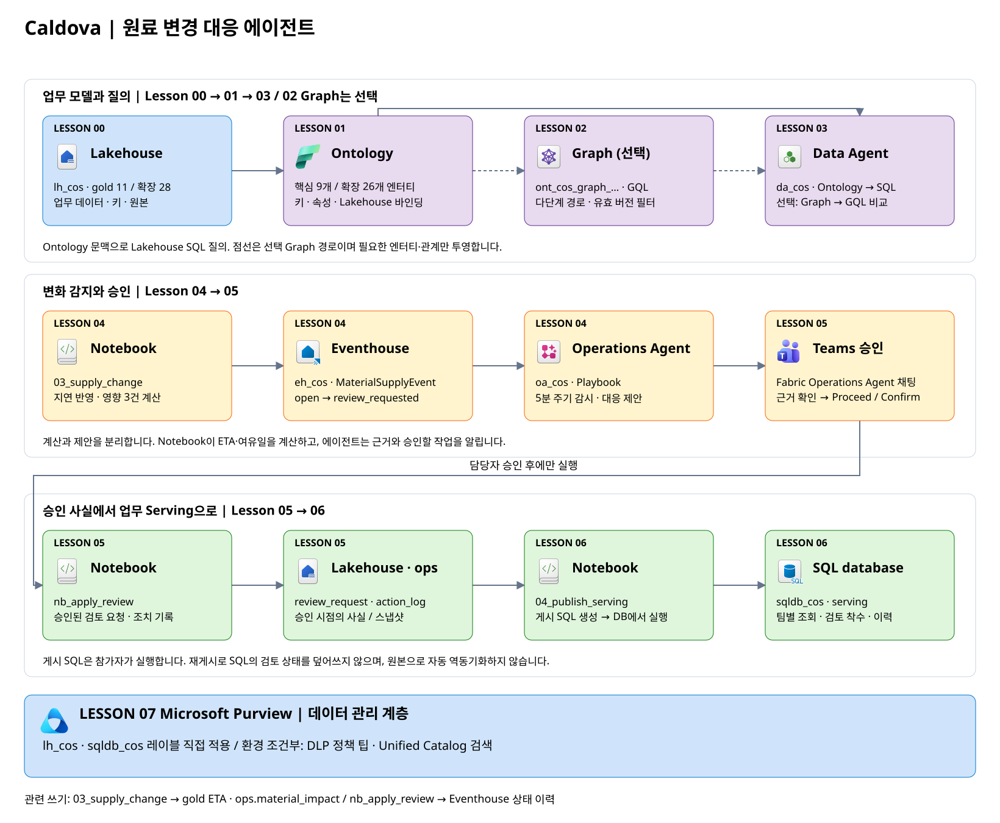

# Workshop: 화장품 원료 공급 지연과 변경 대응

Caldova 코스메틱 연구소에 **히알루론산 원료의 입고가 35일 늦어진다**는 소식이 도착했습니다. 이 원료는 판매 중인 크림·앰플과 개발 중인 토너에 함께 쓰입니다. 모두 같은 영향을 받을까요? **어떤 생산 계획과 안정성 시험이 지연되는지, 대체 원료를 검토할 수 있는지** 처방 버전·일정·시장별 등록 조건을 연결해 확인해야 합니다.

이 hands-on Workshop에서는 **Microsoft Fabric으로** 원료·처방·제품·개발 과제를 하나의 업무 모델로 연결하고, Graph와 에이전트로 영향 경로와 대응 근거를 검토합니다. 공급 지연을 감시하는 에이전트의 Teams 제안을 담당자가 승인하면 검토 요청을 기록하고, SQL Serving DB에서 담당 팀별 조회와 검토 상태 관리까지 이어갑니다.

**업무 데이터 연결 → 공급 지연 영향 찾기 → 대응 근거 질문 → Teams 제안·승인 → 검토 요청 기록과 업무 제공**

처음 시작한다면 [00. 시나리오와 미션](docs/00-scenario.md)에서 업무 상황과 판단 기준을 확인합니다.

## 이 실습에서 완성하는 것

| 기능 | 역할 | 이 실습에서 만드는 것 |
|---|---|---|
| **Ontology** | 테이블을 실제 업무 대상·관계·판정 맥락으로 연결하는 **공유 업무 모델** | 빈 항목에서 **Ontology Agent로 초안을 생성**하고, 생산·개발 일정과 대체 원료 질문에 맞춰 보강. 사람이 Plan의 원본·키·관계를 검토한 뒤 Act로 적용. 기본 과정의 핵심 참고 모델은 **9개 엔터티·10개 관계** |
| **Graph** | 업무 모델의 **인스턴스와 다단계 의존성**을 탐색 | 원료 → 처방 버전 → 제품·생산 계획·시험·개발 과제의 경로를 GQL로 조회. Ontology에 반드시 필요한 저장소가 아니라 경로 탐색을 위한 선택 계층 |
| **Data Agent** | 공통 업무 맥락으로 **질의를 생성하고 근거를 확인** | 영향 대상·연결 경로·지연 가정·대체 조건·통합 검토표를 Ontology 맥락·Lakehouse SQL로 검증. 선택적으로 별도 Graph 에이전트의 GQL과 비교 |
| **Operations Agent** | 계산된 공급 위험을 **주기적으로 감시하고 행동을 제안** | Eventhouse·이벤트 테이블을 직접 만들고 지연 이벤트·Playbook·Teams 메시지를 연결. 영향 계산은 Notebook이 맡고, 에이전트는 근거와 승인할 작업을 전달 |
| **Notebook** | 사람의 승인과 기록 작업을 연결 | 찾아낸 영향 대상의 검토 요청·조치 이력과 이벤트 상태 기록. 실제 구매·처방 변경은 하지 않음 |
| **SQL database in Fabric** | 분석 결과를 **업무용 Serving DB**로 제공 | DB·Serving 스키마를 직접 만들고 승인된 요청 게시 → 담당 팀별 조회 → 검토 착수 → 상태 변경 이력을 T-SQL로 처리. 재게시해도 업무 상태 유지 |
| **Microsoft Purview** | 민감 데이터의 분류와 정책을 업무 흐름에 연결 | 참가자가 게시된 민감도 레이블을 직접 적용·확인. 사전 구성된 환경에서 DLP 정책 팁 확인·카탈로그 자산 검색을 선택 수행 |

## 아키텍처

| 흐름 | Lesson → Fabric 항목 | 경계 |
|---|---|---|
| 업무 이해·질의 | 00 Lakehouse ↔ 01 Ontology 맥락 → 03 Data Agent / 02 Graph는 선택 | 원본 SQL 질의에 Graph가 필요하지 않음. Graph 투영은 갱신 전까지 스냅샷 |
| 감시·승인 | 04 Notebook → Eventhouse → Operations Agent → 05 Teams 승인·Notebook | 사람이 승인한 뒤에만 검토 요청 기록 |
| 업무 제공 | 05 Lakehouse 승인 결과 → 06 SQL database | Notebook이 게시 SQL 생성 → 참가자가 SQL DB에서 실행. 자동 동기화가 아님 |
| 거버넌스 | 07 Purview | 레이블은 기본 실습, DLP 정책 팁 확인·카탈로그 자산 검색은 환경 조건부 선택 활동 |

## 시작 전 확인

| 항목 | 내용 |
|---|---|
| 작업 영역 | 참가자별 `cos-pNNN` (예: `cos-p001`), 기본 **Contributor 권한** |
| 준비된 항목 | 용량이 할당된 **작업 영역·접근 권한·Notebook 5개**. Lakehouse와 데이터는 참가자가 생성 |
| 직접 만들 항목 | **00장에서 Lakehouse `lh_cos` 생성 → `01_prepare_data`에 연결 → `gold` 테이블 생성**. 나머지 Notebook은 해당 장에서 연결. **Ontology `ont_cos`는 01장, Eventhouse `eh_cos`는 04장, SQL DB `sqldb_cos`는 06장에서 직접 생성** |
| 용량 | **유료 Fabric 용량(F SKU)**. Operations Agent는 Trial 용량을 지원하지 않습니다 |
| Teams | **Fabric Operations Agent** Teams 앱 설치 (4장) |
| 브라우저 | Fabric 포털 로그인, 팝업 허용 |
| Purview 실습 | Pro/PPU, 항목 편집 권한, 사용 가능한 게시 레이블. 수행 가능한 확장 범위는 [07장](docs/07-purview.md)에서 확인 |

## 진행 순서

| Lesson(장) | 내용 |
|---|---|
| [00. 시나리오와 미션](docs/00-scenario.md) | 업무 흐름·미션 소개, Lakehouse 생성 → `01_prepare_data`에 연결 → 고정 가상 데이터로 `gold` 테이블 생성 |
| [01. Ontology](docs/01-ontology.md) | 빈 Ontology → 업무 질문으로 Agent 초안 생성 → 검토·Act 적용 → 추가 질문으로 모델 보강 → Plan 질의로 검증 |
| [02. Graph](docs/02-graph.md) | 변경 원료에서 영향 대상까지 경로 추적, 질의·필터로 대상 구분 |
| [03. Data Agent](docs/03-data-agent.md) | 중요도순 핵심 8문항으로 영향·경로·대체 조건·판단 한계 검증, 선택 Graph 실습은 관계 문항 재사용 |
| [04. Operations Agent](docs/04-operations-agent.md) | Eventhouse·이벤트 테이블 직접 생성, 지침·Playbook 구성, 감시 시작, 공급 지연 반영 |
| [05. 승인과 조치 기록](docs/05-approval.md) | Teams 승인 → Notebook으로 검토 요청·조치 이력 기록 |
| [06. SQL Serving DB](docs/06-serving-db.md) | SQL DB·Serving 스키마 직접 생성, 승인 결과 게시, 담당 팀별 조회, 검토 상태 변경·이력 확인 |
| [07. Purview 거버넌스](docs/07-purview.md) | 민감도 레이블 직접 적용, 선택: DLP 정책 팁 확인·카탈로그 자산 검색 |
| [선택. Ontology 엔터티 확장](docs/extensions/ontology.md) | **07장까지 기본 과정을 마친 뒤에만 선택**. 기존 `ont_cos`를 Agent와 보강해 로트·품질·재고·등록·설비·검토 담당 경로 탐색 |

Graph를 사용하지 않는 실습 경로는 01 → 03장으로 진행합니다. 06장은 05장의 승인 결과가 필요하고, 07장의 레이블 적용은 감시·승인과 독립적으로 진행할 수 있습니다. 각 단계에서는 먼저 직접 실행한 뒤 예상 결과와 대조합니다. 마지막에는 Operations Agent 감시와 Spark 세션을 중지합니다.

**기본 과정은 07장 Purview까지입니다.** 이후 원하는 참가자만 [Ontology 엔터티 확장 선택 실습](docs/extensions/ontology.md)을 진행합니다. 확장 실습도 할 참가자는 **00장 첫 실행 전에 `include_extended = True`로 설정해 28개 테이블을 생성**한 뒤, 07장 이후 기존 `ont_cos`를 확장합니다. 참고 범위는 **26개 엔터티·40개 관계·28개 테이블**이며, 선택 실습을 생략해도 기본 과정은 완료됩니다.

## 실습 파일

참가자는 [작업 영역에 준비된 Notebook](docs/00-scenario.md#2-준비된-notebook-확인)을 사용합니다. 아래 파일은 환경 준비·참고용이며 참가자의 파일 업로드는 필요하지 않습니다.

[실습 파일 ZIP 다운로드](https://raw.githubusercontent.com/minkyung01/fabric-cosmetics-workshop/main/downloads/workshop-files.zip)

| 경로 | 내용 |
|---|---|
| `notebooks/paste/*.md` | 파일 가져오기가 허용되지 않는 환경의 대체 준비용 매개변수·실행 코드 |
| `data/*.csv` | 핵심 가상 데이터의 관리용 원본. 준비 코드에 포함됨 |
| `notebooks/01_prepare_data.ipynb` | 코드에 포함된 고정 데이터 → `gold` 테이블 생성. 기본값은 기존 실습 테이블이 있으면 중지하며, `reset_ops = True`는 명시적 데이터 초기화 |
| `notebooks/02_answers.ipynb` | 직접 질의한 뒤 결과를 대조하는 참고 Notebook |
| `notebooks/03_supply_change.ipynb` | 공급 지연 반영 → 영향 분석 → Eventhouse 이벤트 전송 |
| `notebooks/nb_apply_review.ipynb` | 승인 후 검토 요청·조치 이력 기록 (Operations Agent 액션) |
| `notebooks/04_publish_serving.ipynb` | 승인된 요청을 SQL DB에 게시할 T-SQL 생성 (참가자가 DB 편집기에서 실행) |
| `fabric/sql/serving.sql` | SQL Serving 스키마·검토 착수 프로시저 |
| `data/extended/*.csv` | 선택 확장용 가상 데이터 17개 테이블의 관리용 원본. 준비 코드에 포함됨 |
| `fabric/sql/extended-queries.sql` | 확장 모델의 로트·재고·등록·설비·검토 담당 경로를 검증하는 읽기 전용 SQL |
| `notebooks/src/*.py` | Notebook의 읽기 쉬운 Python 원본 |

## 환경 준비 안내

테넌트·작업 영역 준비와 운영 점검은 [관리자 가이드](admin/README.md)를 참고합니다.

> Caldova는 Microsoft가 만든 가상 제약 회사이며, 이 교재에서는 **화장품 R&D 업무로 각색**했습니다. 회사·제품·원료·공급사·수치는 실습용 **가상 데이터**입니다. 시장별 원료 등록 상태는 사내 가상 기준이며 실제 법규·규제 정보가 아닙니다.
