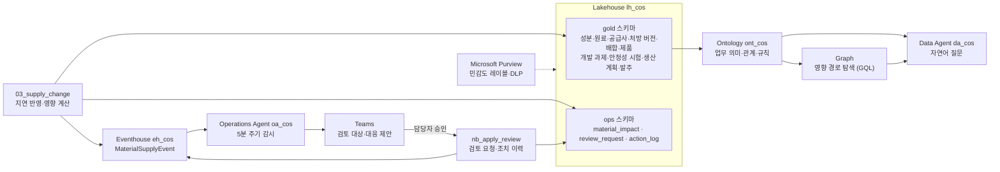

# Fabric 화장품 R&D 워크숍 — 원료 변경 대응 에이전트 만들기

> **원료 공급 일정이 바뀌었다. 어떤 처방·제품이 영향을 받으며, 무엇을 검토해야 할까?**

가상의 화장품 회사 **Contoso 코스메틱** 연구소에서, 원료 공급사가 히알루론산 원료 `RM-HA-120`의 입고를 **35일 늦춘다**고 알려 온 상황을 다룹니다.
사람이 질문해서 영향을 찾는 데서 시작해, 에이전트가 변화를 감시하고 대응을 제안하는 단계까지 확장합니다.

**업무를 이해하고(Ontology) → 영향을 찾아내고(Graph·Data Agent) → 먼저 알려주고(Operations Agent) → 승인 후 조치한다(Notebook)**

## 이 실습에서 완성하는 것

| 기능 | 역할 | 이 실습에서 만드는 것 |
|---|---|---|
| **Ontology** | "우리 업무에서 무엇을 뜻하는가?" | 성분·원료·처방 버전·시험·공급사의 의미와 관계, 업무 규칙(폐기 버전 제외 등) |
| **Graph** | "무엇과 어떤 경로로 연결되는가?" | 변경 원료 → 처방 버전 → 제품·생산 계획·개발 과제까지 영향 경로 |
| **Data Agent** | "내가 궁금한 것을 질문한다" | 같은 영향 질문을 자연어로 묻고 Graph 탐색 결과와 비교 |
| **Operations Agent** | "정해진 조건을 감시하고 먼저 알려준다" | 공급 지연 이벤트를 감시해 Teams로 검토 대상과 대응 제안 |
| **승인 후 Notebook** | 담당자 승인 → 기록 | 영향 대상마다 원료 변경 검토 요청과 조치 이력 기록 (실제 구매·처방 변경 없음) |
| **Purview 연계 거버넌스** | 민감 데이터 관리 | 처방 배합비(영업 비밀)의 민감도 레이블·DLP 범위 확인 (데모) |

## 아키텍처



## 시작 전 확인

| 항목 | 내용 |
|---|---|
| 작업 영역 | 관리자가 준비한 `cos-pNNN` (예: `cos-p001`). Contributor 이상 권한 |
| 준비된 항목 | Lakehouse `lh_cos`(gold 테이블 11개), Notebook 4개, Eventhouse `eh_cos`, 기본 Ontology `ont_cos` |
| 용량 | **유료 Fabric 용량(F SKU)**. Operations Agent는 Trial 용량을 지원하지 않습니다 |
| Teams | **Fabric Operations Agent** Teams 앱 설치 (4장) |
| 브라우저 | Fabric 포털 로그인, 팝업 허용 |

## 진행 순서 (오전 3시간)

| 시간 | 장 | 내용 | 진행 방식 |
|---|---|---|---|
| 15분 | [00. 시나리오와 미션](docs/00-scenario.md) | 완성된 업무 흐름 시연·미션 소개·작업 영역 확인 | 시연 |
| 30분 | [01. Ontology](docs/01-ontology.md) | 기본 모델에 관계·업무 규칙 보완 | **핵심 실습** |
| 35분 | [02. Graph](docs/02-graph.md) | 변경 원료에서 영향 대상까지 경로 추적, 질의·필터로 영향 대상 구분 | **핵심 실습** |
| 10분 | — | 휴식 | |
| 20분 | [03. Data Agent](docs/03-data-agent.md) | Graph·Ontology 기반 Data Agent로 같은 문제 질문하기 | 신기능 체험 |
| 35분 | [04. Operations Agent](docs/04-operations-agent.md) | 지침·Playbook 구성, 감시 시작, 공급 지연 반영 | 짧은 실습 + 데모 |
| 15분 | [05. 승인과 조치 기록](docs/05-approval.md) | Teams 승인 → Notebook으로 검토 요청·조치 이력 기록 | 확장 데모 |
| 10분 | [06. Purview 거버넌스](docs/06-purview.md) | 연구 데이터의 민감도·관리 상태 다루기 | 10분 데모 |
| 10분 | [07. Data Highway 2.0 논의와 마무리](docs/07-discussion.md) | 적용 논의, 감시 중지 | 토론 |

## 실습 파일

| 경로 | 내용 |
|---|---|
| `data/*.csv` | 가상 데이터 11개 테이블 ([데이터 설계](admin/data-design.md)) |
| `notebooks/01_prepare_data.ipynb` | CSV → `gold` 테이블 생성, `ops` 초기화 (관리자 사전 실행, 초기화용) |
| `notebooks/02_answers.ipynb` | Graph·Data Agent 질문의 정답을 Spark SQL로 확인 |
| `notebooks/03_supply_change.ipynb` | 공급 지연 반영 → 영향 분석 → Eventhouse 이벤트 전송 |
| `notebooks/nb_apply_review.ipynb` | 승인 후 검토 요청·조치 이력 기록 (Operations Agent 액션) |
| `fabric/ont_cos_base/` | 참가자가 시작하는 기본 Ontology 정의 |
| `fabric/ont_cos_reference/` | 완성된 참고 Ontology 정의 (막혔을 때 대체용) |
| `notebooks/src/*.py` | Notebook의 읽기 쉬운 원본. `.ipynb`는 여기서 생성 |

## 로컬 점검 (키트 수정 시)

```powershell
python tools/build_notebooks.py
python tools/build_ontology.py
python -m unittest discover -s tests -v
```

## 관리자용

- [관리자 준비 가이드](admin/README.md) — 테넌트 설정, 작업 영역 일괄 준비, 사전 점검, 초기화, 정리
- [데이터 설계와 정답](admin/data-design.md) — 테이블, 업무 규칙, 각 장의 기대 결과

> 모든 회사·제품·원료·공급사·수치는 실습용 **가상 데이터**입니다. 시장별 원료 등록 상태는 사내 가상 기준이며 실제 법규·규제 정보가 아닙니다.
