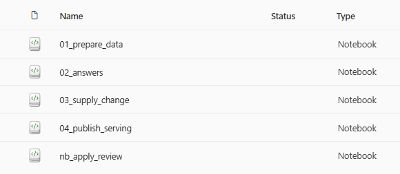
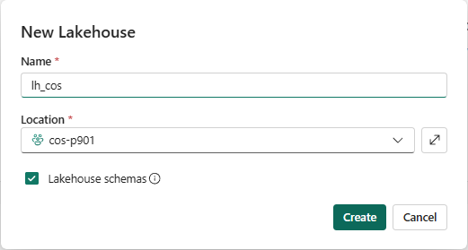
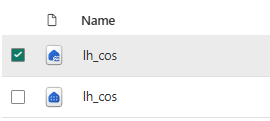
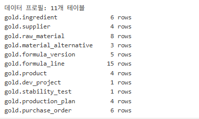
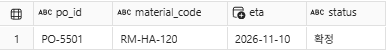
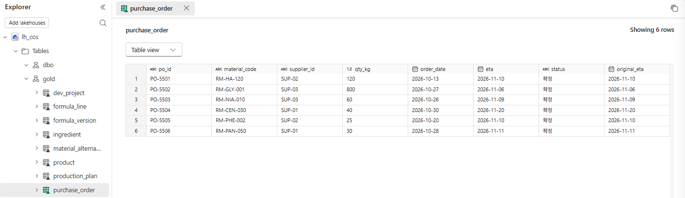

# 00. 시나리오와 미션

[목차](../README.md) \| 다음: [01. Ontology](01-ontology.md)

## 상황

Caldova 코스메틱 연구소의 원료 담당자는 2026년 11월 2일 월요일 아침, 공급사 **Aqua Derm Chemicals**로부터 메일을 받습니다.

> "소듐하이알루로네이트 1% 용액(저분자), 원료 코드 `RM-HA-120`의 다음 입고가 **11월 10일에서 12월 15일로 35일 늦어집니다**."

지금까지는 담당자가 처방 시스템·생산 계획·개발 과제 목록을 하나씩 열어 영향 대상을 찾았습니다. 이 워크숍에서는 같은 일을 다음 순서로 바꿔 봅니다.

| 단계 | 질문 | 사용하는 기능 |
|---|---|---|
| 이해 | 업무 대상을 어떤 키로 식별하고, 원본 데이터와 관계를 어떻게 연결해 재사용하는가? | Ontology |
| 찾기 | `RM-HA-120`에서 출발하면 어떤 처방·제품·과제까지 닿는가? 폐기된 처방은 빼야 하지 않나? | Graph |
| 묻기 | "RM-HA-120 공급이 늦어지면 무엇을 검토해야 해?"를 자연어로 물으면? | Data Agent |
| 먼저 알리기 | 공급 지연이 생기면 사람이 묻기 전에 알려 줄 수 있나? | Operations Agent + Teams |
| 승인 후 조치 | 담당자가 승인하면 검토 요청을 등록하고 이력을 남긴다 | Notebook |
| 업무 제공 | 승인 결과를 담당자가 조회하고 검토 상태를 바꾸려면? | SQL database in Fabric |
| 관리 | 처방 배합비 같은 영업 비밀은 어떻게 관리하나? | Microsoft Purview |

## 미션

1. 준비된 Notebook을 실행해 **`lh_cos.gold`에 실습 테이블을 직접 만듭니다.**
2. 빈 Ontology에서 **Ontology Agent로 업무 질문에 맞는 초안을 만들고**, 추가 질문에 필요한 대상·관계·업무 맥락을 보강합니다. 적용 전에는 사람이 원본과 설계를 검토합니다.
3. Graph 또는 Lakehouse SQL로 `RM-HA-120`의 영향 후보를 찾고, **현행·개발중 처방만** 남기도록 필터를 바꿔 봅니다.
4. Data Agent에 같은 질문을 하고 직접 실행한 질의·Notebook 결과와 비교합니다.
5. Operations Agent가 **공급 지연을 감지해 Teams로 알리고**, 승인하면 **검토 요청이 기록**되게 합니다.
6. SQL DB를 직접 만들어 승인된 요청을 게시하고, 담당 팀별 조회와 검토 착수·이력 확인을 수행합니다.
7. 연구 데이터에 민감도 레이블을 적용하고, 준비된 환경에서 DLP 정책과 연결합니다.

**탐색할 질문:** 같은 원료를 쓰는 대상이 모두 지연될까요? 연결되어 있다는 사실만으로 영향을 확정할 수 있을까요? 대체 원료가 있어도 바로 사용할 수 없는 경우는 무엇일까요?

실습하면서 **대상 ID·연결 경로·일정 근거·검토할 조치**를 기록합니다. 먼저 직접 질의하고 판단한 뒤, 각 단계의 예상 결과와 정답 Notebook으로 대조합니다.

**업무 경계:** 승인 후에도 AI가 처방이나 구매 발주를 직접 변경하지는 않습니다. 이 실습에서 실행하는 조치는 검토 요청과 이력 기록입니다.

## 1. 작업 영역과 권한 확인

1. [Fabric 포털](https://app.fabric.microsoft.com)에 로그인하고 왼쪽 **Workspaces**에서 `cos-pNNN`(예: `cos-p001`)을 엽니다.
2. 내 계정에 이 작업 영역의 **Contributor 권한**과 항목 생성 기능이 있는지 확인합니다.

| 항목 | 이름 | 비고 |
|---|---|---|
| Lakehouse | `lh_cos` | **이 장에서 직접 생성**. Lakehouse schemas를 켜고 `gold` 테이블도 직접 적재 |
| 데이터 | 준비 코드에 포함된 고정 가상 데이터 | 핵심 11개, 선택 확장 포함 시 28개 테이블 |
| Notebook | 아래 목록의 5개 | **미리 준비되어 있습니다.** 각 Notebook을 사용하는 장에서 `lh_cos` 연결 |
| Eventhouse | `eh_cos` | **04장에서 직접 생성** |
| Ontology | `ont_cos` | **01장에서 직접 생성** |
| SQL database | `sqldb_cos` | **06장에서 직접 생성** |

## 2. 준비된 Notebook 확인

작업 영역의 Notebook 목록을 확인합니다. 참가자는 파일을 가져오거나 코드를 붙여 넣지 않습니다.



**00장에서는 `01_prepare_data`만 실행합니다.** 나머지 Notebook은 해당 장의 안내에 따라 실행합니다. **파일 번호 순서대로 한꺼번에 실행하지 않습니다.**

| Notebook 이름 | 실행 시점 | 예상 코드 실행 시간 | 예상 출력 |
|---|---|---|---|
| `01_prepare_data` | 00장: 초기 실습 데이터 생성 | 핵심 11개 약 2–4분 / 확장 28개 약 5–10분 | 테이블별 행 수, 발주 확인 표 1행 |
| `02_answers` | 01–03장: 직접 질의한 뒤 결과 대조 | 약 1–3분 | Q1–Q5·DA 보조 조회 표, 지연 반영 전에는 Q6 안내 문구 |
| `03_supply_change` | 04장 공급 지연 반영 | 약 2–4분 | 영향 분석 4행 중 영향 3건, `open` 이벤트 |
| `nb_apply_review` | 05장 승인 후 자동 실행 | 약 1–3분 | 검토 요청 3행, 조치 이력 1행, `review_requested` 상태 |
| `04_publish_serving` | 06장 게시 SQL 생성 | 약 1–2분 | 승인된 요청 3행과 게시 SQL |

예상 코드 실행 시간은 세션 연결 완료 후 코드 실행 기준이며, 환경에 따라 달라집니다.

## 3. Lakehouse 직접 만들기

1. 내 작업 영역에서 **+ New item → Lakehouse**를 선택합니다.
2. 이름을 `lh_cos`로 입력하고 **Lakehouse schemas** 체크를 유지한 채 **Create**를 누릅니다.

   

3. **Tables → dbo**와 **Files**가 보이는지 확인합니다. `gold`·`ops`는 Notebook 실행 후 생성됩니다.

스키마를 끈 Lakehouse나 기존 항목을 임의로 삭제·재생성하지 않습니다. `dbo`가 보이지 않으면 관리자와 스키마 설정을 확인한 뒤 진행합니다.

## 4. Notebook에 기본 Lakehouse 연결

이 장에서는 `01_prepare_data`에만 연결합니다. 나머지 Notebook은 사용하는 장에서 연결합니다.

1. 작업 영역에서 `01_prepare_data`를 엽니다.
2. 왼쪽 **Data items → Add data items → From OneLake catalog**를 선택합니다.
3. 내 작업 영역의 **Lakehouse** `lh_cos`를 선택하고 **Add**를 누릅니다. 같은 이름의 SQL analytics endpoint가 함께 보이면 항목 유형을 확인해 Lakehouse를 선택합니다.

   

4. `lh_cos`를 **기본 Lakehouse로 고정**(핀)하고 저장합니다. 이미 실행 중인 Spark 세션이 있다면 세션을 다시 시작합니다.

## 5. Notebook으로 gold 테이블 직접 만들기

**예상 코드 실행 시간:** 핵심 11개 약 2–4분, 확장 28개 약 5–10분(세션 준비 제외).

### 5-1. 매개변수 셀 확인

`01_prepare_data`의 기본 Lakehouse가 내 작업 영역의 `lh_cos`인지 확인하고, 매개변수 셀은 다음 기본값을 유지합니다.

```python
include_extended = False
reset_ops = False
```

**07장 이후 엔터티 확장도 할 경우에만 첫 실행 전에 `include_extended = True`로 바꿉니다.** 28개 테이블을 준비하되, 01장에서는 핵심 11개만 사용합니다.

### 5-2. Spark 세션 시작 후 전체 실행

1. 상단 **Connect**를 눌러 Spark 세션을 먼저 시작하고, 연결이 완료될 때까지 기다립니다.

   **세션 시작 대기:** `Connecting`은 Spark 세션 준비 단계이며, 보통 **30초–5분** 정도 걸립니다. 환경에 따라 더 길어질 수 있습니다. 대기 중 **Connect**나 **Run all**을 반복하지 않습니다.

2. 연결 완료 후 **Run all**을 눌러 코드를 실행합니다. 실행이 끝나면 아래 셀별 결과를 확인합니다. 결과 확인을 위해 셀을 다시 실행하지 않습니다.

### 5-3. 테이블 적재 셀 결과

```python
tables_to_load = select_tables(include_extended)
print(f"데이터 프로필: {len(tables_to_load)}개 테이블")
check_existing_data(reset_ops)

spark.sql("CREATE SCHEMA IF NOT EXISTS gold")
spark.sql("CREATE SCHEMA IF NOT EXISTS ops")

for table, columns in tables_to_load.items():
    reader = csv.DictReader(io.StringIO(SCENARIO_DATA[table]))
    if reader.fieldnames != list(columns):
        raise ValueError(f"{table}: 포함된 데이터의 열과 스키마가 일치하지 않습니다.")
    records = [{column: row[column] or None for column in columns} for row in reader]
    raw = spark.createDataFrame(records, schema=", ".join(f"{column} string" for column in columns))
    df = raw.select([F.col(c).cast(t).alias(c) for c, t in columns.items()])
    if table == "purchase_order":
        df = df.withColumn("original_eta", F.col("eta"))
    df.write.mode("overwrite").option("overwriteSchema", "true").format("delta").saveAsTable(f"gold.{table}")
    print(f"gold.{table:<22} {df.count():>3} rows")
```

**예상 출력 — 테이블 적재:** `데이터 프로필: 11개 테이블`과 테이블별 행 수가 표시됩니다. 확장을 선택했다면 `28개 테이블`과 추가 테이블의 행 수가 나옵니다.



### 5-4. 발주 확인 셀 결과

```python
display(spark.sql("SELECT po_id, material_code, eta, status FROM gold.purchase_order WHERE po_id = 'PO-5501'"))
```

**예상 출력 — 발주 확인:** `PO-5501`, `RM-HA-120`, `eta = 2026-11-10`, `status = 확정`의 **1행**이 나옵니다. 이 셀은 발주 1건을 조회하며 데이터를 변경하지 않습니다.



### 5-5. Lakehouse에서 전체 발주 확인

작업 영역에서 `lh_cos`를 열고 **Tables → gold → purchase_order**를 선택합니다. 다음은 Notebook 셀 출력이 아니라 **Lakehouse 테이블 화면**입니다.

**예상 결과:** 발주 전체 **6행**이 보입니다. `PO-5501`의 `eta`와 `original_eta`는 모두 `2026-11-10`, `status`는 `확정`입니다. `ops` 스키마에는 결과 테이블이 없습니다.



**재실행 주의:** `reset_ops = False`는 기존 실습 테이블이 있으면 **쓰기 전에 오류로 중지**합니다. `True`는 `gold`를 초기 데이터로 덮어쓰고 `ops` 결과를 삭제하므로, 초기화에 동의한 경우에만 사용합니다. 07장 이후 모델 확장을 위해 다시 실행하지 않습니다.

## 이 장의 완료 기준

- 공급 지연의 영향과 대체 원료 검토에 필요한 질문을 설명할 수 있습니다.
- 실습 중 기록할 항목과 승인 후 실행할 조치의 범위를 이해했습니다.
- `lh_cos`를 스키마 지원 상태로 만들고 `01_prepare_data`의 기본 Lakehouse로 연결했습니다.
- `01_prepare_data`를 직접 실행해 `gold` 테이블을 만들었습니다.
- 테이블 수와 `PO-5501`의 초기 ETA·상태, 06장·07장의 환경 조건을 확인했습니다.

## Troubleshooting

- 작업 영역이 보이지 않으면 관리자에게 계정과 작업 영역 번호를 확인합니다.
- **Notebook이 없거나 이름이 다름:** 관리자에게 준비된 Notebook 목록을 확인합니다. 임의로 새로 만들거나 기존 항목을 삭제하지 않습니다.
- **항목 생성이 거부됨:** 작업 영역의 Contributor 권한, 유료 용량과 테넌트 설정을 관리자와 확인합니다.
- **`gold` 테이블 없음:** `01_prepare_data` 실행 결과와 기본 Lakehouse 연결을 확인합니다.
- **기존 실습 테이블 오류:** 일부 테이블만 생성된 실패 이력도 포함합니다. 현재 테이블·승인 결과를 관리자와 확인하고, 초기화가 필요한 경우에만 동의 후 `reset_ops = True`로 실행합니다.
- **Action에 매개변수가 보이지 않음:** `nb_apply_review`의 첫 셀을 매개변수 셀로 지정하고 저장했는지 확인합니다.
- **Notebook에서 테이블을 찾지 못함:** 기본 Lakehouse가 내 `lh_cos`인지 확인합니다.
- **`Connecting`이 오래 유지됨:** 왼쪽 아래 세션 상태를 눌러 세션 정보를 확인합니다. 상태가 계속 바뀌지 않거나 오류가 표시되면 세션 ID·경과 시간·오류를 관리자에게 전달해 Spark 풀·환경·용량 상태를 확인합니다. 원인 확인 전 Notebook 5개의 세션을 모두 시작하거나 초기화하지 않습니다.
- Notebook은 성공했지만 SQL analytics endpoint에 테이블이 아직 안 보이면 탐색기를 새로 고치고 동기화 상태를 확인합니다. 동기화 대기를 이유로 적재 Notebook을 재실행하지 않습니다.
- `PO-5501`이 이미 `지연`이면 기존 진행 상태입니다. 임의로 초기화하지 말고 관리자와 재사용·복구 범위를 확인합니다.

## 공식 문서

- [Microsoft Fabric IQ와 Ontology 개요](https://learn.microsoft.com/en-us/fabric/iq/ontology/overview)
- [Lakehouse schemas와 생성 설정](https://learn.microsoft.com/en-us/fabric/data-engineering/lakehouse-schemas)
- [Notebook 생성·기본 Lakehouse 연결](https://learn.microsoft.com/en-us/fabric/data-engineering/how-to-use-notebook)
- [Notebook 실행·매개변수 셀](https://learn.microsoft.com/en-us/fabric/data-engineering/author-execute-notebook)
- [Spark 풀과 세션 시작 시간](https://learn.microsoft.com/en-us/fabric/data-engineering/spark-compute)
- [Operations agent 개요](https://learn.microsoft.com/en-us/fabric/real-time-intelligence/operations-agent)

## 다음 단계

직접 만든 `gold` 테이블을 원본으로 [01. Ontology](01-ontology.md)에서 Ontology Agent와 초안을 만들고, 질문의 범위를 넓혀 모델을 보강합니다.
