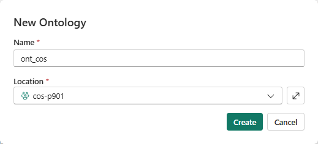
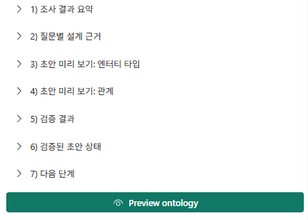
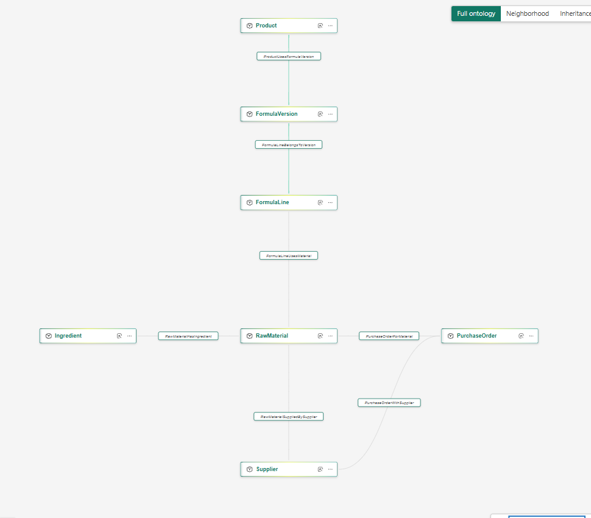
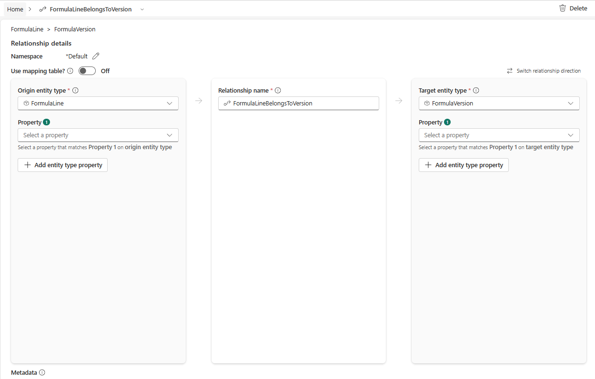
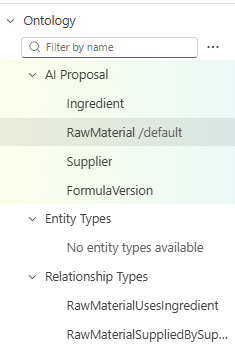

# 01. Ontology — Agent와 초안 만들고 질문으로 보강하기

[목차](../README.md) \| 이전: [00. 시나리오와 미션](00-scenario.md) \| 다음: [02. Graph](02-graph.md)

완성된 모델을 받아 빈칸만 채우는 대신, **빈 Ontology → 업무 질문과 모델링 범위로 초안 생성 → 질문별 검토·보완 → Act 적용 → 추가 업무로 모델 확장**을 경험합니다. 처음에는 원료·공급사·발주·처방·제품을 연결하고, 그다음 생산·개발 일정과 대체 원료 검토로 범위를 넓힙니다. 초안 생성과 보강 모두 **Ontology Agent의 Plan → 검토 → Act**로 수행합니다.

**Ontology는 용어집만이 아닙니다.** `RawMaterial`이라는 단어에 뜻을 붙이는 것에서 끝나지 않고, `material_code`로 업무 대상을 식별하고 원본 열에 바인딩하며 `uses_material`로 처방과 연결합니다. Graph·에이전트가 같은 연결과 맥락을 재사용하는 기반입니다. 다만 설명에 쓴 규칙이 자동 실행되거나 접근 권한을 대신하지는 않습니다. 이 키트의 여유일 계산·판정은 명시적인 질의와 Notebook에서 실행합니다.

**Graph 없이도 Lakehouse에 직접 바인딩할 수 있습니다.** 이 장은 `lh_cos.gold`의 Delta 테이블을 사용합니다. Ontology 캔버스는 타입과 관계의 설계도이지 인스턴스 Graph 저장소가 아닙니다. Graph 생성은 다음 장의 선택 과정입니다.

## 시작 전 확인

- 00장에서 내 작업 영역 `cos-pNNN`의 `01_prepare_data`를 직접 실행해 `lh_cos.gold`의 핵심 테이블 11개를 만들고 초기 상태를 확인했습니다. 확장 포함 28개를 적재했어도 이 장의 모델은 핵심 11개만 사용합니다.
- 작업 영역 **Contributor 이상**, 원본 데이터 읽기 권한과 Ontology·Copilot 사용 설정이 필요합니다. 테이블 이름이 보이는 것뿐 아니라 실제 행을 읽을 수 있어야 합니다.
- `ont_cos`는 이 장에서 만듭니다. 이미 내용이 있는 같은 이름의 항목은 삭제·덮어쓰지 말고 관리자에게 생성 실습을 진행할 작업 영역을 확인합니다.
- 에이전트의 설계와 이름은 달라질 수 있습니다. **개수나 완료 문구보다 업무 질문·실제 키·원본 바인딩**으로 검토합니다. 뒤의 GQL 예제와 맞출 이름·방향은 5단계에서 점검합니다.

## 1. 빈 Ontology 만들기

1. 내 작업 영역에서 **+ New item → Ontology (preview)** 항목을 선택합니다.
2. 이름을 `ont_cos`로 정하고 작업 영역을 확인한 뒤 **Create**를 누릅니다.

   

3. 시작 화면의 **Start with Ontology agent**를 선택합니다. 안내 창이 있다면 닫습니다.
4. 오른쪽 대화창의 모드를 **Plan**으로 둡니다.

**확인할 결과:** 아직 저장된 엔터티 타입이 없고, Ontology Agent와 대화할 수 있습니다. Plan은 발견·초안·검증·설명·질의를 지원하지만 Ontology나 작업 영역을 변경하지 않습니다. 모델을 적용할 때만 검토 후 Act로 전환합니다.

## 2. 첫 업무 질문으로 초안 만들기 — 원료에서 처방·제품까지

처음부터 전체 업무를 모델링하지 않습니다. "**이 원료가 무엇이고, 누가 언제 공급하며, 어떤 처방과 제품에서 쓰는가?**"부터 시작합니다. 이번에는 배합 행·배합비 관리가 목적이 아니므로, 처방과 원료를 직접 연결한다는 모델링 기준도 함께 전달합니다. 전체 엔터티 목록을 미리 주는 대신, 나머지 설계와 원본 근거는 Agent의 제안을 검토합니다.

1. 모드가 **Plan**인지 확인하고 다음 요청을 보냅니다.

    ```text
    lh_cos Lakehouse의 gold 데이터를 근거로, 화장품 연구소의
    원료 공급과 처방·제품 사용처를 추적하는 Ontology 초안을 제안해줘.

    - 구매하는 원료와 INCI 성분은 어떻게 다른가?
    - RM-HA-120은 누가 공급하고, 발주별 입고 예정일은 언제인가?
    - 이 원료를 사용하는 처방 버전과 연결된 판매 제품은 무엇인가?

    배합 행·배합비 관리는 이번 범위에서 제외하고,
    FormulaLine을 거치지 않는 FormulaVersion → RawMaterial의 uses_material 관계로 사용처를 표현해줘.
    관계 매핑에는 gold.formula_line 테이블의 version_id와 material_code를 사용하고,
    각각 FormulaVersion.version_id와 RawMaterial.material_code에 연결해줘.
    생산·개발 일정의 영향 계산과 대체 원료 검토는 제외해줘.

    필요한 업무 대상·고유 키·속성·나머지 관계를 설계하고 실제 원본 바인딩과 근거를 설명해줘.
    확인 가능한 원본 열과 샘플 행으로 키·속성·관계 매핑의 근거를 보여줘.
    RM-HA-120의 공급과 사용처는 확인된 샘플 범위에서 설명해줘.
    테이블별 샘플에서 읽은 값과 관계 설계로 해석한 연결을 구분하고,
    전체 건수·연결 제품의 부재·키의 유일성·결측·참조 누락은 샘플만으로 단정하지 마.
    전수 조회를 실행할 도구가 없으면 해당 검증은 미실행으로 표시해줘.

    기존 제안이나 모델이 있다면 관련 없는 엔터티·관계·키·속성·바인딩은 보존하고
    필요한 변경 전후만 비교해줘. 원본 데이터와 다른 Fabric 항목은 변경하지 마.
    읽기나 검증에 실패하면 원본과 오류를 보고하고 중단해. 추측으로 채우지 마.
    설계 근거·검증 결과와 초안 미리 보기를 보여줘.
    ```

2. 처음 제안된 설계와 근거를 기록한 뒤, **Preview ontology**를 아래 예상 설계·데이터 결과와 대조합니다. 응답의 **제안하는 Ontology 초안**, **제안하는 관계**, **검증 결과**를 펼쳐 근거를 확인합니다. 질문별로 지원되는 부분과 빠진 부분을 찾아 3단계에서 보완합니다.

   

**첫 초안의 참고 범위:** 이 실습에서 정렬할 참고 모델은 엔터티 **6개**(`Ingredient`, `RawMaterial`, `Supplier`, `PurchaseOrder`, `FormulaVersion`, `Product`)와 이들을 잇는 관계 **5개**입니다. 이번 프롬프트는 배합 행 관리를 제외하고 `formula_line`을 통한 직접 관계를 요청합니다. `FormulaLine`의 독립 엔터티화도 다른 업무 범위에서는 타당하지만, 제안되었다면 3단계에서 이번 요청과의 차이를 검토합니다. 생산·개발·시험을 보강한 뒤의 **9개 엔터티·10개 관계**와 구분합니다.

아래 표는 **초안 검토용 정답지**입니다. 유일하게 올바른 설계라는 뜻은 아니며, 후속 실습과 맞출 참고 설계입니다. Agent의 제안이 업무 질문과 지정한 모델링 범위를 지원하는지 대조합니다. 개수가 같아도 필요한 경로·바인딩이 없으면 보완해야 합니다.

### 2-1. 엔터티와 원본 바인딩 대조

모든 원본은 내 작업 영역의 **`lh_cos` Lakehouse → `gold` 스키마**입니다. 미리 보기에서 각 타입의 키와 속성이 아래 테이블·열에 연결되는지 확인합니다. 아직 적용 전인 **제안**이며, 저장 후 실제 바인딩 확인은 3단계에서 합니다.

| 엔터티 타입 | 원본 테이블 | 고유 키 | 확인할 주요 속성 |
|---|---|---|---|
| `Ingredient` | `gold.ingredient` | `ingredient_id` | `inci_name`, `korean_name` |
| `RawMaterial` | `gold.raw_material` | `material_code` | `material_name`, `lead_time_days` |
| `Supplier` | `gold.supplier` | `supplier_id` | `supplier_name` |
| `PurchaseOrder` | `gold.purchase_order` | `po_id` | `eta`, `status` |
| `FormulaVersion` | `gold.formula_version` | `version_id` | `formula_name`, `status` |
| `Product` | `gold.product` | `product_id` | `product_name`, `market` |

**확인할 기준:** 처방 키는 여러 버전에서 반복되는 `formula_id`가 아니라 `version_id`여야 합니다. 이 단계는 원본 열·샘플과 키 선택의 타당성을 대조하는 과정입니다. 샘플만으로 전체 데이터의 키 유일성·결측·참조 누락 0건을 증명하도록 요구하지 않습니다.

### 2-2. 질문별 관계 경로 대조

아래 화살표는 **관계의 저장 방향**입니다. 질문은 원료에서 출발하더라도 연결을 반대 방향으로 따라 발주·처방·제품을 찾을 수 있습니다. 관계 이름이 다르면 같은 업무 의미·양끝 키·원본 매핑인지 확인합니다.

| 첫 프롬프트의 질문 | 있어야 할 경로 | 대조할 원본 열 |
|---|---|---|
| 구매 원료와 INCI 성분은 어떻게 다른가? | `RawMaterial → Ingredient` | `raw_material.ingredient_id = ingredient.ingredient_id` |
| 누가 공급하고 발주별 입고일은 언제인가? | `PurchaseOrder → RawMaterial → Supplier` | `purchase_order.material_code = raw_material.material_code`, `raw_material.supplier_id = supplier.supplier_id`. 입고일은 `purchase_order.eta` |
| 어떤 처방 버전과 판매 제품에서 쓰는가? | `Product → FormulaVersion → RawMaterial` | `product.version_id = formula_version.version_id`. 처방과 원료는 `formula_line.version_id = formula_version.version_id`, `formula_line.material_code = raw_material.material_code`로 연결 |

**확인할 결과:** 위 경로를 이루는 관계가 총 5개이며, 처방 버전이 원료·제품과 분리되어 있지 않습니다. `formula_line`은 두 키를 잇는 매핑 테이블입니다.

### 2-3. RM-HA-120의 원본 샘플과 연결 설계 확인

이 단계에서는 **Act로 전환하지 않습니다**. **Plan에서 확인 가능한 샘플·설명을 요청 → 샘플에 나온 값만 참고 표와 대조 → 미리 보기에서 연결 설계 확인** 순서로 진행합니다. Agent의 사용 가능한 도구에 따라 전체 필터·조인 질의 대신 테이블 샘플만 제공될 수 있습니다. 이 장에서는 전체 건수나 “연결된 제품이 없다”는 사실까지 입증하지 않습니다.

**샘플 행의 확인 범위:** Agent가 샘플 행을 근거로 답했다면, 확인한 것은 제공된 샘플 범위입니다. **‘샘플에서 미확인’은 ‘데이터에 없음’이 아닙니다.** 전체 사용처·제품 목록이나 누락 여부까지 확인했다고 볼 수 없습니다. 샘플 크기·선정 방식도 Agent가 근거를 명시하지 않으면 응답만으로 알 수 없으며, “항상 앞 10행을 본다”와 같은 방식으로 단정하지 않습니다.

1. 초안을 만든 **같은 대화의 Plan**에서 다음 요청을 보냅니다. 필요한 업무 정보만 전달하고, 사용할 원본 열과 정리 형식은 Agent가 판단하도록 합니다. 관계·키·바인딩 상세는 3단계에서 검토하므로, 여기서는 길게 출력하지 않습니다.

    ```text
    lh_cos.gold에서 확인 가능한 원본 샘플을 바탕으로,
    RM-HA-120에 대해 다음 정보를 한눈에 파악할 수 있게 짧게 정리해줘.

    - 어떤 원료인지
    - 어떤 INCI 성분에 해당하는지
    - 어느 공급사가 공급하는지
    - 해당 원료의 발주와 입고 예정일, 발주 상태
    - 이 원료를 사용하는 처방 버전과 각 처방의 상태
    - 해당 처방과 연결된 판매 제품

    원료·성분·공급·발주·처방 상태를 중심으로 보여주고, 제품 정보는 간단히 덧붙여줘.
    샘플에 보이는 폐기·개발중 처방도 제외하지 마.

    샘플에 없는 값이나 연결을 확인하지 못한 제품은 '샘플에서 미확인'으로 표시하고,
    '없음'으로 바꾸거나 관계 설계만으로 값을 추측하지 마.
    전체 필터·조인 질의를 실행하지 않았다면 전체 건수나 제품의 부재는 단정하지 마.
    근거 원본과 샘플 확인 범위·한계는 짧게 덧붙여줘.
    관계 설계·양끝 키·바인딩 상세·도구 실행 로그·긴 해설은 출력하지 마.
    원본 읽기 오류가 나면 원본과 오류를 보고하고 중단해.
    원본 데이터와 현재 Ontology는 변경하지 마.
    ```

2. 응답에서 **실제로 확인한 샘플 값만** 아래 참고 값과 대조합니다. 모두 나와야 통과하는 목록은 아닙니다. 샘플에서 읽힌 값이 다르면 원본·열·ID를 점검합니다.
3. **Preview ontology**에서 제안된 관계·키·매핑 원본을 2-1·2-2 표와 대조합니다. 샘플 미표시와 설계 누락을 구분하고, 설계 불일치·바인딩 미확인은 3단계에서 **Plan으로 보완**합니다.

**샘플 값 대조용 참고**

| 확인할 대상 | 예상 값 |
|---|---|
| 원료 | `RM-HA-120` — 소듐하이알루로네이트 1% 용액(저분자) |
| 성분 | `ING-HA` — INCI `Sodium Hyaluronate` |
| 공급사 | `SUP-02` — Aqua Derm Chemicals |
| 해당 원료 발주 | `PO-5501` — `eta = 2026-11-10`, `status = 확정` |

**제품 연결의 참고 예시:** 아래 원본 값이 샘플에 나타나면 처방의 `version_id`와 제품의 `version_id`를 대조합니다. 이는 전체 경로를 조인 질의로 검증했다는 뜻은 아닙니다.

| 처방 버전 | status | 연결된 판매 제품 |
|---|---|---|
| `FV-CRM-01-03` | 현행 | `P-101` · `P-102` |
| `FV-AMP-03-02` | 현행 | `P-301` |

**‘미확인’도 정상인 경우:** `FV-CRM-01-02`나 `FV-TON-02-01`의 제품이 샘플에 없으면 **샘플에서 미확인**으로 남깁니다. 이는 “원본에 제품이 없음”도 “관계가 잘못됨”도 뜻하지 않습니다. 샘플에서 찾을 수 없는 값을 채우려고 같은 질문을 반복하거나, 이 단계에서 별도 SQL 실습으로 이동하지 않습니다.

**이 단계의 완료 기준:** 확인한 값의 원본과 샘플 범위를 설명하고, 성분·공급·발주·사용처를 잇는 초안의 경로를 구분할 수 있습니다. 처방·제품의 전체 건수나 제품이 없는 처방의 판정은 완료 조건이 아닙니다. 실제 저장된 키·Data source·관계 매핑과 Instances는 3단계의 Act 적용 후 확인합니다. 전체 처방 결과는 6단계의 `02_answers` Q1에서 별도로 확인합니다.

## 3. Act 적용 → 저장된 모델 확인

2-1·2-2에서 초안의 타입·키·관계·원본 매핑을 검토했다면 **검토표를 다시 요청할 필요는 없습니다**. 여기서는 검토한 초안을 적용하고, 실제로 저장되었는지만 간단히 확인합니다.

1. 누락·불일치가 있을 때만 **Plan**에서 아래 보완 예시를 사용하고 **Preview ontology**로 변경안을 확인합니다. 문제가 없다면 보완 요청 없이 적용 단계로 진행합니다. 설계의 키·관계·원본 바인딩이 미확인이거나 읽기 오류가 남아 있다면 승인하지 않습니다.
2. **Switch to 'Act' + approve**로 검토한 초안을 적용합니다. 버튼이 없는 UI에서는 직접 **Act**로 바꾸고 다음 요청을 보냅니다. **이 장에서 처음 Act로 전환하는 시점입니다.**

    ```text
    이 대화에서 제안한 초안의 설계와 원본 근거를 확인했어.
    검토한 초안만 현재 ont_cos에 적용해줘.
    lh_cos.gold 원본은 읽기만 하고, 원본 테이블·데이터나 다른 Fabric 항목은 변경하지 마.
    ```

3. 적용이 끝나면 아래 항목을 화면에서 확인합니다. **AI Proposal이나 완료 메시지만으로 저장을 판단하지 않습니다.**

| 확인할 곳 | 확인할 결과 |
|---|---|
| Explorer → **Entity Types** | 2단계에서 검토한 타입이 저장되어 있음. 첫 참고 범위는 6개 업무 대상 |
| 타입 선택 → **View Entity Type details → Configure** | 키와 **Data source**가 2-1 표의 원본에 연결됨. 예: FormulaVersion의 키는 `version_id` |
| **Manage relationships** | 2-2에서 검토한 관계·매핑이 저장됨. 특히 `uses_material`은 `FormulaVersion → RawMaterial`, 매핑 원본은 `gold.formula_line`의 `version_id`·`material_code` |
| **Instances** | 표시되는 원본 행을 읽을 수 있음. 특정 ID가 안 보인다는 이유만으로 데이터가 없다고 판단하지 않음 |

4. 확인 후 대화 모드를 **Plan으로 복귀**하고 다음 단계로 이동합니다. 저장된 키·원본·관계가 검토한 내용과 다르거나 오류가 있으면 먼저 해결합니다.

**샘플 미확인과 구분:** 샘플에 특정 제품이 안 보이거나 전수 검증이 미실행인 것은 설계 바인딩 미확인과 다릅니다. 설계·원본 접근에 문제가 없다면 해당 제한을 기록하고 진행할 수 있으며, 전체 처방은 6단계의 `02_answers` Q1에서 확인합니다.

**보완 예시 — 필요한 경우에만 펼치기**

<details>
<summary>FormulaLine이 별도 엔터티로 제안된 경우</summary>

아래는 직접 관계 기준을 추가하기 전의 초안 예시입니다. `FormulaLine → FormulaVersion`과 `FormulaLine → RawMaterial` 관계로 배합 행을 처방·원료에 연결했습니다. `formula_line`에는 고유 키 `line_id`와 배합비 `pct_wt`가 있으므로, 배합 행별 속성을 관리하려면 독립 엔터티로 표현하는 것도 타당합니다. 화면의 연결만으로 실제 원본 바인딩·검증까지 완료되었다고 판단하지는 않습니다.



**관계 방향과 바인딩은 따로 확인합니다.** `FormulaLine → FormulaVersion`은 “배합 행이 처방 버전에 속한다”는 의미라면 자연스럽습니다. `Product → FormulaVersion`과 방향을 맞추기 위해 뒤집을 필요는 없습니다. 이 모델에서는 `FormulaLine.version_id = FormulaVersion.version_id`로 매칭되는지가 중요합니다.



위 화면은 양쪽 **Property 1**이 `Select a property`인 상태입니다. 이 화면만으로 실제 연결이 완료되었다고 볼 수 없으므로, 양끝의 `version_id` 속성·원본 바인딩과 실제 행의 매칭을 확인합니다. `Use mapping table`이 꺼진 것 자체는 이 직접 속성 매칭 모델의 오류 근거가 아닙니다. 이번 실습의 목표는 방향만 바꾸는 것이 아니라, `gold.formula_line`을 매핑으로 쓰는 **처방 → 원료 직접 관계**입니다.

이번 실습은 **어떤 처방에 어떤 원료가 쓰이는지**를 추적하며, 배합 행·배합비 관리는 다루지 않습니다. 따라서 누락 오류를 고치는 것이 아니라, 필요한 업무 범위에 맞춰 모델을 단순화합니다. 같은 대화의 **Plan**에서 다음 요청을 보냅니다. 이미 적용했다면 현재 모델에 대한 변경안을 검토한 뒤 적용하며, 항목을 직접 삭제하고 다시 만들지 않습니다.

```text
FormulaLine을 독립 엔터티로 제안한 이유는 이해했어.
이번 실습에서는 배합 행과 배합비를 관리하지 않고 처방별 원료 사용처만 추적할 거야.
FormulaLine을 통해 연결된 처방·원료를
FormulaVersion → RawMaterial의 uses_material 관계로 단순화하는 변경안을 제안해줘.
관계 원본은 lh_cos.gold.formula_line이고, version_id를 FormulaVersion.version_id에,
material_code를 RawMaterial.material_code에 매핑해줘.
기존과 새 관계의 양끝 키·원본 매핑을 비교하고, 확인 가능한 샘플을 근거로 설명해줘.
전수 비교를 실행할 도구가 없으면 결과 건수의 보존은 미실행으로 표시하고 단정하지 마.
검증이 끝나기 전에는 FormulaLine과 기존 연결을 제거하지 마.
검증 후 FormulaLine과 그에 연결된 관계만 정리하는 변경 범위를 보여줘.
나머지 엔터티·키·속성·바인딩·관계는 보존하고, gold.formula_line 테이블과 원본 데이터는 변경하지 마.
읽기나 검증에 실패하면 원본과 오류를 보고하고 중단해.
변경 전후 경로와 검증 결과를 보여주고 Preview ontology를 갱신해줘.
```

**확인할 결과:** `FormulaLine`을 거치지 않는 직접 관계가 `gold.formula_line`에 바인딩됩니다. 기존 연결과 새 매핑의 키·원본 정의를 검토한 뒤 변경안을 적용합니다. 샘플만으로 전체 결과 보존을 검증했다고 표시하지 않습니다. 다른 관계 이름·방향의 정렬은 5단계에서 점검합니다.

</details>

<details>
<summary>엔터티 또는 관계가 불충분하게 제안된 경우</summary>

업무 질문에 필요한 대상이 없거나, 대상은 있어도 공급·발주·처방·제품으로 이어지는 관계가 빠졌다면 **미완성 초안**입니다. 개수만으로 판단하지 말고 2-1·2-2 표와 대조합니다. 아래 화면은 그중 `PurchaseOrder`·`Product`와 처방 사용 관계 등이 빠진 예시입니다. **AI Proposal**에 있는 항목은 아직 저장된 모델이 아닙니다. 그대로 승인하지 말고 **Plan**에서 보완합니다. 다음 요청은 현재 초안의 누락을 확인한 뒤 사용하며, 첫 요청에 함께 넣지 않습니다.



```text
현재 초안에서 첫 세 업무 질문에 필요한 엔터티·관계·바인딩의 누락을 찾아 보완해줘.
질문별로 이미 지원되는 부분과 누락된 부분, 추가가 필요한 이유를 먼저 보여줘.
원본은 lh_cos.gold의 ingredient, raw_material, supplier, purchase_order, formula_version, formula_line, product 테이블만 사용해.
성분·원료·공급사·발주·처방 버전·제품을 각각 독립된 업무 대상으로 모델링해줘.
발주나 제품을 다른 대상의 속성으로만 합치거나 생략하지 마.
이미 있는 엔터티·관계는 의미와 원본 매핑을 확인해 재사용하고, 누락된 항목만 추가해줘.
기존 항목·ID·키·속성·바인딩은 보존하고, 수정이 필요한 부분은 이유를 설명해줘.
발주 대상은 gold.purchase_order의 po_id를 키로 eta와 status를,
제품 대상은 gold.product의 product_id를 키로 product_name과 market을 바인딩하는지 확인해줘.
아래 관계가 모두 있는지 확인하고, 빠진 관계를 원본에 연결해줘.
- has_ingredient: RawMaterial → Ingredient, gold.raw_material의 material_code → ingredient_id
- supplied_by: RawMaterial → Supplier, gold.raw_material의 material_code → supplier_id
- orders: PurchaseOrder → RawMaterial, gold.purchase_order의 po_id → material_code
- uses_material: FormulaVersion → RawMaterial, gold.formula_line의 version_id → material_code
- made_with: Product → FormulaVersion, gold.product의 product_id → version_id
formula_line은 관계 매핑으로만 사용하고 별도 엔터티로 추가하지 마.
지금은 처방의 status를 확인하되 is_active와 cn_registration을 활용한 판정은 다음 단계로 남겨줘.
이름은 영어, 설명과 동의어는 한국어로 작성해줘. dbo, Files, ops, Eventhouse와 확장 테이블은 사용하지 마.
보완된 엔터티와 관계의 키·속성·원본 바인딩을 확인 가능한 원본 열과 샘플로 설명해줘.
전수 검증을 실행하지 못하면 키 유일성·참조 누락은 미실행으로 표시해줘.
읽기나 검증에 실패하면 원본과 오류를 보고하고 중단해.
추가·수정·유지한 항목과 보완된 전체 초안을 보여주고 Preview ontology를 갱신해줘.
```

다시 미리 보기를 열어 발견한 누락이 보완되고, 발주·제품과 처방·원료의 경로가 이어지는지 확인합니다. 타입이 모두 있어도 관계·바인딩이 빠졌다면 아직 완료가 아닙니다.

</details>

## 4. 추가 질문으로 모델 보강하기 — 일정과 대체 검토

사용처를 찾았다고 공급 지연의 영향까지 판단할 수 있는 것은 아닙니다. 이번에는 "언제 필요한가?", "폐기 버전도 검토해야 하나?", "대체 원료를 바로 쓸 수 있나?"를 해결합니다.

### 4-1. 현재 모델의 빈틈 진단

모드가 **Plan**인지 확인하고 질문합니다.

```text
현재 Ontology로 아래 질문을 지원할 수 있는지 진단해줘.
- RM-HA-120을 쓰는 제품의 생산 계획일은 언제인가?
- 이 원료를 쓰는 개발 과제와 예정된 안정성 시험의 배치일은 언제인가?
- 폐기 처방을 제외하려면 무엇이 필요할까?
- 대체 원료 후보의 승인 상태와 CN 판매 제품에 쓸 수 있는지까지 판단하려면 무엇이 필요할까?
이미 바인딩된 범위와 추가로 조사한 gold 원본을 구분해줘.
질문별로 현재 모델의 근거, 빠진 대상·속성·관계, 필요한 원본을 표로 보여줘.
읽을 수 없는 데이터와 해결하지 못한 질문은 명시해줘.
```

**확인할 결과:** 생산 계획, 개발 과제·안정성 시험, 활성 여부, 대체 후보·승인·등록 상태의 보강 필요성을 확인합니다. **Agent가 추가 원본을 직접 조회해 답했다고 현재 모델에도 이미 바인딩된 것은 아닙니다.** 답의 정확성과 모델의 원본 연결을 따로 점검합니다.

### 4-2. 변경안 검토와 적용

같은 대화에서 모드가 **Plan**인지 확인하고 보강을 요청합니다.

```text
진단한 질문을 지원하도록 현재 ont_cos를 보강하는 변경안을 제안해줘.
이번에는 lh_cos.gold의 production_plan, dev_project, stability_test, material_alternative도 사용해.
생산 계획에서 제품·처방·원료로, 안정성 시험에서 개발 과제·처방·원료로 이어지게 해줘.
formula_version.is_active는 Boolean 속성, raw_material.cn_registration은 String 속성으로 바인딩해줘.
material_alternative는 material_code가 원래 원료, alt_material_code가 대체 원료인 방향으로 연결해줘.
이미 있는 대상은 재사용하고 엔터티·관계·속성을 중복 생성하지 마.
아래 업무 맥락을 관련 엔터티·관계 설명에 보강하되, 설명이 계산·필터·접근통제를 자동 실행한다고 표시하지 마.
- 영향 분석은 is_active = true인 현행·개발중 처방만 대상으로 하고 폐기 버전은 제외한다.
- 원료 필요일 = 생산 계획일 또는 예정된 안정성 시험 배치일 - QC 리드타임 7일.
- 여유일 = 필요일 - 입고 예정일이며, 음수이면 영향 대상이다. 정확한 계산은 별도 질의·Notebook에서 한다.
- 대체 후보는 material_alternative.approval_status가 '승인'인지 원본에서 확인한다.
- CN 판매 제품에 바로 사용하려면 대체 원료의 cn_registration이 '완료'여야 한다(실습용 사내 가상 기준).
기존 항목·ID·키·바인딩은 보존하고, 변경이 꼭 필요한 부분은 이유를 설명해줘.
추가·변경·유지 항목과 원본 검증 결과를 보여주고 변경 미리 보기를 제공해줘.
원본을 읽지 못하거나 키·관계를 검증하지 못하면 오류를 보고하고 중단해.
```

1. **Plan 미리 보기**에서 새 대상·연결과 기존 항목 보존을 확인합니다. 처음 모델을 버리고 새 모델로 교체하는 계획은 그대로 승인하지 않습니다.
2. 이미 있는 속성·관계는 중복 추가가 아니라 검증·설명 보강으로 처리했는지 봅니다.
3. 미해결 오류가 없으면 **Act**로 전환해 `검토한 보강 변경안만 현재 ont_cos에 적용해줘. 원본 데이터와 다른 Fabric 항목은 바꾸지 마.`를 보냅니다.
4. 적용 후 **Plan**으로 돌아갑니다. `Configure`와 `Instances`에서 새 바인딩·실제 행을 확인합니다.

**확인할 결과:** 원료에서 생산 계획과 개발·시험 일정까지 추적할 수 있고, `is_active`, `cn_registration`과 대체 원료 관계가 원본에 연결됩니다. 대체 **후보 연결**과 **승인 상태 판정**은 다릅니다. 참고 모델의 관계에는 승인 상태 속성이 없으므로 `gold.material_alternative.approval_status`를 실제 질의에서 확인해야 합니다.

## 5. 다음 장과 연결되는 모델 점검

Agent의 초안이 모두 같은 이름·방향으로 생성되지는 않습니다. 다음 장의 GQL은 아래 **핵심 참고 이름·방향**을 사용합니다. 설계가 다르면 해당 업무 개념과 원본부터 대조한 뒤, **Agent의 Plan에서 필요한 정렬만 제안받고 검토 후 Act로 적용**합니다. 이름을 바꿨다고 잘못된 원본 연결이 고쳐지는 것은 아닙니다.

| 엔터티 타입 | 원본 테이블 (`gold`) | 키 | 질의에 필요한 주요 속성 |
|---|---|---|---|
| `Ingredient` | `ingredient` | `ingredient_id` | `inci_name`, `korean_name` |
| `RawMaterial` | `raw_material` | `material_code` | `material_name`, `lead_time_days`, `cn_registration` |
| `Supplier` | `supplier` | `supplier_id` | `supplier_name` |
| `FormulaVersion` | `formula_version` | `version_id` | `formula_name`, `status`, `is_active` |
| `Product` | `product` | `product_id` | `product_name`, `market` |
| `DevProject` | `dev_project` | `project_id` | `project_name` |
| `StabilityTest` | `stability_test` | `test_id` | `batch_date`, `status` |
| `ProductionPlan` | `production_plan` | `plan_id` | `planned_date` |
| `PurchaseOrder` | `purchase_order` | `po_id` | `eta`, `status` |

| 관계 이름 | 방향 | 매핑 테이블과 열 (`gold`) |
|---|---|---|
| `has_ingredient` | RawMaterial → Ingredient | `raw_material.material_code → ingredient_id` |
| `supplied_by` | RawMaterial → Supplier | `raw_material.material_code → supplier_id` |
| `uses_material` | FormulaVersion → RawMaterial | `formula_line.version_id → material_code` |
| `made_with` | Product → FormulaVersion | `product.product_id → version_id` |
| `develops` | DevProject → FormulaVersion | `dev_project.project_id → version_id` |
| `tests_version` | StabilityTest → FormulaVersion | `stability_test.test_id → version_id` |
| `for_project` | StabilityTest → DevProject | `stability_test.test_id → project_id` |
| `produces` | ProductionPlan → Product | `production_plan.plan_id → product_id` |
| `orders` | PurchaseOrder → RawMaterial | `purchase_order.po_id → material_code` |
| `alternative_to` | RawMaterial → RawMaterial | `material_alternative.material_code → alt_material_code` |

**핵심 참고 모델은 엔터티 9개·관계 10개입니다.** 추가 타입이 있다는 이유만으로 실패는 아니지만, 위 핵심 경로·키·바인딩은 있어야 합니다. 02장에서는 핵심 범위를 선택해 투영하며, 네임스페이스 접두사가 붙은 Graph 레이블은 실제 스키마에 맞춥니다.

수동 조정이 필요하면 **Explorer → 타입 선택 → View Entity Type details → Configure**에서 키와 속성의 **Data source**를 확인하고, **Manage relationships**에서 방향·양끝 키·매핑 원본을 확인합니다. `uses_material`은 `formula_line.version_id → material_code`, `alternative_to`는 `material_alternative.material_code → alt_material_code`입니다. 변경 후 Agent의 Plan에서 재검증합니다. Graph 생성이나 Data Agent 연결 전에 이름·방향·바인딩 점검을 마칩니다.

## 6. Plan에서 모델 설명 확인 → Notebook으로 전체 처방 조회

모드가 **Plan**인지 확인하고 다음 요청을 보냅니다.

```text
Ingredient와 RawMaterial의 차이, RawMaterial의 키와 원본 테이블,
uses_material의 양끝과 매핑을 현재 저장된 정의에서 설명해줘.
이어서 확인 가능한 샘플에서 RM-HA-120의 사용처와 version_id, status, is_active를 설명해줘.
생산 계획·개발 과제·안정성 시험으로 이어지는 경로와 추가한 업무 설명도 확인해줘.
사용한 원본·도구와 확인 범위를 보여줘. 전체 질의를 실행하지 않았다면 미실행으로 표시하고,
확인할 수 없는 값이나 전체 건수·데이터 부재는 추정하지 마.
```

전체 처방 목록과 건수는 Agent의 샘플이 아닌 **명시적인 Notebook 질의**로 확인합니다. `02_answers`를 열고 내 작업 영역의 `lh_cos`를 기본 Lakehouse로 연결·저장합니다([연결 절차](00-scenario.md#4-notebook에-기본-lakehouse-연결)). 세션이 연결되어 있지 않다면 **Connect**로 시작합니다. 연결 완료 후 **Run all**을 누르고 Q1을 비교합니다.

**예상 코드 실행 시간:** 전체 Notebook 약 1–3분(세션 준비 제외).

**예상 출력:** Q1 표의 **4행** — `FV-CRM-01-02`(폐기, false), `FV-CRM-01-03`(현행, true), `FV-TON-02-01`(개발중, true), `FV-AMP-03-02`(현행, true). 지연 반영 전 Q6의 `ops.material_impact가 아직 없습니다` 안내는 정상이며, 이를 없애려고 `03_supply_change`를 먼저 실행하지 않습니다. Plan 상태를 유지하며 엔터티·관계·바인딩은 바뀌지 않습니다.

Ontology Agent는 이처럼 현재 Ontology 안에서 설명·질의·개선을 수행합니다. 03장의 **Data Agent는 별도 에이전트 항목**에 완성한 Ontology 문맥과 원본을 연결해 질문하는 경험입니다.

## 이 장의 완료 기준

- 빈 `ont_cos`에서 Agent의 Plan으로 초안을 만들고, 원본 근거를 검토한 뒤 Act로 적용했습니다.
- 첫 초안의 근거를 기록하고 업무 질문과 대조했습니다. 누락이 있다면 보완 전후를 비교했으며, 이후 일정·대체 검토 질문으로 모델을 보강했습니다.
- 5단계의 핵심 경로·키·바인딩이 있고, `FormulaVersion.is_active`, `RawMaterial.cn_registration`이 연결됩니다.
- Plan에서 모델 설명·확인 가능한 샘플을 검토하고, 읽기 질문과 Act의 변경 적용을 구분합니다. 전체 처방 조회는 `02_answers` Q1에서 별도로 확인했습니다.
- 업무 설명을 저장하는 것과 질의·Notebook으로 계산·필터를 실행하는 것의 차이를 설명할 수 있습니다.

## Troubleshooting

- **Ontology·Agent 메뉴가 없거나 원본 읽기에 실패하는 경우:** 오류와 원본을 기록하고 관리자에게 권한·용량·테넌트 설정을 확인합니다.
- **Agent가 필터·조인 질의를 실행할 도구가 없다고 하는 경우:** 확인된 샘플과 미실행 검증을 구분해 기록합니다. 같은 요청을 반복하거나 샘플 미표시를 데이터 부재로 바꾸지 않습니다. 모델 정의 검토는 계속하되, 전체 처방 조회는 6단계의 Notebook에서 확인합니다.
- **기존 항목을 다시 만들거나 전체 모델을 교체하려는 경우:** Plan에서 기존 항목·ID·바인딩을 유지하는 변경안으로 다시 요청합니다. 미해결 변경은 승인하지 않습니다.
- **미리 보기 버튼이 없는 경우:** 텍스트 계획과 검증 결과를 검토한 뒤 Act에서 적용하고, 저장된 정의를 확인합니다.
- **자기 자신을 가리키는 관계를 만들 수 없는 경우:** `alternative_to`는 미완료로 기록하고 대체 후보는 `02_answers` Q3으로 확인합니다. 02장의 Q6은 건너뛰며 다른 핵심 경로는 점검합니다.
- **Agent로 끝내기 어려운 경우:** 현재 작업을 임의로 삭제하지 말고 관리자에게 완성 참고 모델을 사용하는 복구 경로를 요청합니다. 복구 모델 사용은 Agent 생성 실습 완료와 구분합니다.
- 브라우저 새로 고침으로 대화가 사라지면 저장된 정의를 다시 확인합니다. 검토 근거와 변경 전후 요약을 기록해 둡니다.

## 공식 문서

- [Ontology Agent의 빈 항목 생성·모델 개선·Plan/Act](https://learn.microsoft.com/en-us/fabric/iq/ontology/how-to-use-ontology-agent)
- [관계 타입과 매핑 테이블](https://learn.microsoft.com/en-us/fabric/iq/ontology/how-to-create-relationship-types)
- [Ontology의 업무 맥락·데이터 바인딩·규칙](https://learn.microsoft.com/en-us/fabric/iq/ontology/overview)

## 다음 단계

[02. Graph](02-graph.md)에서 선택적으로 인스턴스 경로를 탐색합니다. Graph를 사용하지 않는 구성은 [03. Data Agent](03-data-agent.md)로 바로 이동합니다.
