# 02. Graph — 영향 경로 추적

[목차](../README.md) \| 이전: [01. Ontology](01-ontology.md) \| 다음: [03. Data Agent](03-data-agent.md)

Ontology는 원본에 바인딩된 업무 모델이며 **Graph가 필수는 아닙니다.** 이 장에서는 선택적으로 인스턴스(원료 `RM-HA-120`, 처방 버전 `FV-CRM-01-03` …)를 노드·에지로 투영해 다단계 경로를 탐색합니다. **질의와 필터를 바꿔 진짜 영향 대상만 남기는** 연습입니다. Graph를 쓰지 않는 환경은 `02_answers`로 대상을 확인한 뒤 [03장](03-data-agent.md)의 Ontology·Lakehouse 경로로 진행할 수 있습니다.

## 시작 전 확인

- 01장에서 Ontology Agent로 생성·보강하고 5단계의 핵심 경로(`uses_material` 포함)와 `is_active` 속성 바인딩을 점검했습니다.
- 질의는 GQL(Graph Query Language)로 씁니다. 기본 형태는 `MATCH (노드:레이블)-[:관계]->(노드:레이블) WHERE … RETURN …`입니다.

## 1. Graph 만들기

이 장의 예시는 **엔터티 9개·관계 10개**와 원료끼리 직접 연결하는 **`alternative_to` 관계**를 사용합니다.

1. `ont_cos`의 리본에서 **Manage graph**를 누릅니다. "Preparing graph..." 후 **Choose what to project** 화면이 열립니다. 처음의 **Graph not materialized**는 아직 Graph를 생성하지 않았다는 상태입니다.
2. 이번 실습에서 사용할 엔터티와 관계를 선택합니다. 각 행의 **Status**가 **Eligible**인지 확인하고, 엔터티 행 왼쪽의 펼치기 버튼으로 관계도 확인합니다.

   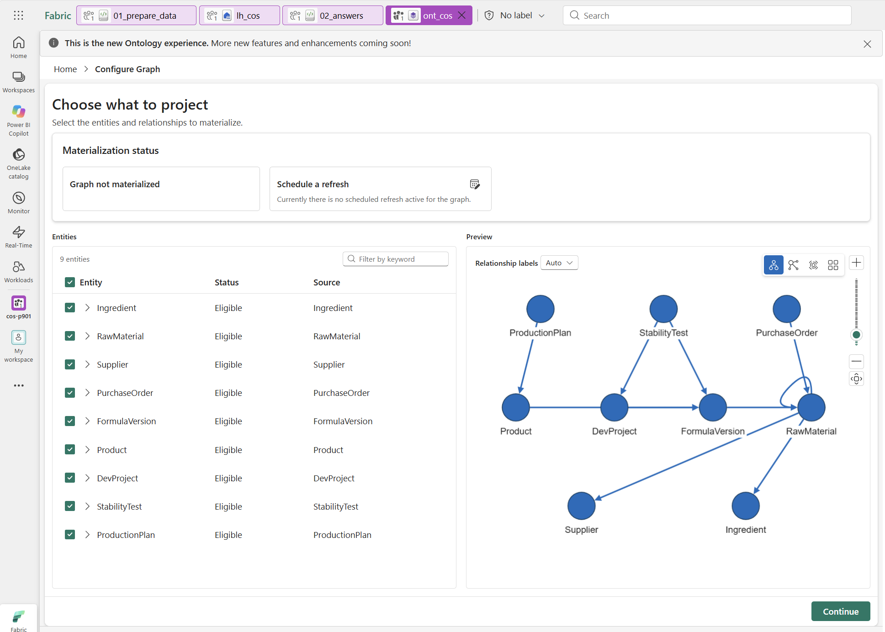

   위 화면의 **9 entities**와 엔터티별 **Eligible**을 확인합니다. 관계도 참고 모델의 10개가 선택되어 있고 투영 가능한지 확인합니다. 추가 엔터티·관계가 있다면 총개수만 맞추려고 삭제하지 말고, 실습에 필요한 경로를 선택합니다.

3. **Continue**를 눌러 **Projection summary**에서 선택한 대상과 연결을 확인한 뒤 **Materialize**를 누릅니다.

   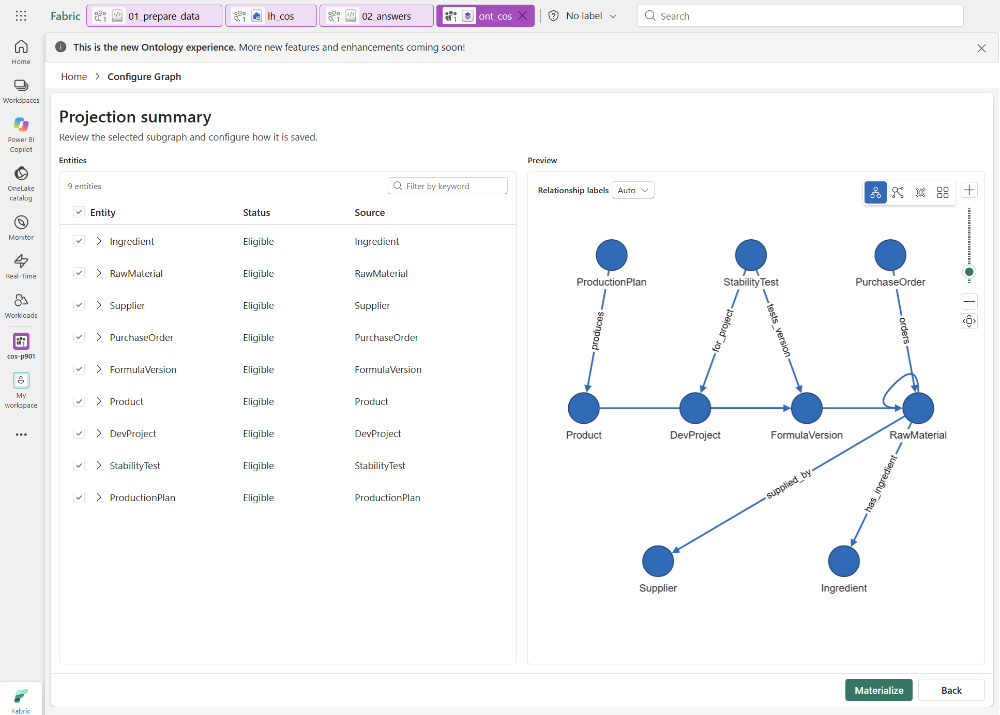

   오른쪽 **Preview**의 `produces`·`for_project`·`tests_version` 등 이름·방향을 확인합니다. RawMaterial의 자기 연결은 대체 원료 관계인 `alternative_to`입니다. 이 미리 보기도 실제 데이터 행이 아닌 **투영할 타입과 관계 구조**를 보여 줍니다.

4. 생성·반영이 완료될 때까지 기다립니다. 데이터 크기뿐 아니라 용량·반영 대기에도 영향을 받습니다. 작업 영역에서 이름이 `ont_cos_graph_`로 시작하고 항목 유형이 **Graph model**인 항목을 확인합니다.

   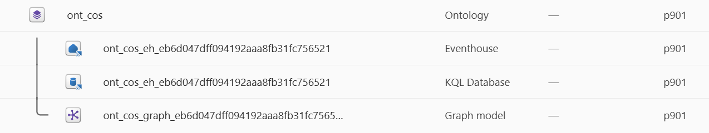

   위 예시에는 `ont_cos_eh_…` **Eventhouse**와 같은 이름의 **KQL Database**도 보입니다. 이름 뒤의 자동 생성 접미사는 환경마다 다릅니다. 이 장에서 GQL 질의를 실행할 대상은 **Graph model**이지 KQL Database가 아닙니다. Ontology가 생성·관리하는 항목의 이름·원본·스키마를 직접 고치거나 삭제하지 않습니다.

**확인할 결과:** 필요한 엔터티·관계가 Eligible이고, Materialize 완료 후 작업 영역에서 Graph model을 열 수 있습니다. **Eligible은 투영 가능하다는 뜻**이며, 실제 데이터와 연결 결과가 맞는지는 아래 탐색·질의로 확인합니다.

확장 모델을 사용해도 모든 엔터티를 투영할 필요는 없습니다. 우선 핵심 경로만 선택합니다. **Ontology 바인딩 가능 여부와 Graph 투영 적격성은 별개**이며 현재 Graph 투영에는 키·매핑, 엔터티/관계별 단일 기반 테이블, 지원되는 Lakehouse/미러링 Delta 원본이 필요합니다. 다중 바인딩이나 의미 체계 모델을 쓴다고 모두 투영 가능한 것은 아닙니다.

## 2. Graph model 열고 구조와 데이터 구분하기

1. 작업 영역에서 생성된 `ont_cos_graph_…` **Graph model**을 엽니다. 이 가이드는 `ont_cos` Home의 **Explore graph 버튼을 전제로 하지 않습니다.** 해당 버튼이 보이지 않아도 여기서 진행합니다.
2. Graph model의 스키마에서 `RawMaterial`·`FormulaVersion`과 `uses_material` 연결을 확인합니다. `Product`·`DevProject`·`StabilityTest`로 이어지는 관계도 살펴봅니다. 스키마의 노드는 **타입**이므로 RawMaterial 하나가 보인다고 원료 데이터가 1행이라는 뜻은 아닙니다.
3. 실제 `RM-HA-120`의 사용처는 다음 절 **Q1의 GQL을 실행해 결과로 확인**합니다. 뒤의 Q3·Q4로 제품·생산 계획·개발 과제·시험까지 경로를 확장합니다.

**확인할 결과:** 모델의 연결 구조를 살펴보는 것과 실제 원료·처방 행을 조회하는 것을 구분합니다. Q1의 기대값은 처방 버전 4개이며, 대체 원료는 Q6의 `alternative_to` 경로로 별도 조회합니다. 같은 성분이거나 대체 후보라는 이유만으로 현재 처방의 사용 원료라고 판단하지 않습니다.

## 3. GQL로 질의하기

1. Graph model `ont_cos_graph_…`을 열고 **Data load completed** 안내를 확인합니다. 상단 **Query → Query now**를 선택합니다.

   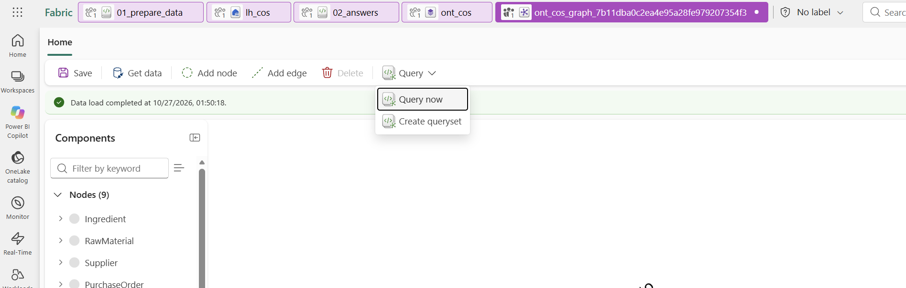

2. 새 쿼리 탭이 열리면 **Code editor**에서 아래 Q1의 GQL을 붙여 넣습니다.
3. 상단 **Run query**를 누르고 편집기 아래의 결과 표를 확인합니다. 각 질의 뒤의 **예상 결과**와 비교합니다. 이후 질의도 같은 편집기에서 내용을 바꿔 실행할 수 있습니다.

### 실행 전: 내 Graph의 이름과 경로에 맞추기

**아래 GQL은 참고 모델 기준입니다. 내 모델의 이름이나 구조가 다르면 질의도 수정해야 합니다.** 01장에서 참고 이름으로 이미 맞췄다면 그대로 사용하되, Graph에 네임스페이스 접두사가 붙었는지 확인합니다. 기존 모델을 유지한다면 질의를 실제 스키마에 맞춥니다.

| 다른 부분 | GQL에서 바꿀 곳 | 확인 방법 |
| --- | --- | --- |
| 엔터티·관계 이름 | `(변수:레이블)`의 레이블과 `[:관계]` | Graph model의 스키마(노드·에지 목록)에 표시된 실제 식별자를 사용합니다. Ontology 화면의 표시 이름만 보고 추정하지 않습니다. |
| 연결 방향 | `->` 또는 `<-` | 원래 원료·대체 원료 등 양끝의 업무 역할과 실제 출발·도착 타입을 확인합니다. |
| 속성 이름 | `WHERE`·`RETURN`의 속성 | `material_code`·`version_id`·`is_active` 등이 실제로 투영됐는지 확인합니다. |

예를 들어 Product → FormulaVersion 관계의 실제 이름이 `product_usesFormulaVersion`이면, Q3의 `[:made_with]`를 그 이름으로 바꿉니다. `produces`·`tests_version`·`for_project`·`supplied_by`도 실제 이름과 대조합니다. **이름만 다르고 원본 매핑과 방향이 같다면 모델을 다시 만들 필요는 없습니다.** 결과가 0행이거나 오류가 나면 먼저 스키마와 질의를 대조하며, 방향을 무조건 없애거나 데이터를 초기화하지 않습니다.

**Q1. 이 원료를 쓰는 처방 버전은?**

``` gql
MATCH (fv:FormulaVersion)-[:uses_material]->(rm:RawMaterial)
WHERE rm.material_code = 'RM-HA-120'
RETURN fv.version_id, fv.formula_name, fv.status, fv.is_active
```

**예상 결과:** 4행입니다. `status`와 `is_active`는 서로 다른 열이며, 결과 표에서는 각각 **`fv.status` 열**과 **`fv.is_active` 열**로 표시됩니다. 행 순서는 다를 수 있으므로 `version_id`로 대조합니다.

| version_id | status — 처방 버전의 업무 상태 | is_active — 활성 여부(Boolean) |
| --- | --- | --- |
| `FV-CRM-01-02` | 폐기 | false |
| `FV-CRM-01-03` | 현행 | true |
| `FV-TON-02-01` | 개발중 | true |
| `FV-AMP-03-02` | 현행 | true |

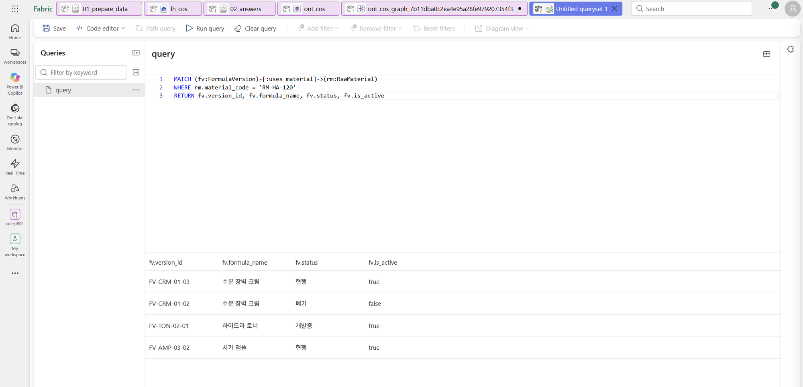

**Q2. 업무 규칙 적용 — 폐기 버전 제외**

Q1의 `WHERE`에 `AND fv.is_active = true`를 **직접 추가해** **Run query**로 다시 실행합니다.

**예상 결과:** 3행. `is_active = false`인 `FV-CRM-01-02`가 빠지고, true인 나머지 3개 버전은 남습니다.

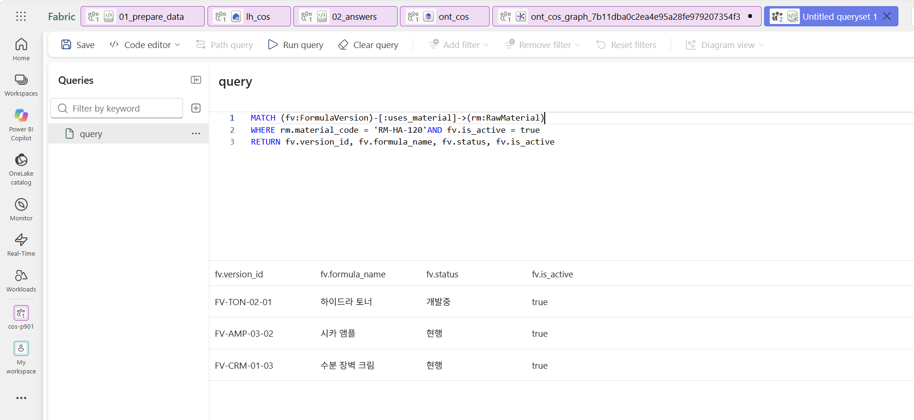

Q1의 4행과 비교해 보세요. 이 필터는 **조회 결과에서 비활성 버전을 제외**하는 것이며 원본 데이터를 삭제하거나 상태를 변경하지 않습니다. 같은 Graph라도 **필터 하나가 영향 대상을 바꿉니다.**

**Q3. 제품과 생산 계획까지**

``` gql
MATCH (pp:ProductionPlan)-[:produces]->(p:`Product`)-[:made_with]->(fv:FormulaVersion)-[:uses_material]->(rm:RawMaterial)
WHERE rm.material_code = 'RM-HA-120' AND fv.is_active = true
RETURN pp.plan_id, pp.planned_date, p.product_id, p.product_name, p.market
```

**예상 결과:** 3행 — `PP-1101`(2026-11-25, `P-101`, KR), `PP-1102`(2026-12-02, `P-102`, CN), `PP-1103`(2027-01-20, `P-301`, KR).

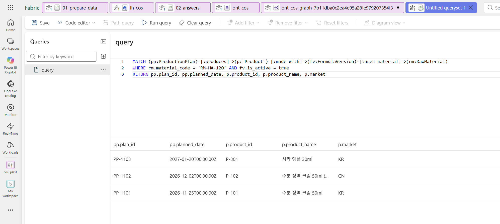

**Q4. 개발 과제와 안정성 시험까지**

``` gql
MATCH (st:StabilityTest)-[:tests_version]->(fv:FormulaVersion)-[:uses_material]->(rm:RawMaterial),
      (st)-[:for_project]->(dp:DevProject)
WHERE rm.material_code = 'RM-HA-120' AND fv.is_active = true
RETURN dp.project_id, dp.project_name, st.test_id, st.batch_date, st.status
```

**예상 결과:** 1행 — `DP-2026-07` 하이드라 토너 출시, `ST-0711`, 배치일 2026-11-20, `예정`.

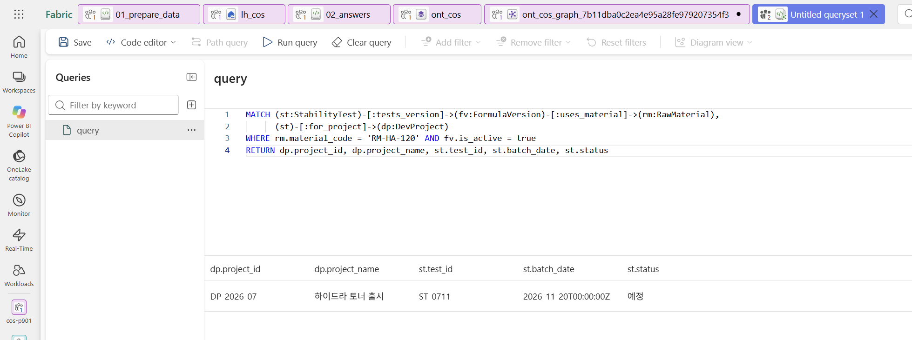

**Q5. 공급사 관점 — 같은 공급사의 원료를 쓰는 처방은? (도전)**

``` gql
MATCH (s:Supplier)<-[:supplied_by]-(rm:RawMaterial)<-[:uses_material]-(fv:FormulaVersion)
WHERE s.supplier_id = 'SUP-02' AND fv.is_active = true
RETURN rm.material_code, rm.material_name, fv.version_id
```

**예상 결과:** 5행 — `RM-HA-120` × 3개 버전, `RM-PHE-002`(페녹시에탄올) × 2개 버전(`FV-CRM-01-03`, `FV-AMP-03-02`). 같은 공급사에 문제가 번지면 수분 장벽 크림·시카 앰플은 원료 두 개가 동시에 걸립니다.

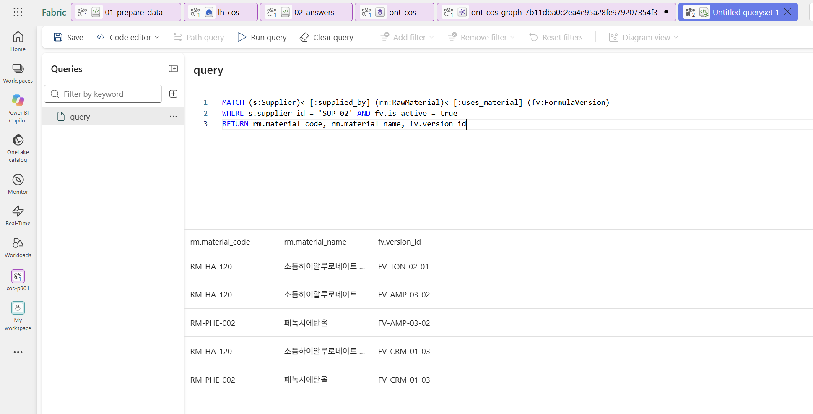

**Q6. 대체 원료 후보**

``` gql
MATCH (rm:RawMaterial)-[:alternative_to]->(alt:RawMaterial)-[:supplied_by]->(s:Supplier)
WHERE rm.material_code = 'RM-HA-120'
RETURN alt.material_code, alt.material_name, alt.lead_time_days, alt.cn_registration, s.supplier_name
```

**예상 결과:** 2행 — `RM-HA-210`(리드타임 10일, CN `필요`, 한빛바이오), `RM-HA-305`(42일, `완료`, Nordic Actives). 승인 상태(`승인`·`검토중`)는 참고 관계에 속성이 없어 이 질의에 나오지 않습니다. `02_answers` Q3에서 확인합니다.

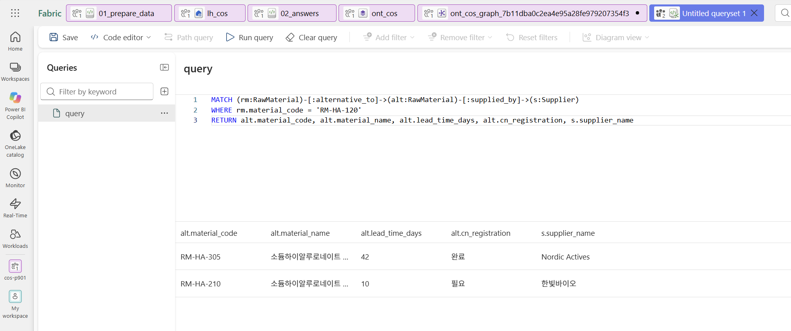

## 4. 정답 Notebook과 비교

### 4-1. `02_answers`의 기본 Lakehouse 확인

1. 작업 영역에서 **`02_answers` Notebook**을 엽니다. Graph 쿼리 탭이 아니라 Notebook에서 실행합니다.
2. 왼쪽 **Data items**에서 내 작업 영역의 `lh_cos`가 **기본 Lakehouse로 고정**(핀)되어 있는지 확인합니다. 01장에서 이미 연결했다면 설정을 그대로 사용합니다.
3. 미연결 상태라면 **Add data items → From OneLake catalog**에서 내 작업 영역의 **Lakehouse** `lh_cos`를 선택하고 **Add**를 누릅니다. 같은 이름의 **SQL analytics endpoint**를 선택하지 않습니다. 선택 화면은 [00장의 연결 예시](00-scenario.md#4-notebook에-기본-lakehouse-연결)를 참고합니다.
4. 추가한 `lh_cos`를 기본 Lakehouse로 고정하고 Notebook을 저장합니다. 실행 중인 Spark 세션의 기본 Lakehouse를 바꿨다면 세션을 다시 시작합니다.
5. 매개변수 셀은 아래 기본값을 유지합니다.

   ```python
   material_code = "RM-HA-120"
   qc_lead_days = 7
   ```

### 4-2. Spark 세션 연결 후 실행

**예상 코드 실행 시간:** 약 1–3분(세션 준비 제외).

1. 세션이 연결되어 있지 않다면 Notebook 상단 **Connect**를 누릅니다. Graph에서 질의를 실행한 것과 Notebook의 Spark 세션 연결은 별개입니다.
2. **Connecting**이 표시되면 연결 완료를 기다립니다. 보통 **30초–5분** 정도 걸리며 환경에 따라 더 길어질 수 있습니다. 대기 중 **Connect**나 **Run all**을 반복해서 누르지 않습니다.
3. 연결 완료 후 **Run all**을 한 번 누릅니다. 이미 세션이 연결되어 있고 기본 Lakehouse도 맞다면 재시작하지 않고 실행합니다.
4. 실행이 끝나면 아래 Q1–Q6 셀 출력을 확인합니다. 결과를 보기 위해 각 셀을 다시 실행할 필요는 없습니다. 01장에서 실행한 결과가 남아 있고 원본·매개변수가 그대로라면 기존 결과로 비교해도 됩니다.

### 4-3. Notebook 결과를 Graph와 비교

**예상 출력:** 아래 화면처럼 나옵니다. **Graph와 Notebook은 Q번호가 같아도 질문이 다릅니다.** 각 항목에 적힌 비교 대상을 사용하고, 행 순서보다 ID와 값을 대조합니다.

#### Notebook Q1. 처방 버전

**4행**, 폐기 버전 `FV-CRM-01-02`를 포함합니다. **Graph Q1**과 `version_id`·`status`·`is_active`를 비교합니다. 이 중 `is_active = true`인 3개 버전은 **Graph Q2**와 같습니다.

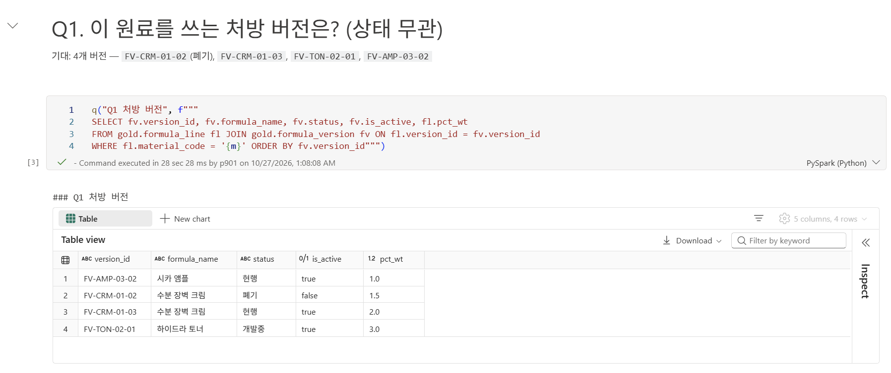

#### Notebook Q2. 영향 후보

**4행** — 제품 `P-101`·`P-102`·`P-301`, 개발 과제 `DP-2026-07`입니다. **Graph Q3**의 제품 ID와 **Graph Q4**의 개발 과제 ID를 각각 비교합니다.

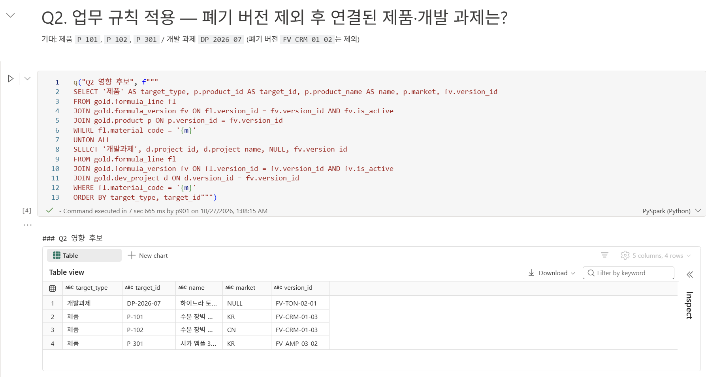

#### Notebook Q3. 대체 원료

**2행** — `RM-HA-210`은 승인, `RM-HA-305`는 검토중입니다. **Graph Q6**과 대체 원료 코드·리드타임·CN 등록 상태·공급사를 비교하고, Notebook에서 승인 상태와 조건도 확인합니다.

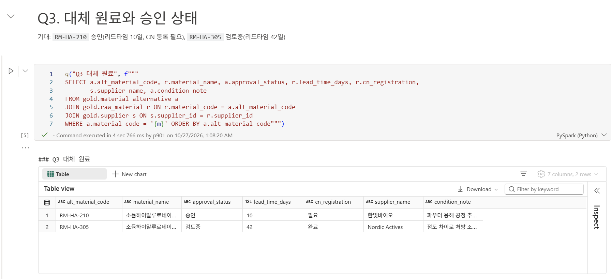

#### Notebook Q4. 같은 공급사의 다른 원료

**2행** — `RM-PHE-002`를 쓰는 `FV-CRM-01-03`·`FV-AMP-03-02`입니다. **Graph Q5**의 5행 중 원래 원료 `RM-HA-120`을 제외한 2행과 비교합니다.

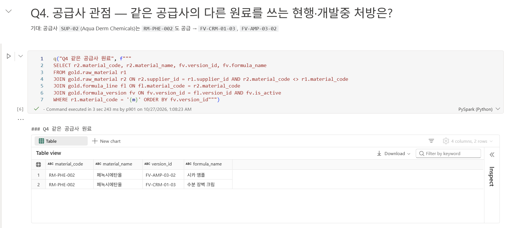

#### Notebook Q5. 필요일 대비 여유

**4행** — `PP-1101` 8일, `PP-1102` 15일, `PP-1103` 64일, `ST-0711` 3일입니다. **Graph Q3의 생산 계획 3건·Q4의 시험 1건**에 대해, Notebook은 원료 필요일과 여유일을 계산합니다. 지연 반영 전에는 `is_impacted`가 모두 false입니다.

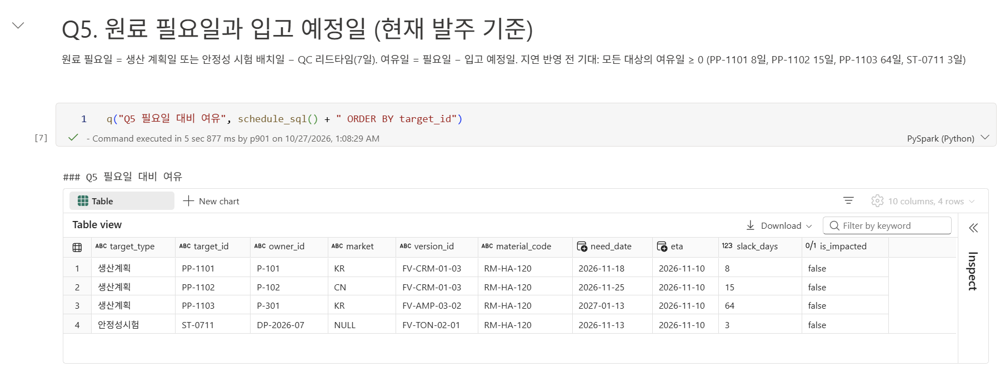

#### Notebook Q6. 영향 분석

`ops.material_impact가 아직 없습니다` 안내는 **지연 반영 전의 정상 출력**입니다. 이를 없애려고 `03_supply_change`를 먼저 실행하지 않습니다. 이 Q6은 대체 원료를 조회한 **Graph Q6과 다른 질문**입니다.

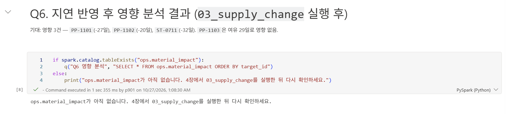

뒤에 나오는 DA 보조 조회 표는 03장에서 사용합니다.

> **토론 포인트:** Graph는 "무엇이 연결되어 있는가"를 빠르게 보여 줍니다. 그러나 "며칠 늦으면 문제인가" 같은 날짜 계산과 판정은 **명시적인 질의·Notebook**으로 하는 편이 정확하고 검증하기 쉽습니다. 4장의 `03_supply_change`가 그 역할을 합니다.

## 이 장의 완료 기준

- Graph model이 만들어졌고 Q1–Q4를 실행했습니다.
- `is_active` 필터로 폐기 버전이 빠지는 것을 확인했습니다.
- 영향 후보(생산 계획 3건, 안정성 시험 1건)를 `02_answers`와 비교했습니다.

## Troubleshooting

- **Manage graph**에서 **Ineligible**이면 키뿐 아니라 원본 종류·바인딩 수·지원 속성 형식을 확인합니다. [관리자 제약사항](../admin/preview-limitations.md)의 투영 적격성 항목을 참고합니다.
- 관계가 **Not mapped**로 나오면 관계 설정에서 양쪽 Property와 원본 열을 확인합니다.
- **Reserved keyword 'Product'** 오류가 나면 Q3처럼 레이블을 백틱으로 감싸 ``(p:`Product`)``로 씁니다. Ontology의 엔터티 이름을 바꿀 필요는 없습니다.
- 질의가 0행이면 레이블·속성 이름의 대소문자를 Graph model의 스키마(노드·에지 목록)와 비교합니다. 예제는 엔터티 타입·관계 이름을 사용하며, 네임스페이스 접두사가 붙은 환경은 실제 레이블에 맞춰 수정합니다.
- `is_active`가 없다는 오류가 나면 01장 4단계의 보강과 5단계 점검을 마친 뒤 **Manage graph**로 다시 Materialize합니다. Graph는 Materialize 시점의 데이터 스냅샷입니다.
- 다른 핵심 경로는 있고 `is_active`만 누락된 경우 임시로 `WHERE fv.status <> '폐기'`를 쓸 수 있습니다. 타입·관계 자체가 없으면 필터로 대신할 수 없으므로 01장에서 보완하거나 `02_answers`로 확인합니다.
- 원본 ETA만 바뀌었다면 Graph 항목의 **… → Schedule → Refresh now**로 갱신합니다. 스키마 변경 후 재투영과 원본 데이터 새로 고침을 구분합니다.

## 공식 문서

- [Ontology에서 Graph 만들기와 제한 사항](https://learn.microsoft.com/en-us/fabric/iq/ontology/how-to-use-ontology-graph)
- [GQL 언어 가이드](https://learn.microsoft.com/en-us/fabric/graph/gql-language-guide)
- [GQL 그래프 패턴 질의](https://learn.microsoft.com/en-us/fabric/graph/gql-graph-patterns)

## 다음 단계

[03. Data Agent](03-data-agent.md)에서 같은 질문을 자연어로 묻고 결과를 비교합니다.
