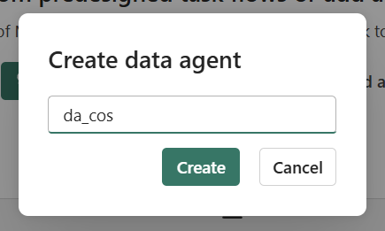
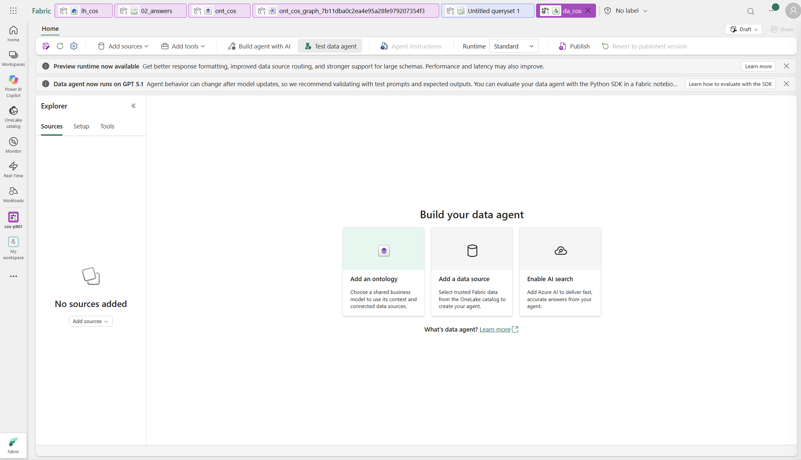
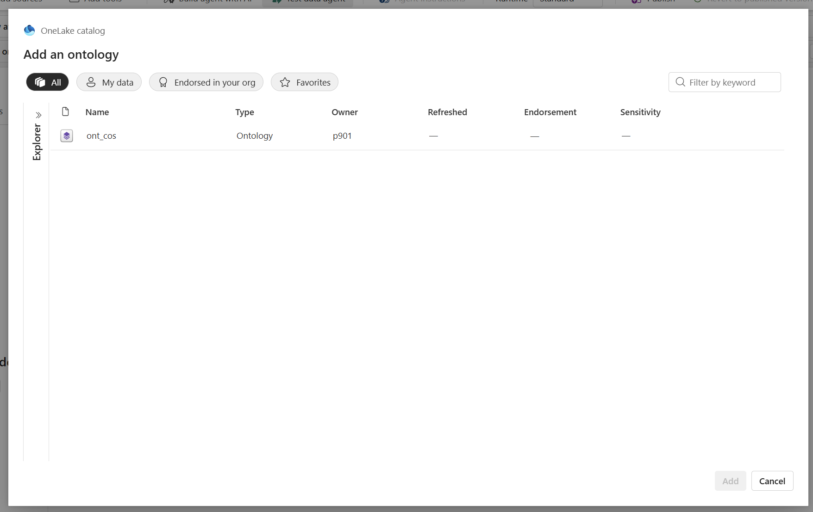
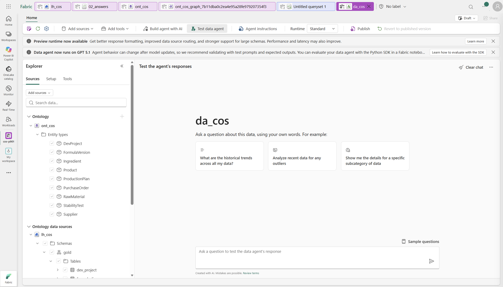
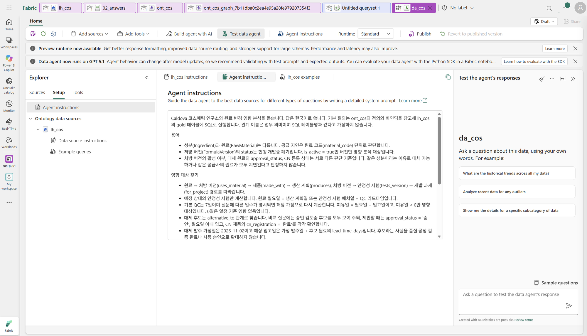

# 03. Data Agent — 업무 맥락으로 다양한 질문 검증하기

[목차](../README.md) \| 이전: [02. Graph](02-graph.md) \| 다음: [04. Operations Agent](04-operations-agent.md)

앞에서 만든 업무 모델로 **영향 대상·지연 가정·대체 원료 비교·발주 검토 기한**을 확인합니다. Data Agent를 만들고 지침을 입력해 본 뒤, **Ontology Agent의 Plan 모드에서 업무 질문을 검증**합니다.

> **Preview 환경 안내:** Ontology v2는 아직 Preview 상태이며, 워크숍에서 확인한 환경에서는 Data Agent와의 메타데이터 연계가 충분히 반영되지 않은 상태입니다. Ontology의 설명(description)·동의어(synonyms)·추가 업무 메타데이터를 사용해야 하는 질문에는 Data Agent가 의도한 답변을 하지 못할 수 있습니다. 이는 모든 원본 조회가 불가능하다는 뜻은 아니며, 배포 버전·환경에 따라 차이가 있습니다.
>
> 따라서 이번 실습은 **Data Agent 생성·원본 연결·Agent instructions 입력까지 체험**하고, 질문은 공통 업무 규칙을 전달한 **Ontology Agent**에서 실행합니다. 현재 환경에서 동작을 확인한 경로로 업무 맥락 기반 질의를 체험하고, 향후 Data Agent 연계에서 활용할 질문을 미리 검증하는 취지입니다. 두 Agent의 기능이나 결과가 항상 같다는 뜻은 아닙니다.

## 실습 구성과 사용 권장 기준

**1–2번은 Data Agent 구성 체험**, **3–4번은 Ontology Agent 질문·Notebook 대조**, **5번은 Graph 기반 선택 실습**입니다. Graph 비교용 Data Agent는 별도로 만들어 실행 원본을 구분합니다.

| 구분 | 연결 구성 | 이번 실습에서 권장하는 용도 |
| --- | --- | --- |
| **구성 체험: `da_cos`** | `ont_cos` 업무 문맥 + 연결된 `lh_cos`. Graph는 연결하지 않음 | 생성·연결·Agent instructions 입력. 메타데이터 활용 질문의 정확도 검증은 현재 기본 완료 조건이 아님 |
| **질문 검증: Ontology Agent** | `ont_cos` 안의 **Plan 모드** + 대화 첫 메시지의 공통 업무 규칙 | 전체·활성 처방, 날짜·여유일, 일정·CN 등록 비교, 발주 검토 기한 계산 |
| **선택: `da_cos_graph`** | 02장에서 만든 Graph model만 연결 | 원료 → 처방 → 제품 → 생산 계획처럼 다단계 연결을 따라 관련 대상·경로 찾기 |

**연결된 대상·경로를 찾으려면 Graph, 원본의 상세 조건과 계산을 검증하려면 Lakehouse**를 권장합니다.

## 시작 전 확인

- 1장에서 `ont_cos`의 관계와 속성을 완성했고, `lh_cos`의 SQL analytics endpoint에서 `gold` 테이블을 조회할 수 있습니다. Graph는 필수가 아닙니다.
- 테넌트에서 Data agent와 Copilot·Azure OpenAI 설정이 켜져 있어야 합니다(관리자 준비 사항).
- 질문은 **현재 연결된 10개 테이블·9개 엔터티**로 풉니다. `material_alternative`의 대체 승인 정보는 이 장의 조회 대상에 포함하지 않습니다. 여기서 여러 데이터 통합은 같은 Lakehouse 안의 발주·공급사·처방·제품·계획·시험 데이터를 조인하는 뜻이며, 별도 시스템 간 교차 원본 질의나 07장 이후 엔터티 확장을 요구하지 않습니다.
- 날짜 계산의 기준일은 **2026-11-02**, 기본 QC 리드타임은 **7일**입니다. 질문에 제시한 입고일·QC 일수는 **조회용 가정**이며 04장의 실제 지연 반영을 먼저 실행하지 않습니다. 이전 실습으로 원본이 바뀌었다면 현재 ETA와 가정 ETA를 구분합니다.

## 1. Data Agent 만들고 원본 연결

1. 작업 영역에서 **+ New item → Data agent**를 선택합니다. **Create data agent** 창에 `da_cos`를 입력하고 **Create**를 누릅니다.

   

2. 생성 직후 **No sources added**는 아직 연결한 원본이 없다는 정상 상태입니다. 가운데 **Add an ontology** 카드를 선택합니다. 상단이나 왼쪽의 **Add sources → Add an ontology**로도 시작할 수 있습니다. 이번에는 기존 업무 모델을 연결하므로 **Add a data source**가 아니라 **Add an ontology**를 사용합니다. Runtime은 관리자와 사전 검증한 설정을 사용합니다.

   

3. OneLake catalog의 **Add an ontology** 창에서 내 작업 영역의 `ont_cos`를 선택합니다. 항목 유형이 **Ontology**인지 확인하고 오른쪽 아래 **Add**를 누릅니다. 화면의 Add 버튼은 항목을 선택한 뒤 활성화됩니다.

   

4. 왼쪽 **Sources**에서 아래 두 영역을 펼쳐 확인합니다.
   - **Ontology → ont_cos → Entity types:** 앞에서 만든 핵심 엔터티 9개가 보입니다.
   - **Ontology data sources → lh_cos → Schemas → gold → Tables:** 연결된 Lakehouse와 `formula_line` 등 화면에 표시된 테이블을 확인합니다.

   

   `lh_cos`가 이미 연결되어 있다면 중복으로 추가하지 않습니다. 표시되지 않거나 원본 읽기에 실패하면 연결·바인딩과 요청 사용자의 Lakehouse/SQL endpoint 읽기 권한을 확인합니다. 필요한 경우에만 연결 가능한 Lakehouse 원본을 추가/마운트합니다.

기본 `da_cos`에는 **Graph model을 추가하지 않습니다.** Graph 비교를 하려면 기본 실습을 마친 뒤 5번에서 별도 `da_cos_graph`를 만듭니다.

**확인할 결과:** Sources에 `ont_cos`와 `lh_cos`가 연결됩니다. 다음 단계에서 지침을 입력하고, 질문 검증은 3번의 Ontology Agent에서 진행합니다.

## 2. 에이전트 지침 입력

기본 에이전트 **`da_cos`의 Agent instructions**에 아래 지침을 붙여 넣습니다.

``` text
Caldova 코스메틱 연구소의 원료 변경 영향 분석을 돕습니다. 답은 한국어로 씁니다.
기본 질의는 ont_cos의 정의와 바인딩을 참고해 lh_cos의 gold 테이블에 SQL로 실행합니다.
관계 이름은 업무 의미이며 SQL 테이블명과 같다고 가정하지 않습니다.

용어
- 성분(Ingredient)과 원료(RawMaterial)는 다릅니다. 공급 지연은 원료 코드(material_code) 단위로 판단합니다.
- 처방 버전(FormulaVersion)의 status는 현행·개발중·폐기입니다. is_active = true인 버전만 영향 분석 대상입니다.
- 처방 버전의 활성 여부와 원료의 CN 등록 상태는 서로 다른 판단 기준입니다. 같은 성분이라는 이유로 대체 가능하거나 같은 공급사의 원료가 모두 지연된다고 단정하지 않습니다.

영향 대상 찾기
- 원료 → 처방 버전(uses_material) → 제품(made_with) → 생산 계획(produces), 처방 버전 → 안정성 시험(tests_version) → 개발 과제(for_project) 경로를 따라갑니다.
- 예정 상태의 안정성 시험만 계산합니다. 원료 필요일 = 생산 계획일 또는 안정성 시험 배치일 − QC 리드타임입니다.
- 기본 QC는 7일이며 질문에 다른 일수가 명시되면 해당 가정으로 다시 계산합니다. 여유일 = 필요일 − 입고일이고, 여유일 < 0만 영향 대상입니다. 0일은 일정 기준 영향 없음입니다.
- 원료 코드가 지정된 비교 질문은 해당 RawMaterial의 속성을 직접 조회합니다. 대체 관계나 승인 상태를 조회하는 질문으로 확대하지 않습니다.
- 발주 가정일은 2026-11-02이고 예상 입고일은 가정 발주일 + 비교 원료의 lead_time_days입니다. 필요일 이내 입고와 CN 제품의 cn_registration = '완료'를 각각 확인하되, 일정·등록 조건 충족을 품질·공정 검증 완료나 대체 사용 승인으로 확대하지 않습니다.

가정과 데이터 범위
- 현재 발주의 ETA와 질문에 명시된 가정 ETA를 구분합니다. What-if는 원본·Ontology·ops 테이블을 변경하지 않는 계산입니다.
- 여러 조건을 비교할 때는 대상·원료·날짜 기준을 고정하고 바뀐 조건만 달리합니다.
- 시험에 제품 시장이 연결되지 않으면 시장을 추정하지 않습니다.
- 원료 단가와 생산 계획 수량만으로 총 추가 비용·생산 가능 수량을 확정하지 않습니다. 농도·제형 환산, 소요량·재고 할당·공정 검증 등 부족한 근거를 구분합니다.

답변 원칙
- 대상의 ID·이름과 포함·제외 이유를 표로 보여 줍니다. 계산 질문에는 기준일·가정·필요일·여유일·판정을 함께 표시합니다.
- 용어는 Ontology 정의와 실제 열을 구분해 설명하고, 연결된 원료·처방·제품의 ID와 업무상 검토 근거를 밝힙니다.
- 어떤 원본·조인·필터로 찾았는지 설명하고 실행한 SQL을 확인할 수 있게 합니다.
- 확인할 수 없는 값은 추측하지 말고 확인할 수 없다고 말합니다.
- 구매 발주나 처방을 바꾸라고 단정하지 말고 '검토 필요'로 제안합니다.
```

아래는 **Setup → Agent instructions**에 지침을 입력한 화면입니다. 오른쪽 **Test the agent's responses**는 Data Agent의 테스트 영역이며, 현재 기본 실습에서는 입력·저장까지 진행합니다. 질문은 3번의 Ontology Agent 대화에서 실행합니다.



**기본 실습은 Agent instructions만 입력하고 시작합니다.** Data source instructions는 특정 원본의 조인·필터 등 질의 생성 규칙을 보완할 때 쓰는 **선택 설정**이므로, 여기서는 별도로 입력하지 않습니다.

**참고: 설정 항목별 역할**

| 항목 | 설명 |
| --- | --- |
| **Agent instructions** | 역할·사용할 원본·답변 형식 등 에이전트 전체에 적용할 지침 |
| **Data source description** | 원본에 어떤 데이터가 있고 어떤 질문에 답할 수 있는지 요약해, 적절한 원본 선택을 돕는 설명 |
| **Data source instructions** | 해당 원본을 조회할 때 적용할 조인·필터·계산 규칙 등 질의 생성 지침 |
| **Example queries** | 자연어 질문과 검증된 질의를 짝지어 제공하는, 질의 생성용 참고 예시 |

## 3. Ontology Agent에서 핵심 질문 7개 검증

### 3-1. Plan 모드에서 공통 업무 규칙 전달

작업 영역에서 **`ont_cos` → Ontology agent**를 열고 **Plan 모드**인지 확인합니다. 아래 프롬프트를 **대화 첫 메시지**로 보냅니다. Data Agent에 저장한 Agent instructions는 이 대화에 자동 적용되지 않습니다.

```text
이 대화에서는 ont_cos를 활용해 코스메틱 원료 변경 영향에 관한 업무 질문을 검증합니다.
답변은 한국어로 간결하게 작성하세요.

[실행 범위]
- 현재 Ontology 정의와 lh_cos.gold의 실제 데이터를 근거로 답하세요.
- 조회만 수행하세요. Ontology·엔터티·관계·바인딩·원본 데이터는 변경하지 마세요.
- 모델 구성 설명이나 변경 제안보다 질문한 업무의 답과 근거에 집중하세요.

[처방 사용처와 영향 분석 범위]
- “특정 원료를 쓰는 전체 처방”은 해당 원료의 사용 기록이 있는 처방만 뜻합니다.
  해당 원료를 쓰지 않는 처방은 이 목록에 넣지 마세요.
- 전체 사용처를 물으면 상태와 무관하게 조회하세요.
- 영향 분석에 포함할 처방은 그중 is_active = true인 버전입니다.
  개발중이어도 활성인 처방은 포함하고, 비활성·폐기 처방은 제외하세요.
- 원료를 사용한다는 사실만으로 실제 일정 지연을 확정하지 마세요.
- 전체 목록과 영향 분석 포함 목록을 비교할 때는 같은 처방 집합에서
  version_id·status·is_active·포함/제외 이유를 보여주세요.

[일정 계산 — 생산 계획과 시험에 공통 적용]
- 활성 처방에 연결된 생산 계획과 예정 상태의 안정성 시험을 확인하세요.
- 기본 QC 리드타임은 7일이며, 질문에서 지정하면 그 값을 사용하세요.
- 원료 필요일은 다음과 같이 계산하세요.
  · 생산 계획: production_plan.planned_date - QC 리드타임
  · 안정성 시험: stability_test.batch_date - QC 리드타임
- 생산 계획일과 시험 배치일은 작업 일정이지 원료 필요일이 아닙니다.
  두 대상 모두 원본 일정에서 QC를 각각 한 번씩 차감하세요.
  시험에만 QC를 적용하거나, 생산 계획일을 그대로 필요일로 사용하지 마세요.
- 여유일 = 계산된 원료 필요일 - 입고일입니다.
  계획일·배치일과 입고일을 직접 비교해 여유일을 계산하지 마세요.
- 여유일 < 0만 일정 영향이 있고, 0일은 일정 기준 영향 없음입니다.
- 입고일만 바꾸는 비교에서는 필요일과 QC를 고정하고 입고일만 바꾸세요.
- 날짜는 달력일로 계산하세요. 가정 발주일 + 원료 lead_time_days는 예상 입고일이며,
  일정상 최종 발주일 = 원료 필요일 - lead_time_days입니다.
  남은 일수 = 일정상 최종 발주일 - 질문의 기준일입니다.
- 결과 표에는 대상 ID·대상 유형·계획일/배치일·QC 일수·원료 필요일을 구분하고,
  비교 질문에는 입고일별 여유일·영향 여부를, 발주 기한 질문에는 리드타임·최종 발주일·남은 일수를 표시하세요.
- 답변 전에 모든 일정 행에서 다음 식을 검산하세요.
  · 계획일 또는 배치일 - 원료 필요일 = 적용한 QC 일수
  · 원료 필요일 - 입고일 = 여유일
  · 최종 발주일 + 리드타임 = 원료 필요일
  계산이나 조회로 검증하지 못한 값은 확정값으로 제시하지 마세요.

[공급 위험과 가정]
- 현재 발주 ETA와 질문에서 지정한 가정 입고일을 구분하세요.
- 같은 공급사의 다른 원료도 지연됐다고 단정하지 말고 해당 발주를 확인하세요.
- 시험에 제품 시장이 연결되지 않으면 시장을 추정하지 마세요.
- 가정 계산은 원본을 변경하지 않는 조회입니다.

[대체 원료와 판단 한계]
- 질문에 지정한 원료를 비교하는 것과 승인된 대체 원료를 찾는 것은 다릅니다.
- 일정·CN 등록 조건 충족이나 발주 기한을 대체 사용 승인·품질·공정 검증 완료로 해석하지 마세요.
- 계획 수량을 실제 생산 가능 수량으로 답하지 마세요.
- 원료 단가와 배합비만으로 총 추가 비용을 확정하지 마세요.
  농도·제형 환산, 소요량·재고·공정 검증 등 추가 근거를 구분하세요.

[근거와 답변]
- 수치·상태·목록은 실제 조회 결과로 확인하세요.
- 실제 실행한 질의와 사용 원본을 제시하고, 제안한 질의를 실행 결과처럼 설명하지 마세요.
- 샘플만 확인했다면 전체 건수나 데이터 부재를 단정하지 마세요.
- 조회 실패, 정상 조회 결과 0행, 속성 미확인을 구분하세요.
- Ontology에 속성이 안 보이는 것과 원본에 열·데이터가 없는 것을 구분하세요.
  참조 원본의 실제 열을 확인해 조회 가능한 값은 보완하고,
  확인하지 못하면 원본에 없다고 단정하지 말고 조회·바인딩 확인 필요로 표시하세요.
- 확인되지 않은 값을 추측하거나 이전 답변에서 가져와 채우지 마세요.
- 답변은 짧은 결론 → 결과 표 → 필요한 근거·한계 순서로 작성하세요.
- 다음 질문에는 이 공통 규칙을 적용하되, 이전 질문의 가정 날짜나 결론을 자동으로 재사용하지 마세요.
```

이 프롬프트는 **현재 대화용 기준**이며 Ontology에 업무 규칙을 영구 저장하는 작업이 아닙니다. **같은 대화에서** 다음 질문을 이어 보냅니다. **Clear chat·새 대화·페이지 새로고침으로 대화를 초기화했다면 공통 프롬프트도 다시 보냅니다.**

### 3-2. 질문과 기대 답변 비교

아래 **핵심 7문항을 DA01–DA07 순서대로** 질문합니다. **질문 열만 복사**해 보낸 뒤, 오른쪽 **기대 답변**과 비교합니다. `02_answers` Notebook에도 같은 번호·질문·순서로 확인 결과가 있습니다. DA는 대조를 위한 문항 ID이며, 현재 질문 실행 위치는 **Ontology Agent**입니다.

| ID | 유형 | 질문 | 기대 답변 |
|---|---|---|---|
| DA01 | 대조 | `RM-HA-120을 쓰는 전체 처방 버전과 영향 분석에 포함되는 처방 버전을 대조해줘. version_id·status·is_active·포함/제외 이유를 보여줘.` | 전체 **4개**, 활성 **3개**. `FV-CRM-01-02`는 폐기·false로 제외. `FV-CRM-01-03`·`FV-TON-02-01`·`FV-AMP-03-02`는 포함하며, 개발중이어도 활성인 버전은 제외하지 않음 |
| DA02 | 규칙 | `ST-0711에서 QC 7일을 적용할 때 RM-HA-120이 2026-11-13에 입고되는 경우와 11-14에 입고되는 경우를 판정해줘. 필요일과 여유일을 계산하고, 여유일이 0이면 영향 대상인지 설명해줘.` | 필요일 **11-13**. 11-13 입고는 **0일·영향 없음**, 11-14 입고는 **-1일·영향 있음**. 영향 기준은 여유일 **< 0** |
| DA03 | 규칙 | `2026-11-02에 발주한다고 가정해줘. CN 제품 P-102의 PP-1102에 대해 RM-HA-210과 RM-HA-305의 예상 입고일·여유일·CN 등록 상태를 비교해줘. QC는 7일로 적용하고, 일정과 CN 등록을 모두 충족하는 원료가 있는지 설명해줘. 이 결과만으로 대체 사용을 확정할 수 있나?` | 필요일 **11-25**. `RM-HA-210`: 11-12 입고·여유 **13일**, 일정 충족/CN 등록 필요. `RM-HA-305`: 12-14 입고·여유 **-19일**, 일정 미충족/CN 등록 완료. **두 조건을 모두 충족하는 원료 없음**. 대체 사용 승인은 별도 확인 |
| DA04 | 관계 | `RM-HA-120의 공급사가 공급하는 다른 원료를 찾고, 그 원료를 쓰는 활성 처방과 제품까지 연결해줘. 같은 공급사라는 이유만으로 그 원료도 지연됐다고 판단해도 되는지 실제 발주 ETA와 구분해줘.` | `SUP-02`의 다른 원료 `RM-PHE-002` → 활성 처방 `FV-CRM-01-03`·`FV-AMP-03-02` → 제품 `P-101`·`P-102`·`P-301`. 발주 `PO-5505` ETA는 **11-10**. 같은 공급사라는 이유만으로 지연 확정 불가 |
| DA05 | What-if | `RM-HA-120의 입고일을 2026-11-10과 2026-12-15로 각각 가정해 비교해줘. QC는 7일로 고정하고 활성 처방에 연결된 생산 계획·예정 시험별 필요일·여유일·영향 여부와 새로 영향을 받는 대상을 보여줘.` | 필요일·여유일: `PP-1101` 11-18, **8 → -27일**; `PP-1102` 11-25, **15 → -20일**; `PP-1103` 2027-01-13, **64 → 29일**; `ST-0711` 11-13, **3 → -32일**. 새 영향은 `PP-1101`·`PP-1102`·`ST-0711` **3건**, `PP-1103`은 영향 없음 |
| DA06 | 여러 데이터 통합 | `RM-HA-120이 2026-12-15에 입고된다고 가정하고 QC 7일을 적용해, 영향받는 생산 계획과 예정 시험을 하나의 검토표로 만들어줘. 제품/과제·시장·처방 버전·원 발주/공급사·필요일·여유일을 연결하고, 일정 조정이나 추가 검토가 필요한 대상을 정리해줘. 시험의 시장은 추정하지 마.` | 영향 **3행**: `PP-1101`/`P-101`/KR **-27일**, `PP-1102`/`P-102`/CN **-20일**, `ST-0711`/`DP-2026-07`/시장 미연결 **-32일**. 원 발주 `PO-5501`·공급사 `SUP-02`. 생산·시험 일정 조정과 원료 확보 검토 필요 |
| DA07 | 의사결정 지원 | `2026-11-02 기준으로 RM-HA-210을 대체 원료로 검토 중이야. PP-1101·PP-1102·ST-0711의 일정을 맞추려면 늦어도 언제까지 발주해야 할까? QC 7일과 해당 원료의 리드타임을 달력일로 적용해, 대상별 원료 필요일·일정상 최종 발주일·기준일로부터 남은 일수를 보여줘. 어떤 대상을 먼저 검토해야 하는지와 CN 제품의 추가 확인 사항도 정리해줘. 일정 계산 결과를 실제 대체 사용 승인으로 해석하지 마.` | 리드타임 **10일**. 일정상 검토 순서: `ST-0711` 필요일 11-13 → 최종 발주 **11-03**, **1일** 남음; `PP-1101` 필요일 11-18 → **11-08**, **6일**; `PP-1102` 필요일 11-25 → **11-15**, **13일**. CN 제품 `P-102`는 **CN 등록 검토 필요**. 발주 기한은 대체 사용 승인·공정 검증 완료를 뜻하지 않음 |

## 4. 답과 근거 검증하기

Ontology Agent의 답이 맞는지 확인하려고 **`02_answers` Notebook에 준비된 SQL 실행 결과와 비교**합니다. 대상 ID·날짜·영향 판정이 같은지 확인하는 단계입니다.

`02_answers`를 열고 기본 Lakehouse가 내 작업 영역의 `lh_cos`인지 확인합니다. 미연결 상태라면 [00장의 연결 절차](00-scenario.md#4-notebook에-기본-lakehouse-연결)에 따라 연결·저장합니다. 세션이 연결되어 있지 않다면 **Connect**로 시작하고, 연결 완료 후 **Run all**을 누릅니다.

앞의 **Q1–Q6은 01–02장 비교용으로 유지**합니다. 이 장에서는 뒤의 **03장 Data Agent — DA01–DA07 질문과 확인 결과**로 이동합니다. 각 문항의 질문과 바로 아래 실행 결과를 순서대로 확인하면 됩니다. DA01도 전용 셀이 있으므로 Q1 출력을 따로 찾아갈 필요가 없습니다. 모든 DA 질의는 원본을 바꾸거나 `03_supply_change`를 실행하지 않아도 확인할 수 있습니다.

**예상 코드 실행 시간:** 약 1–3분(세션 준비 제외).

**예상 출력:** DA01–DA07마다 질문 문구와 아래 표가 순서대로 나옵니다. 지연 반영 전 Q6의 `ops.material_impact가 아직 없습니다` 안내는 정상이며, 뒤의 DA 확인 결과와는 별개입니다.

| 출력 | 행 수와 확인할 값 |
|---|---|
| DA01 전체·활성 처방 | 4행, 전체 4개 중 포함 3개·제외 1개 |
| DA02 경계 판정 | 2행, 여유 0일은 영향 없음·-1일은 영향 있음 |
| DA03 일정·CN 비교 | 2행, 두 원료 모두 `schedule_cn_ok = false`. 대체 사용 승인 판정은 아님 |
| DA04 공급사 경로 | 3행, 제품 `P-101`·`P-102`·`P-301` |
| DA05 입고일 비교 | 4행, 입고일 변경 전후 비교 |
| DA06 통합 검토표 | 3행, `PP-1101`·`PP-1102`·`ST-0711` |
| DA07 발주 검토 기한 | 3행, `ST-0711` → `PP-1101` → `PP-1102` 순서. 최종 발주일 11-03/11-08/11-15, 남은 일수 1/6/13 |

<details>
<summary>상세 확인: 핵심 7문항의 판정 기준과 Notebook 근거</summary>

날짜의 연도는 별도 표시가 없으면 2026년입니다. 순서·표현이 달라도 **ID·조건·날짜·판정·근거**가 맞아야 합니다.

| ID | 정답·필수 근거 | Notebook 근거 |
|---|---|---|
| DA01 | 전체 4개 → 활성 3개. `FV-CRM-01-02`는 폐기·false로 제외하고 `FV-CRM-01-03`, `FV-TON-02-01`, `FV-AMP-03-02` 포함. 개발중을 제외하면 틀림 | DA01 전체·활성 처방 |
| DA02 | 시험 배치일 11-20 − QC 7일 = 필요일 **11-13**. 11-13 입고는 여유 **0일·영향 없음**, 11-14는 **-1일·영향 있음**. `< 0`과 `<= 0`을 구분 | DA02 경계 판정 |
| DA03 | `PP-1102` 계획일 12-02 − QC 7일 = 필요일 11-25. `RM-HA-210` 리드타임 10일 → 11-12 입고·여유 13일, CN 등록 필요. `RM-HA-305` 리드타임 42일 → 12-14 입고·여유 -19일, CN 등록 완료. 일정과 CN 등록을 모두 충족하는 원료 없음. 승인 상태는 조회하지 않음 | DA03 일정·CN 비교 |
| DA04 | `SUP-02`의 다른 원료 `RM-PHE-002` → 활성 `FV-CRM-01-03`/`FV-AMP-03-02` → 제품 `P-101`/`P-102`/`P-301`. 해당 발주 `PO-5505`의 ETA는 11-10. 연결된 위험을 검토할 수는 있으나 실제 지연 확정 근거는 아님 | DA04 공급사 경로 |
| DA05 | 필요일: `PP-1101` 11-18, `PP-1102` 11-25, `PP-1103` 2027-01-13, `ST-0711` 11-13. 같은 순서로 여유일 **8/15/64/3 → -27/-20/29/-32**. 새 영향 3건은 `PP-1101`/`PP-1102`/`ST-0711`; `PP-1103` 영향 없음, 원료를 쓰지 않는 `PP-1104` 제외 | DA05 입고일 비교 |
| DA06 | 영향 3행. `PP-1101`/`P-101`/KR, `PP-1102`/`P-102`/CN, `ST-0711`/`DP-2026-07`/시장 미연결. 원 발주 `PO-5501`·공급사 `SUP-02`, 여유 -27/-20/-32. 생산·시험 일정과 원료 확보를 검토하며 대체 후보·승인 정보는 조회하지 않음. 원본 ETA와 가정 ETA를 구분 | DA06 통합 검토표 |
| DA07 | 최종 발주일 = 원료 필요일 − RM-HA-210 리드타임 10일. `ST-0711` 11-03(기준일 대비 1일), `PP-1101` 11-08(6일), `PP-1102` 11-15(13일). 일정상 검토 순서는 시험 → KR 생산 → CN 생산. CN 제품은 등록 검토가 별도 필요하며, 추가 공정·검증에 필요한 시간은 이 역산에 포함하지 않음 | DA07 발주 검토 기한 |

</details>

문항별로 **답과 필수 근거 충족 / 일부 누락 / 불일치·확인 불가**를 기록합니다. 최초 답과 실행 질의를 남기고, 답이 다르면 조인·활성 필터·가정 날짜·QC·경계 조건을 확인해 다시 질문합니다. 보완 질문 뒤의 답은 별도로 기록합니다.

**확인할 결과:** 활성 대상·공급사 위험·지연 영향·원료별 일정·등록 조건과 발주 검토 기한을 설명할 수 있습니다. 특히 DA02의 0일 경계, DA03의 조건 비교, DA05의 생산·시험 공통 QC 적용, DA07의 기한 역산과 승인 구분을 확인합니다.

## 5. 선택 실습 — 별도 Graph 기반 Data Agent로 경로 비교

**02장에서 Graph를 생성한 경우에만 진행합니다.** Graph model이 없거나 사용할 수 없다면 이 절을 건너뛰어도 기본 실습은 완료입니다. 새 문항을 추가하지 않고, 기본 7문항 중 DA04의 **같은 공급사 원료 탐색**을 재사용해 비교합니다.

### 5-1. Graph 전용 에이전트 만들기

1. 작업 영역에서 **+ New item → Data agent**로 별도 `da_cos_graph`를 만듭니다. 기존 `da_cos`는 그대로 유지합니다.
2. **Add a data source** 또는 **Add sources**에서 02장의 `ont_cos_graph_…`을 선택합니다. 항목 유형이 **Graph model**인지 확인합니다. 이 에이전트에는 **Graph 원본만 연결**하고, Ontology나 Lakehouse는 추가하지 않습니다.
3. Graph가 최신 원본을 반영했는지 확인합니다. **Graph는 Materialize·새로 고침 시점의 데이터**이므로, 원본 변경 후에는 02장의 갱신 절차를 먼저 확인합니다.
4. `da_cos_graph`의 **Agent instructions**에는 아래 지침을 입력합니다. 기본 `da_cos`의 SQL·계산용 지침을 그대로 복사하지 않습니다.

```text
연결된 Graph model만 사용해 원료의 사용처와 업무 연결 경로를 조회합니다.
답은 한국어로 하고, 실제 Graph 스키마에 맞는 GQL을 사용합니다.
활성 처방을 묻는 질문에는 is_active = true를 적용합니다.
대상의 ID와 중간 노드·관계, 실제 저장된 관계 방향을 보여줍니다.
사용한 Graph 원본과 실행한 GQL을 확인할 수 있게 합니다.
원본·Ontology·Graph 정의는 변경하지 않습니다.
투영되지 않은 속성이나 확인할 수 없는 값은 추정하지 않습니다.
```

### 5-2. 같은 관계 질문을 두 에이전트에 보내기

아래 질문을 `da_cos_graph`와 3번에서 공통 프롬프트를 보낸 **Ontology Agent**에 각각 보냅니다. Graph Data Agent는 **Clear chat**으로 대화를 비우고, Ontology Agent를 초기화했다면 공통 프롬프트부터 다시 보냅니다. `da_cos`와의 직접 비교는 메타데이터 연계를 검증한 환경에서만 선택적으로 진행합니다.

**같은 공급사의 다른 원료 — DA04의 관계 탐색**

```text
RM-HA-120과 같은 공급사가 공급하는 다른 원료를 찾아줘.
RM-HA-120 자체는 제외하고, 그 원료를 쓰는 활성 처방과 연결된 제품까지
원료·처방 버전·제품 ID와 경로를 보여줘.
```

### 5-3. 대상·경로와 실행 원본 비교

| 질문 | 대조할 대상·경로 | Notebook 근거 |
| --- | --- | --- |
| 같은 공급사의 다른 원료 | `SUP-02`의 `RM-PHE-002` → 활성 처방 `FV-CRM-01-03`·`FV-AMP-03-02` → 제품 `P-101`·`P-102`·`P-301` | DA04 공급사 경로 |

두 에이전트가 같은 원료·처방·제품을 찾았는지 보고, 실제 질의 원본과 언어를 확인합니다. **`da_cos_graph`는 Graph GQL**을 사용하며, Ontology Agent는 사용 가능한 원본에 따라 SQL 또는 GQL 등을 선택할 수 있습니다. `da_cos` 직접 비교를 진행했다면 **`da_cos`는 Lakehouse SQL**을 실행했는지도 확인합니다.

답이 다르면 Graph의 갱신 시점·투영 범위, 실제 스키마와 활성 필터를 먼저 비교합니다. Graph에서 확인할 수 없는 속성·계산은 확인 불가로 기록하고 **Ontology Agent 또는 Notebook의 Lakehouse SQL**로 검증합니다. Graph의 지원 범위 밖 질문에 답하기 위해 `da_cos_graph`에 Lakehouse를 추가하지 않습니다.

> **토론 포인트:** Data Agent는 "내가 궁금한 것을 질문"할 때 강력합니다. 하지만 매번 사람이 물어야 합니다. 공급 지연처럼 **정해진 조건**은 사람이 묻기 전에 알려 주는 편이 낫습니다 — 다음 장의 Operations Agent입니다.

## 이 장의 완료 기준

- `da_cos`를 생성하고 `ont_cos`·`lh_cos` 연결과 Agent instructions 입력을 체험했습니다.
- Preview 환경의 Ontology 메타데이터 연계 제약과 질문 실행 위치를 구분했습니다.
- Ontology Agent의 **Plan 모드**에서 공통 프롬프트를 보낸 뒤 핵심 7문항을 정답 기준·Notebook과 대조했습니다.
- 날짜·QC 가정을 바꾼 계산과 실제 원본 변경을 구분하고, 데이터만으로 확정할 수 없는 결론을 설명할 수 있습니다.
- **선택 실습을 한 경우:** 별도 `da_cos_graph`에서 공급사 원료 탐색의 GQL·대상을 Ontology Agent·Notebook 결과와 비교했습니다. 선택 실습을 생략해도 기본 과정은 완료입니다.

## Troubleshooting

- Graph model이 원본 목록에 보이지 않으면 Graph의 미리 보기 기능 설정을 관리자에게 확인하고, 선택 실습은 건너뛴 채 Ontology Agent의 기본 질문 검증을 진행합니다.
- "데이터에 접근할 수 없다"는 답이 나오면 `lh_cos` 읽기 권한과 Ontology 원본 바인딩을 확인합니다.
- 폐기 버전을 영향 분석에 포함하면 Ontology Agent의 공통 프롬프트가 현재 대화에 전달됐는지 확인합니다. 원료 사용처 전체와 활성 처방의 범위를 구분해 다시 질문합니다.
- 생산 계획의 여유일만 7일 크게 나오면 시험에만 QC를 적용했는지 확인합니다. 계획일/배치일·QC·필요일을 분리하고 두 대상 모두 같은 규칙으로 검산합니다.
- 수량·단가가 모델에 없다는 답변은 원본 데이터 부재와 다릅니다. 원본 열을 조회할 수 있는지 확인하고, 조회 실패·속성 미노출·정상 조회 0행을 구분합니다. 모델 변경이 필요하다면 조회와 분리해 검토하고, 질문 검증 중에는 Act로 바꾸지 않습니다.
- 엔터티 정의가 오래되면 Ontology 문맥 **Refresh**를 실행하고 내려받은 문맥·실행 단계를 확인합니다. 문맥 편집은 Ontology에서 합니다.
- Ontology 내부의 일부 엔터티만 선택해 Data Agent에 노출하는 기능은 현재 지원되지 않습니다. 기본 과정에서는 01장에서 완성한 핵심 `ont_cos`를 사용합니다.

## 공식 문서

- [Data agent 데이터 원본 추가 (Graph model 포함)](https://learn.microsoft.com/en-us/fabric/data-science/data-agent-add-datasources)
- [Ontology를 Data agent 원본으로 사용](https://learn.microsoft.com/en-us/fabric/data-science/data-agent-ontology-sources)
- [Data agent 개념·지원 원본·지침](https://learn.microsoft.com/en-us/fabric/data-science/concept-data-agent)
- [Agent instructions와 Data source instructions 구성](https://learn.microsoft.com/en-us/fabric/data-science/data-agent-configurations)
- [Ontology Agent의 질의·Plan 모드·대화 유지 범위](https://learn.microsoft.com/en-us/fabric/iq/ontology/how-to-use-ontology-agent)

## 다음 단계

[04. Operations Agent](04-operations-agent.md)에서 공급 지연을 감시하고 먼저 알려 주는 에이전트를 만듭니다.
