# 04. Operations Agent — 감시하고 먼저 알리기

[목차](../README.md) \| 이전: [03. Data Agent](03-data-agent.md) \| 다음: [05. 승인 후 조치](05-approval.md)

Data Agent는 사람이 물어야 답합니다. **Operations Agent**는 정해진 조건을 주기적으로 감시하다가, 조건이 맞으면 **Teams로 먼저 알리고 대응을 제안**합니다. 이 장에서는 목표를 좁게 잡습니다.

> **"공급 지연 상태가 된 원료를 감지하고, 검토가 필요한 대상을 알린다."**

영향 계산(필요일·여유일·대체 원료 판정)은 `03_supply_change` Notebook이 명시적으로 하고, 에이전트는 그 결과를 근거로 제안만 합니다.

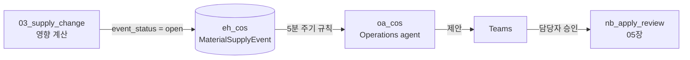

## 시작 전 확인

- **유료 Fabric 용량**(F SKU)이 필요합니다. Operations agent는 Trial 용량을 지원하지 않습니다.
- 내 작업 영역 `cos-pNNN`에 **Contributor 이상** 권한이 있고 Fabric 항목을 생성할 수 있어야 합니다. `eh_cos`는 이 장에서 직접 만듭니다.
- 테넌트에서 Operations agent, Copilot·Azure OpenAI, (필요 시) 지역 간 처리 설정이 켜져 있어야 합니다(관리자 준비 사항).
- Teams는 Fabric과 같은 조직 계정으로 사용합니다. 앱의 수동 추가는 아래 안내에 따라 필요한 경우에만 진행합니다.
- 규칙 질의는 **5분 주기**로 실행됩니다. 알림까지 수 분이 걸리는 것이 정상입니다.

### Teams 알림 앱 확인

**Fabric Operations Agent** 앱은 자동으로 설치될 수 있으므로 **수동 추가가 항상 필요한 것은 아닙니다.** 이미 알림을 받고 있다면 아래 절차는 건너뜁니다.

<details>
<summary>앱을 수동으로 추가해야 하는 경우</summary>

알림을 받지 못하고 앱도 설치되어 있지 않다면 **Teams 안에 앱을 추가**합니다.

1. Fabric에 사용하는 조직 계정으로 Teams에 로그인합니다.
2. Teams의 **앱(Apps) 메뉴**에서 `Fabric Operations Agent`를 검색합니다.

   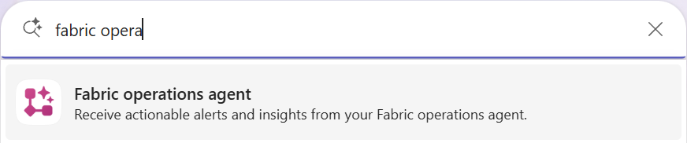

3. **Fabric Operations Agent** 앱을 선택하고 **추가(Add) 버튼**을 누릅니다.

앱이 검색되지 않거나 추가가 차단되면 Teams 관리자에게 앱 사용 허용을 요청합니다. 설치한 뒤에는 이 장에서 에이전트를 시작하고 공급 지연 이벤트를 발생시켜 메시지 수신을 확인합니다.

</details>

## 1. Eventhouse 만들기

1. 내 작업 영역 `cos-pNNN`에서 **+ New item**을 누릅니다.
2. 검색 칸에 `Eventhouse`를 입력하고 **Eventhouse**를 선택합니다.
3. 이름을 `eh_cos`로 입력하고 **Create**를 누릅니다.

   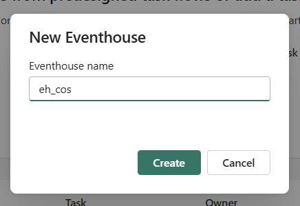

4. Eventhouse의 **System overview**가 열리면 왼쪽 **KQL Databases**에서 `eh_cos`를 선택합니다.

   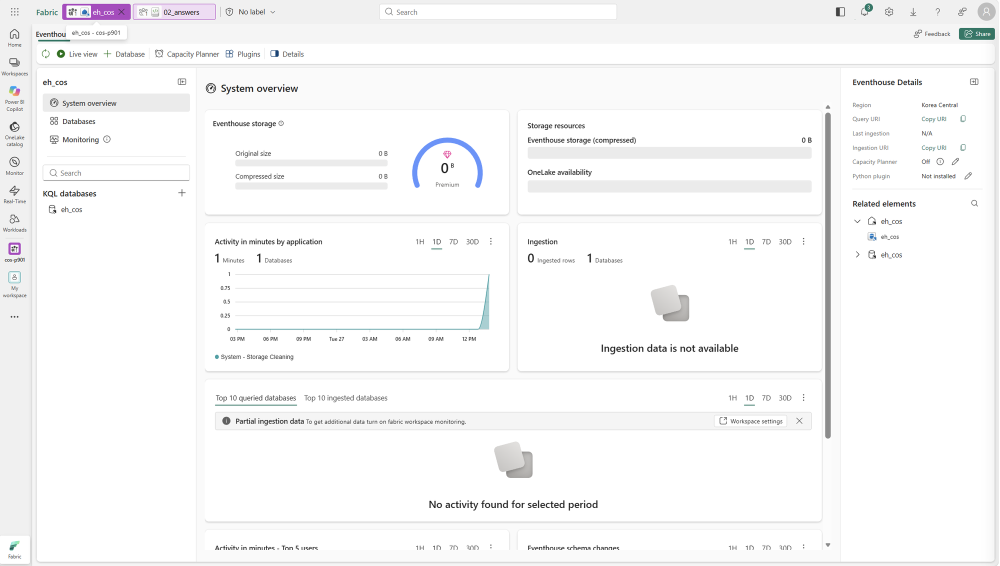

**확인할 결과:** Eventhouse와 **같은 이름의 기본 KQL Database가 자동 생성**됩니다. `eh_cos` KQL Database가 열리고 처음 만든 데이터베이스에는 아직 테이블이 없습니다. 별도의 KQL Database를 추가로 만들 필요는 없습니다.

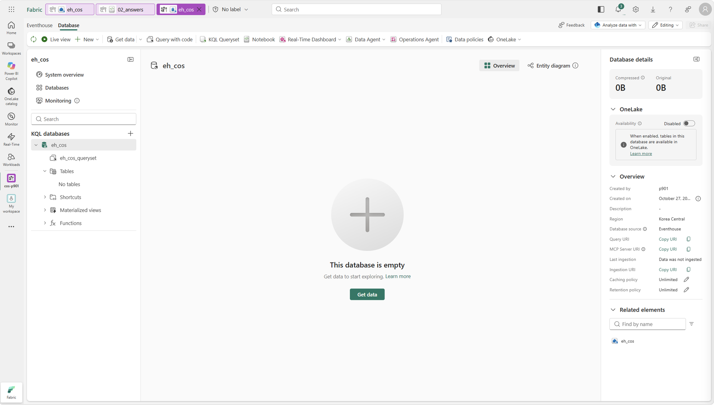

**이름 확인:** 뒤의 Notebook은 같은 작업 영역에서 Eventhouse를 찾고, `eventhouse_name`을 KQL Database 이름으로도 사용합니다. **Eventhouse와 기본 KQL Database 이름을 모두 `eh_cos`로 유지**합니다.

이미 `eh_cos`가 있다면 중복 생성하거나 삭제하지 말고 기존 KQL Database와 테이블을 확인합니다. 이전 실습 이력은 보존하며, 반복 실행할 때는 6단계의 `run_tag`를 새 값으로 바꿉니다.

## 2. 이벤트 테이블 만들기

`eh_cos` KQL Database의 왼쪽 목록에서 `eh_cos_queryset`을 엽니다. 없다면 상단의 **KQL Queryset**으로 편집기를 엽니다. 실행할 데이터베이스가 `eh_cos`인지 확인한 뒤 아래 명령을 붙여 넣고 **Run**을 누릅니다.

``` kql
.create-merge table MaterialSupplyEvent (
    event_id:string,
    event_time:datetime,
    event_status:string,
    material_code:string,
    material_name:string,
    supplier_name:string,
    original_eta:datetime,
    new_eta:datetime,
    delay_days:int,
    impacted_count:int,
    impacted_targets:string,
    updated_by:string,
    note:string
)
```

**확인할 결과:** 왼쪽 **Tables** 아래에 `MaterialSupplyEvent`가 보입니다. 생성 명령의 `1 records`는 **테이블 정의 결과 1행**입니다.

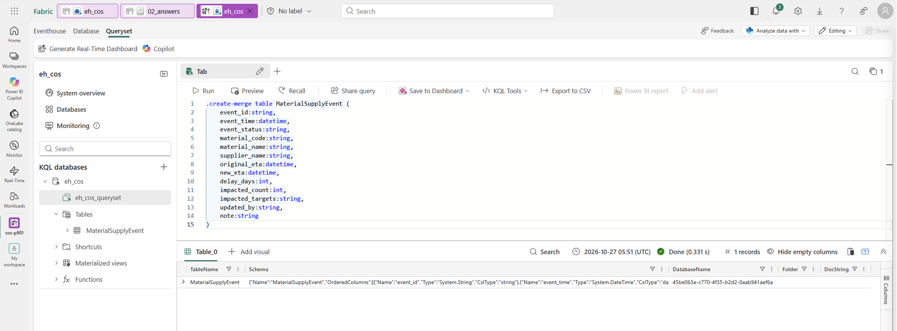

이벤트는 상태가 바뀔 때마다 **새 행으로 추가**됩니다. `open`(검토 필요) → `review_requested`(검토 요청 등록됨) 순서입니다.

아래 질의로 행 수를 확인합니다.

``` kql
MaterialSupplyEvent
| count
```

**예상 결과:** 처음 만든 `MaterialSupplyEvent` 테이블의 행은 0개입니다. 기존 테이블을 재사용했다면 이전 행은 그대로 남으며, 임의로 지우지 않습니다.

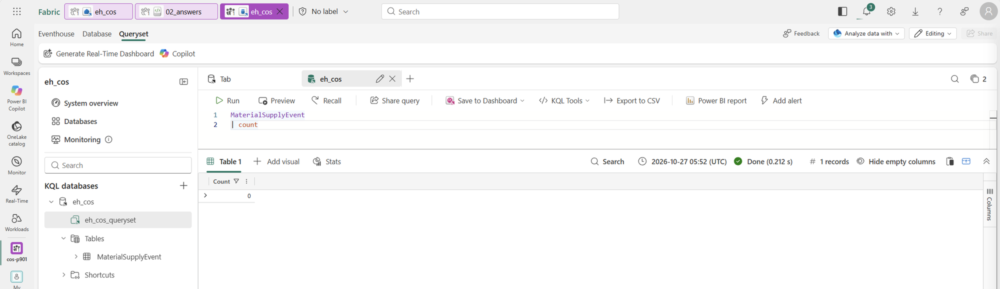

새 테이블에서는 결과 표의 `Count = 0`을 확인합니다. 화면의 `1 records`는 집계 결과 1행입니다.

## 3. 승인 후 실행할 Notebook 살펴보기

`nb_apply_review`를 열고 내 작업 영역의 `lh_cos`를 기본 Lakehouse로 연결·저장합니다([연결 절차](00-scenario.md#4-notebook에-기본-lakehouse-연결)). 코드를 읽되 **지금 실행하지 않습니다.** 세션을 직접 시작하지 않아도 됩니다.

`event_id`와 `material_code`는 승인 후 액션에서 전달하므로, 이 단계에서는 빈 값으로 둡니다. `eventhouse_name`은 기본값 `eh_cos`를 유지합니다.

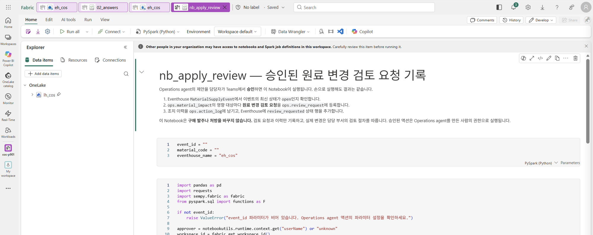

- 매개 변수 셀: `event_id`, `material_code`, `eventhouse_name`
- 최신 상태가 `open`일 때만 동작합니다. 같은 이벤트를 두 번 승인해도 중복 기록하지 않습니다.
- 하는 일: `ops.review_request`에 검토 요청 등록, `ops.action_log`에 조치 이력 기록, Eventhouse에 `review_requested` 행 추가
- 하지 않는 일: 구매 발주 변경, 처방 변경

## 4. Operations Agent 만들기

1. 작업 영역에서 **+ New item** → **Operations agent**를 고릅니다. **Name**에 `oa_cos`, **Location**에 내 작업 영역 `cos-pNNN`이 선택되어 있는지 확인하고 **Create**를 누릅니다.

   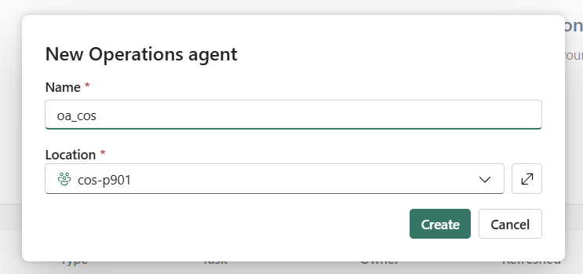

2. **Agent instructions**에 아래 영문 지침을 붙여 넣습니다. **현재 Operations Agent의 지침과 업무 목표는 영어만 지원합니다.** 영문 지침 안에서 한국어 알림 출력을 요청합니다.

``` text
Goal: Notify the responsible user when a new supply-delay event requires review.

Monitoring:
- Use the MaterialSupplyEvent table.
- Each event_id identifies a separate business object.
- For each event_id, use the row with the latest event_time.
- In the monitoring query, calculate open_flag = iff(event_status == "open", 1, 0).
- open_flag is a calculated query field, not an existing table column. Do not change the table schema.
- Create one transition rule for each event_id. Prefer open_flag crosses above 0.5, including a change from null to 1.
- Equivalent transition conditions, such as Changes to open for a text property or Becomes true for a boolean property, are acceptable.
- Detect the first open observation of a new event_id.
- Do not repeatedly notify for the same event_id while its status remains open.
- Keep non-open states in the query so they produce open_flag = 0.

Notification:
- Write notification titles, summaries, and recommended-action explanations in Korean.
- Keep event IDs, material codes, field names, and action names unchanged.
- Include material_code, material_name, supplier_name, original_eta, new_eta, delay_days, impacted_count, and impacted_targets.
- Use impacted_targets as provided. Do not invent additional impacts.

Recommended action:
- Recommend RequestMaterialReview.
- Only after human approval, run it with event_id and material_code from the detected event, and eventhouse_name set to "eh_cos".
- Do not change purchase orders or formulas.
```

`open_flag`는 `open`이면 1, 그 외에는 0인 **질의 계산 필드**입니다. 테이블에 열을 추가하지 않습니다.

3. **Knowledge** → **Add data** → **Add from OneLake catalog**에서 `eh_cos` KQL Database를 고릅니다.

> Operations Agent는 원본을 한 번에 하나만 지원합니다. Eventhouse 대신 Ontology를 선택할 수도 있지만, 이 워크숍에서는 `eh_cos`만 연결합니다.

4. **Actions** → **Add action** → **Fabric item** → **Browse**에서 `nb_apply_review`를 고릅니다.
   - **Action name:** `RequestMaterialReview`
   - **Action description:** `공급 지연 이벤트의 영향 대상에 원료 변경 검토 요청을 등록하고 조치 이력을 남긴다.`
   - **Parameters**의 **Name·Type**은 Notebook에서 불러옵니다. **Description은 직접 입력**하며, 전달할 값을 아래처럼 설명합니다.

   | 매개 변수 | Description에 입력할 내용 |
   | --- | --- |
   | `event_id` | 감지한 이벤트의 MaterialSupplyEvent.event_id를 전달한다. |
   | `material_code` | 같은 이벤트의 MaterialSupplyEvent.material_code를 전달한다. |
   | `eventhouse_name` | MaterialSupplyEvent가 저장된 Eventhouse 이름. 항상 eh_cos를 전달한다. |

   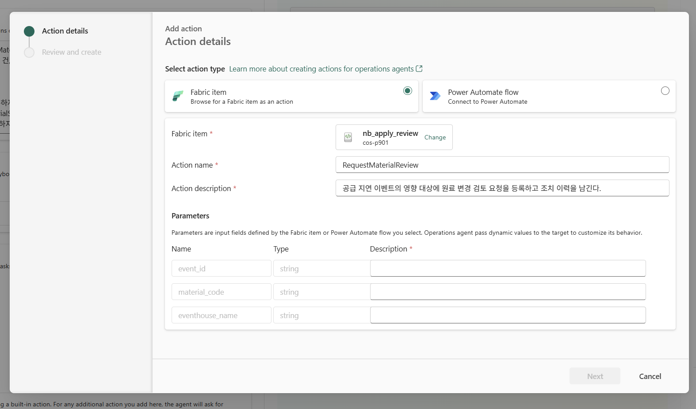

   - 세 행의 Description을 모두 입력한 뒤 **Next**를 누릅니다. **Review and create** 단계에서 내용을 확인하고 **Create**를 누릅니다.

   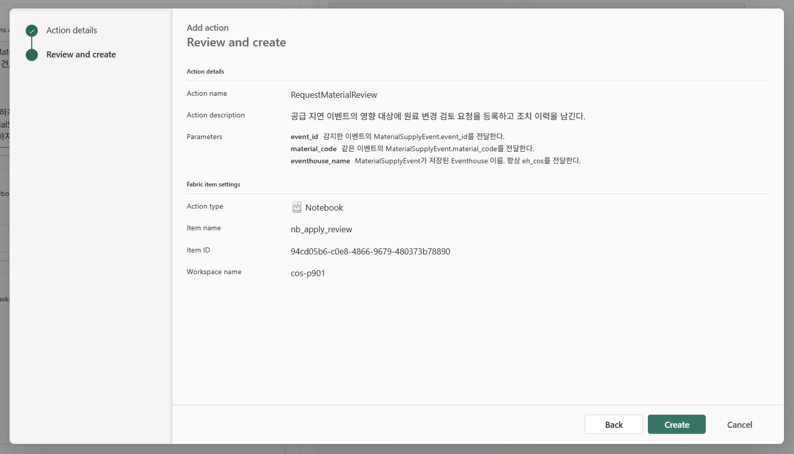

5. 저장 아이콘을 누릅니다.

**확인할 결과:** Knowledge에 `eh_cos`, Actions에 `RequestMaterialReview`와 **Action connected** 상태가 보입니다.

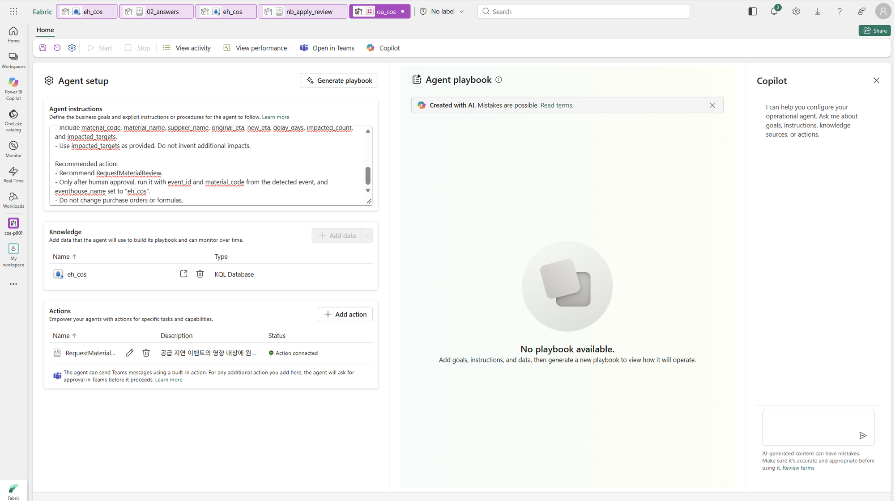

## 5. Playbook 생성과 검토

1. **Generate playbook**을 누릅니다.
2. **Business term glossary**와 **Rules**를 검토합니다.

**확인할 결과:** 용어집과 Rules에서 아래 항목을 확인합니다. **속성 이름·조건 이름이 달라도, 이벤트가 새로 `open`이 될 때 알리는 동작이면 됩니다.** `Crosses above`만 정답은 아닙니다.

| 항목 | 확인 기준 |
| --- | --- |
| 이벤트 구분·최신 행 | `event_id`별로 `event_time`이 가장 최근인 행. 생성 질의의 `summarize arg_max(event_time, *) by event_id`와 조회 시간 범위 확인 |
| 상태 표현 | 기본 예시는 `OpenFlag` 또는 `open_flag`를 `iff(event_status == "open", 1, 0)`으로 계산. 문자열·불리언 속성으로 전환을 감지하는 방식도 가능 |
| 전환 조건 | **Crosses above 0.5**, 문자열 상태의 **Changes to open**, 불리언 속성의 **Becomes true** 등 자료형에 맞는 전환 조건 사용. 새 이벤트의 첫 `open`도 감지하는지 확인(숫자형 예시는 `null → 1`) |
| 반복 알림 | **Is above**, **Is** 같은 상태 조건은 조건을 만족하는 입력마다 알릴 수 있으므로, 같은 상태가 유지될 때 재알림이 발생하는지와 반복 설정 확인 |
| 승인 액션 | `RequestMaterialReview`를 제안하고, 담당자 승인 후 해당 이벤트의 매개 변수로 실행 |

같은 `event_id`의 `open → open`(`1 → 1`)에서는 반복 알림이 없어야 합니다. 새 `event_id`의 첫 `open`이나, 같은 이벤트가 다른 상태를 거쳐 다시 `open`이 되는 것은 별도 전환입니다.

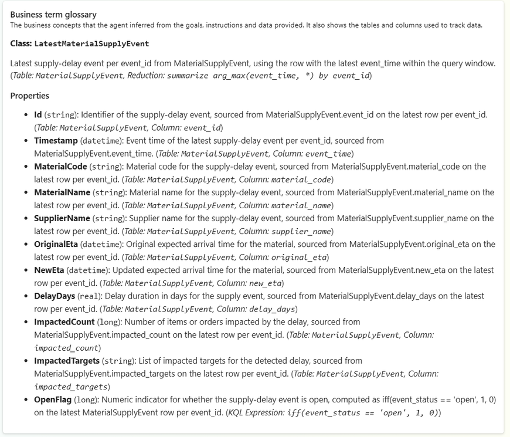

화면은 **용어집 생성 확인 예시**입니다. Rules의 조건·질의를 검토한 뒤, 실제 알림은 6–7번에서 확인합니다.

<details>
<summary>Rule 정상 예시와 다르게 생성됐을 때 수정 방법</summary>

**아래 Rule은 수정 없이 사용할 수 있는 예시**입니다. 하단 설정이 `OpenFlag / Crosses Above / 0.5`이고, 질의도 이벤트별 최신 행에서 상태를 0/1로 계산합니다.

`Changes to open`이나 `Becomes true` 등으로 생성됐어도, 자료형에 맞고 같은 이벤트의 상태 유지 중 반복 알림이 없다면 조건 이름만 맞추려고 수정할 필요는 없습니다.

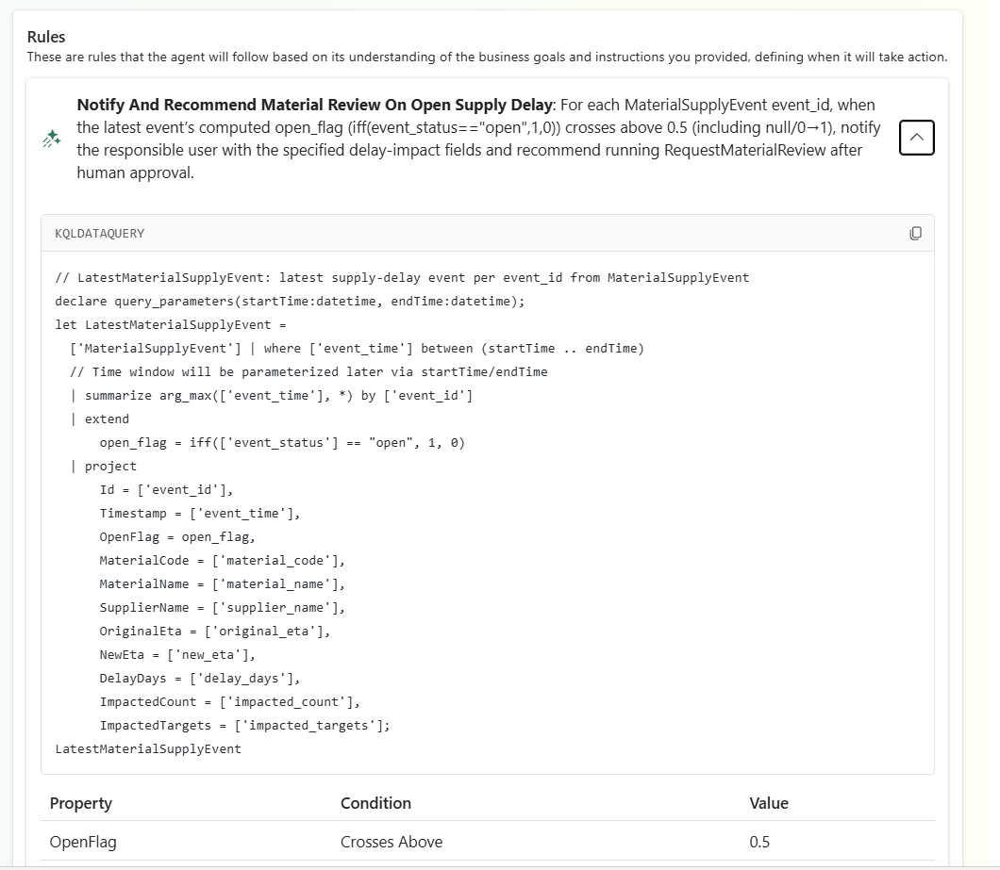

| 확인 위치 | 정상 기준 |
| --- | --- |
| 질의의 식별자·시각 | `Id = event_id`, `Timestamp = event_time` |
| 최신 행 선택 | `arg_max(event_time, *)`를 `event_id`별로 적용 |
| 상태 계산 | 숫자형 예시는 `open`이면 1, 그 외에는 0. 다른 방식도 상태 전환을 비교할 수 있도록 `open`인 행만 미리 필터링하지 않음 |
| 하단 Property / Condition / Value | 숫자형 예시는 `OpenFlag` / `Crosses Above` / `0.5`. 문자열은 `Changes to` / `open`, 불리언은 `Becomes true` 등 동등한 전환 조건도 가능 |
| Rule 설명 | Teams 알림과 검토 요청을 제안하고, 사람의 승인 후 액션 실행 |

`startTime`·`endTime`은 에이전트의 조회 시간 범위 매개 변수이므로, 표시되어 있다는 이유로 제거하지 않습니다.

**수정이 필요한 경우:** 상태 조건·반복 설정 때문에 같은 이벤트의 `open` 유지 중 재알림이 생기거나, 새 이벤트의 첫 `open`을 놓치거나, 이벤트 대신 원료별로 묶였거나, `open` 상태만 남겨 이전 상태와 비교할 수 없는 경우입니다. 상단 **Copilot**을 열고 아래 영문 보완 요청을 보냅니다.

```text
Correct the existing supply-delay rule only.
Use event_id as Id and event_time as Timestamp.
For each event_id, use the row with the latest event_time.
Use a transition condition appropriate to the property's data type; preserve an equivalent existing transition condition.
For the numeric example, compute OpenFlag as iff(event_status == "open", 1, 0) and use OpenFlag Crosses Above 0.5, including a change from null to 1.
Detect the first open observation of a new event_id.
Do not repeatedly notify for the same event_id while its status remains open.
Keep non-open states as 0 for the numeric example; do not filter the query to open events only.
Preserve the query time-window parameters and the existing notification fields.
Keep RequestMaterialReview as a recommendation requiring human approval.
Pass the detected event_id and material_code, with eventhouse_name set to "eh_cos".
Do not change the table schema or existing data.
```

수정 후 Rule을 다시 펼쳐 **질의와 하단 조건을 모두 확인**하고 저장합니다. 실제 알림 수신은 6–7번, 승인 실행은 05장에서 확인합니다.

</details>

3. 왼쪽 위 **저장 아이콘**을 누릅니다. **Configuration saved successfully** 메시지가 나오면 **Start**를 누를 수 있습니다.

   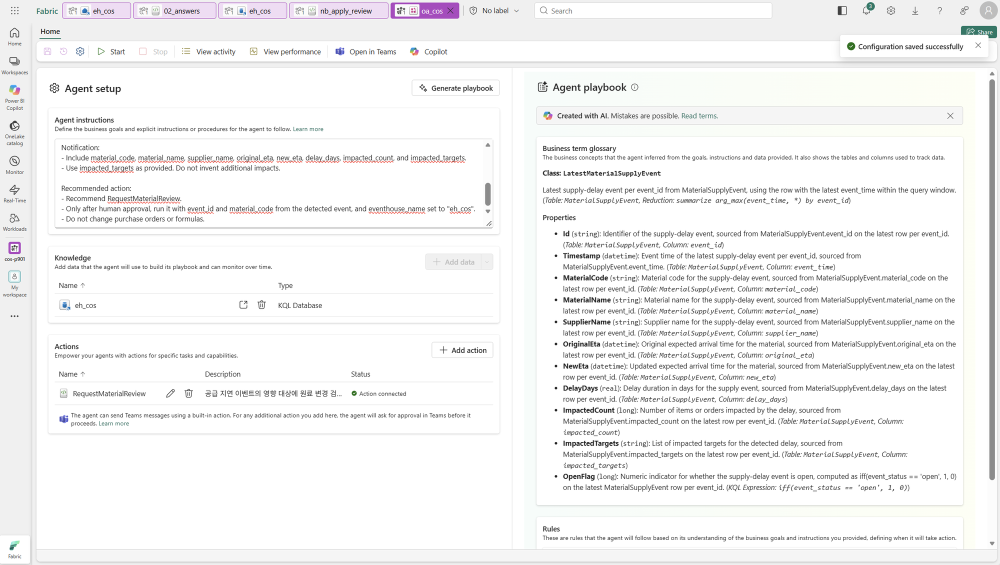

4. **Start**를 누르고 **Agent started successfully** 메시지를 확인합니다. 시작되면 **Stop** 버튼이 활성화됩니다.

   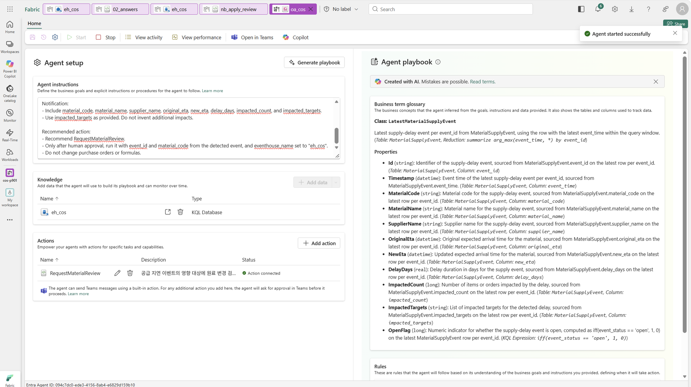

## 6. 공급 지연 발생시키기

**예상 코드 실행 시간:** 약 2–4분(세션 준비 제외). 실행 후 Teams 알림 대기는 별도입니다.

1. `03_supply_change`를 열고 내 작업 영역의 `lh_cos`를 기본 Lakehouse로 연결·저장합니다([연결 절차](00-scenario.md#4-notebook에-기본-lakehouse-연결)). 매개 변수를 확인합니다: `material_code = "RM-HA-120"`, `delay_days = 35`, `run_tag = "r1"`.

   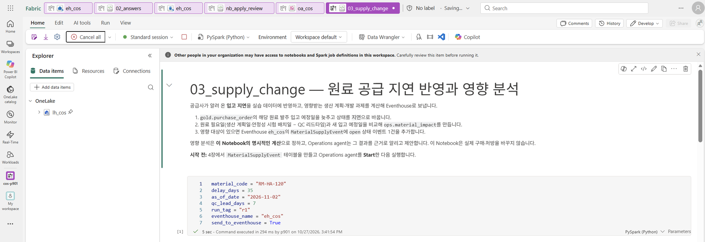

2. 세션이 연결되어 있지 않다면 **Connect**로 시작하고, 연결 완료 후 **Run all**을 누릅니다.

**예상 출력**(기본 매개 변수·첫 이벤트 기준, Notebook의 1–3번 구간 순서):

- **1. 공급 지연 반영:** `PO-5501 RM-HA-120 2026-11-10 → 2026-12-15 (지연 35일)`
- **2. 영향 분석:** `ops.material_impact` 4행 중 `impacted = true` 3행 — `PP-1101`(-27일), `PP-1102`(-20일), `ST-0711`(-32일). `PP-1103`은 여유 29일. 표 아래에 `SUP-20261102-RM-HA-120-r1: 영향 3건` 출력.
- **3. Eventhouse로 보내기:** `SUP-20261102-RM-HA-120-r1: MaterialSupplyEvent에 open 추가`와 이벤트 조회 표 1행.

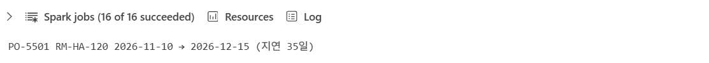

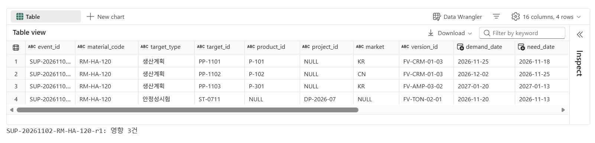

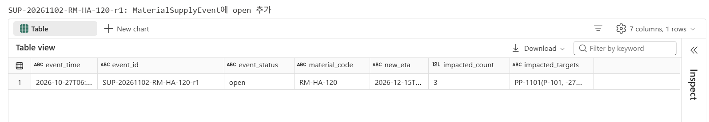

`eh_cos`에서도 KQL로 확인합니다. 아직 승인하지 않았으므로 첫 이벤트의 `event_status = open`, `impacted_count = 3`입니다.

``` kql
MaterialSupplyEvent
| project event_time, event_id, event_status, impacted_count, impacted_targets
| order by event_time asc
```

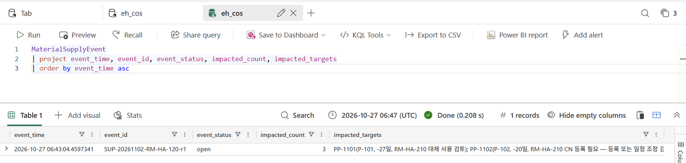

## 7. Teams 알림 받기

5–10분 안에 Teams의 **Fabric Operations Agent** 채팅에 메시지가 옵니다. **Show details**로 근거를 펼쳐 봅니다.

메시지가 이미 도착했다면 **앱을 수동으로 추가할 필요는 없습니다.**

**확인할 결과:** 알림의 `RM-HA-120`과 `RequestMaterialReview` 제안, 상세 화면의 `Id`와 숫자형 상태 값 1(`OpenFlag`, `OpenFlagValue` 등)을 확인합니다. 지연 35일·영향 3건과 대상별 제안은 6번의 KQL 결과와 대조합니다. **아직 Proceed를 누르지 않습니다** — 다음 장에서 함께 승인합니다.

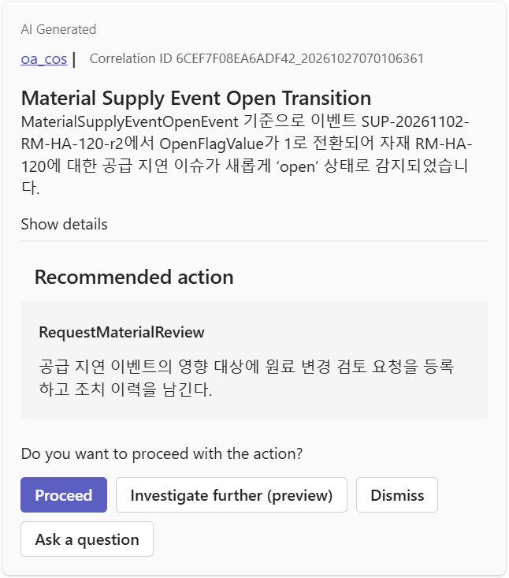

<details>
<summary>Show details — 이벤트·규칙 상세 화면</summary>

스크린샷은 `run_tag = "r2"`로 재실행한 예시입니다. 내 Notebook의 `run_tag`와 알림의 `Id`를 맞춰 봅니다.

`Data Source`가 `eh_cos`인지도 확인합니다. 이 예시의 상세 화면에는 지연 일수·영향 건수가 표시되지 않습니다.

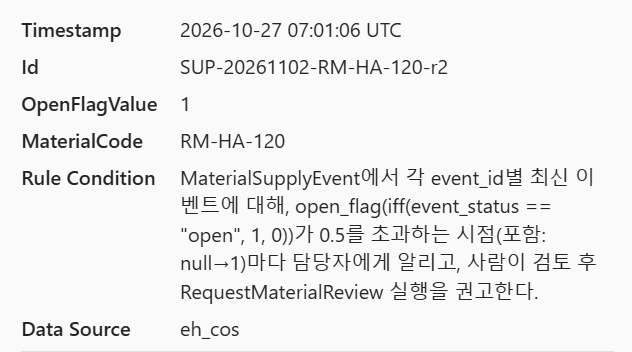

</details>

4번 지침으로 **알림 본문과 규칙 설명이 한국어로 생성된 결과**입니다. 제목·기본 레이블·버튼은 영어로 남을 수 있습니다.

## 이 장의 완료 기준

- Eventhouse와 기본 KQL Database `eh_cos`를 직접 생성하고 `MaterialSupplyEvent` 테이블을 만들었습니다. 기존 항목을 재사용했다면 해당 범위를 구분합니다.
- `oa_cos`가 시작(Start) 상태이고 Knowledge·Action·Playbook이 구성되어 있습니다.
- Eventhouse에 `open` 이벤트가 있고 Teams 제안 메시지를 받았습니다.

## Troubleshooting

- `No playbook generated`와 `numeric-style condition` 오류가 나오면 4번의 영문 지침으로 다시 생성하고, 숫자형 `OpenFlag`와 전환 조건을 확인합니다.
- 메시지가 오지 않으면 `oa_cos`의 **View activity**에서 규칙 실행 기록을 봅니다. 규칙이 실행되지 않았으면 **Start** 상태인지, 실행됐는데 조건이 안 맞았으면 Playbook 규칙 조건을 확인합니다.
- `03_supply_change`가 "이미 보낸 이벤트"라고 하면 `run_tag`를 `r2`처럼 바꿔 다시 실행합니다. 지연 일수는 원래 ETA 기준으로 계산하므로 다시 실행해도 누적되지 않습니다.
- "MaterialSupplyEvent 테이블이 없다"는 오류가 나면 2단계를 먼저 실행합니다.
- Action에 매개변수가 보이지 않으면 `nb_apply_review`의 첫 셀을 **Toggle parameter cell**로 지정하고 저장합니다.
- `original_eta`가 없다는 오류는 이전 준비 코드로 만든 테이블일 수 있습니다. 최신 00장과 스키마를 확인하고, 진행 중인 실습을 임의로 초기화하지 않습니다.
- **New item에 Eventhouse가 없거나 생성이 거부되면** 내 작업 영역·용량·Contributor 이상 권한과 항목 생성 설정을 관리자와 확인합니다.
- Eventhouse를 찾지 못하면 현재 작업 영역과 `eventhouse_name` 매개 변수를 확인합니다. Eventhouse는 찾지만 데이터베이스 오류가 나면 기본 KQL Database 이름도 `eh_cos`인지 확인합니다.
- Teams 앱이 없거나 메시지를 받을 수 없으면 앱 사용 권한과 Fabric·Teams 로그인 계정을 관리자와 확인합니다.

## 공식 문서

- [Eventhouse 만들기·기본 KQL Database 자동 생성](https://learn.microsoft.com/en-us/fabric/real-time-intelligence/create-eventhouse)
- [Operations agent 만들기와 구성](https://learn.microsoft.com/en-us/fabric/real-time-intelligence/operations-agent)
- [Operations agent 제한사항 — 지침·업무 목표의 영어 지원](https://learn.microsoft.com/en-us/fabric/real-time-intelligence/operations-agent-limitations#language-and-model-behavior-limitations)
- [Activator 감지 조건 — 전환 조건·상태 조건·반복 평가의 차이](https://learn.microsoft.com/en-us/fabric/real-time-intelligence/data-activator/activator-detection-conditions#conditions)
- [Operations agent 작업(Actions)](https://learn.microsoft.com/en-us/fabric/real-time-intelligence/operations-agent-actions)

## 다음 단계

[05. 승인 후 조치](05-approval.md)에서 Teams 제안을 승인하고 기록을 확인합니다.
