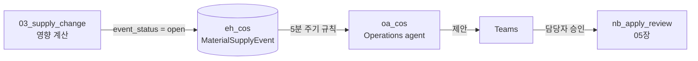

# 04. Operations Agent — 감시하고 먼저 알리기

[목차](../README.md) \| 이전: [03. Data Agent](03-data-agent.md) \| 다음: [05. 승인 후 조치](05-approval.md)

Data Agent는 사람이 물어야 답합니다. **Operations Agent**는 정해진 조건을 주기적으로 감시하다가, 조건이 맞으면 **Teams로 먼저 알리고 대응을 제안**합니다. 이 장에서는 목표를 좁게 잡습니다.

> **"공급 지연 상태가 된 원료를 감지하고, 검토가 필요한 대상을 알린다."**

영향 계산(필요일·여유일·대체 원료 판정)은 `03_supply_change` Notebook이 명시적으로 하고, 에이전트는 그 결과를 근거로 제안만 합니다.



## 시작 전 확인

- **유료 Fabric 용량**(F SKU)이 필요합니다. Operations agent는 Trial 용량을 지원하지 않습니다.
- 내 작업 영역 `cos-pNNN`에 **Contributor 이상** 권한이 있고 Fabric 항목을 생성할 수 있어야 합니다. `eh_cos`는 이 장에서 직접 만듭니다.
- 테넌트에서 Operations agent, Copilot·Azure OpenAI, (필요 시) 지역 간 처리 설정이 켜져 있어야 합니다(관리자 준비 사항).
- Teams에 **Fabric Operations Agent** 앱이 설치되어 있어야 메시지를 받을 수 있습니다.
- 규칙 질의는 **5분 주기**로 실행됩니다. 알림까지 수 분이 걸리는 것이 정상입니다.

## 1. Eventhouse 만들기

1. 내 작업 영역 `cos-pNNN`에서 **+ New item**을 누릅니다.
2. 검색 칸에 `Eventhouse`를 입력하고 **Eventhouse**를 선택합니다.
3. 이름을 `eh_cos`로 입력하고 **Create**를 누릅니다.
4. Eventhouse의 **System overview**가 열리면 왼쪽 **KQL Databases**에서 `eh_cos`를 선택합니다.

**확인할 결과:** Eventhouse와 **같은 이름의 기본 KQL Database가 자동 생성**됩니다. `eh_cos` KQL Database가 열리고 처음 만든 데이터베이스에는 아직 테이블이 없습니다. 별도의 KQL Database를 추가로 만들 필요는 없습니다.

**이름 확인:** 뒤의 Notebook은 같은 작업 영역에서 Eventhouse를 찾고, `eventhouse_name`을 KQL Database 이름으로도 사용합니다. **Eventhouse와 기본 KQL Database 이름을 모두 `eh_cos`로 유지**합니다.

이미 `eh_cos`가 있다면 중복 생성하거나 삭제하지 말고 기존 KQL Database와 테이블을 확인합니다. 이전 실습 이력은 보존하며, 반복 실행할 때는 6단계의 `run_tag`를 새 값으로 바꿉니다.

## 2. 이벤트 테이블 만들기

`eh_cos` KQL Database에서 **Explore your data**(또는 KQL queryset)를 열고, 실행할 데이터베이스가 `eh_cos`인지 확인한 뒤 아래 명령을 실행합니다.

``` kql
.create-merge table MaterialSupplyEvent (
    event_id:string,
    event_time:datetime,
    event_status:string,
    material_code:string,
    material_name:string,
    supplier_name:string,
    original_eta:datetime,
    new_eta:datetime,
    delay_days:int,
    impacted_count:int,
    impacted_targets:string,
    updated_by:string,
    note:string
)
```

이벤트는 상태가 바뀔 때마다 **새 행으로 추가**됩니다. `open`(검토 필요) → `review_requested`(검토 요청 등록됨) 순서입니다.

아래 질의로 행 수를 확인합니다.

``` kql
MaterialSupplyEvent
| count
```

**예상 결과:** 처음 만든 `MaterialSupplyEvent` 테이블의 행은 0개입니다. 기존 테이블을 재사용했다면 이전 행은 그대로 남으며, 임의로 지우지 않습니다.

## 3. 승인 후 실행할 Notebook 살펴보기

`nb_apply_review`를 열고 내 작업 영역의 `lh_cos`를 기본 Lakehouse로 연결·저장합니다([연결 절차](00-scenario.md#4-notebook에-기본-lakehouse-연결)). 코드를 읽되 **지금 실행하지 않습니다.** 세션을 직접 시작하지 않아도 됩니다.

- 매개 변수 셀: `event_id`, `material_code`, `eventhouse_name`
- 최신 상태가 `open`일 때만 동작합니다. 같은 이벤트를 두 번 승인해도 중복 기록하지 않습니다.
- 하는 일: `ops.review_request`에 검토 요청 등록, `ops.action_log`에 조치 이력 기록, Eventhouse에 `review_requested` 행 추가
- 하지 않는 일: 구매 발주 변경, 처방 변경

## 4. Operations Agent 만들기

1. 작업 영역에서 **+ New item** → **Operations agent**를 고르고 이름을 `oa_cos`로 만듭니다.
2. **Agent instructions**에 아래 지침을 붙여 넣습니다. 열은 `Table.column` 형식으로 적어야 규칙이 정확히 만들어집니다.

``` text
목표: 원료 공급 지연으로 생산 계획이나 안정성 시험 일정에 영향이 생기면 담당자에게 먼저 알리고 검토 요청을 제안한다.

감시 대상
- MaterialSupplyEvent.event_status 가 'open' 으로 바뀌면(becomes) 공급 지연 이벤트가 새로 발생한 것이다.
- 같은 MaterialSupplyEvent.event_id 의 최신 행만 본다.

알릴 내용
- MaterialSupplyEvent.material_code, MaterialSupplyEvent.material_name, MaterialSupplyEvent.supplier_name
- MaterialSupplyEvent.original_eta → MaterialSupplyEvent.new_eta (MaterialSupplyEvent.delay_days 일 지연)
- MaterialSupplyEvent.impacted_count 건, 대상 목록은 MaterialSupplyEvent.impacted_targets 를 그대로 보여 준다.

제안
- 영향 대상에 원료 변경 검토 요청을 등록하자고 제안한다. 승인되면 RequestMaterialReview 작업을 MaterialSupplyEvent.event_id 와 MaterialSupplyEvent.material_code 로 실행한다.
- 구매 발주나 처방을 직접 바꾸라고 제안하지 않는다. 대체 원료는 impacted_targets 의 제안 문구만 전달한다.
```

3. **Knowledge** → **Add data** → **Add from OneLake catalog**에서 `eh_cos` KQL Database를 고릅니다.

> 테넌트에서 Ontology를 Operations agent 원본으로 쓸 수 있다면 `ont_cos`를 추가해 볼 수 있습니다. 이 워크숍의 기본 경로는 상태 변화를 감지하기 쉬운 Eventhouse입니다.

4. **Actions** → **Add action** → **Fabric item** → **Browse**에서 `nb_apply_review`를 고릅니다.
   - **Action name:** `RequestMaterialReview`
   - **Action description:** `공급 지연 이벤트의 영향 대상에 원료 변경 검토 요청을 등록하고 조치 이력을 남긴다.`
   - 매개 변수(`event_id`, `material_code`, `eventhouse_name`)는 Notebook 매개 변수 셀에서 자동으로 채워집니다. `eventhouse_name`은 기본값 `eh_cos`를 그대로 둡니다.
   - **Review and create**를 누릅니다.
5. 저장 아이콘을 누릅니다.

**확인할 결과:** Knowledge에 `eh_cos`, Actions에 `RequestMaterialReview`가 보입니다.

## 5. Playbook 생성과 검토

1. **Generate playbook**을 누릅니다.
2. **Business term glossary**와 **Rules**를 검토합니다.

**확인할 결과:** 규칙 조건이 `event_status`가 `open`으로 **바뀔 때**(Becomes / Changes to)로 만들어졌는지 확인합니다. 조건이 `Is open`이면 같은 이벤트로 5분마다 알림이 반복될 수 있으므로 지침 문장을 고쳐 다시 생성합니다. 규칙 작업에 `RequestMaterialReview`가 연결되어 있는지도 확인합니다.

3. 저장한 뒤 **Start**를 누릅니다.

## 6. 공급 지연 발생시키기

**예상 코드 실행 시간:** 약 2–4분(세션 준비 제외). 실행 후 Teams 알림 대기는 별도입니다.

1. `03_supply_change`를 열고 내 작업 영역의 `lh_cos`를 기본 Lakehouse로 연결·저장합니다([연결 절차](00-scenario.md#4-notebook에-기본-lakehouse-연결)). 매개 변수를 확인합니다: `material_code = "RM-HA-120"`, `delay_days = 35`, `run_tag = "r1"`.
2. 세션이 연결되어 있지 않다면 **Connect**로 시작하고, 연결 완료 후 **Run all**을 누릅니다.

**예상 출력**(기본 매개 변수·첫 이벤트 기준):

- `PO-5501 RM-HA-120 2026-11-10 → 2026-12-15 (지연 35일)`
- `ops.material_impact` 4행 중 `impacted = true` 3행 — `PP-1101`(-27일), `PP-1102`(-20일), `ST-0711`(-32일). `PP-1103`은 여유 29일.
- `SUP-20261102-RM-HA-120-r1: 영향 3건`
- `SUP-20261102-RM-HA-120-r1: MaterialSupplyEvent에 open 추가`와 이벤트 조회 표 1행

`eh_cos`에서도 KQL로 확인합니다. 아직 승인하지 않았으므로 첫 이벤트의 `event_status = open`, `impacted_count = 3`입니다.

``` kql
MaterialSupplyEvent
| project event_time, event_id, event_status, impacted_count, impacted_targets
| order by event_time asc
```

## 7. Teams 알림 받기

5–10분 안에 Teams의 **Fabric Operations Agent** 채팅에 메시지가 옵니다. **Show details**로 근거를 펼쳐 봅니다.

**확인할 결과:** 메시지에 `RM-HA-120`, 지연 35일, 영향 3건과 대상별 제안(`PP-1102`는 `RM-HA-210 CN 등록 필요`)이 들어 있습니다. **아직 Proceed를 누르지 않습니다** — 다음 장에서 함께 승인합니다.

## 이 장의 완료 기준

- Eventhouse와 기본 KQL Database `eh_cos`를 직접 생성하고 `MaterialSupplyEvent` 테이블을 만들었습니다. 기존 항목을 재사용했다면 해당 범위를 구분합니다.
- `oa_cos`가 시작(Start) 상태이고 Knowledge·Action·Playbook이 구성되어 있습니다.
- Eventhouse에 `open` 이벤트가 있고 Teams 제안 메시지를 받았습니다.

## Troubleshooting

- 메시지가 오지 않으면 `oa_cos`의 **View activity**에서 규칙 실행 기록을 봅니다. 규칙이 실행되지 않았으면 **Start** 상태인지, 실행됐는데 조건이 안 맞았으면 Playbook 규칙 조건을 확인합니다.
- `03_supply_change`가 "이미 보낸 이벤트"라고 하면 `run_tag`를 `r2`처럼 바꿔 다시 실행합니다. 지연 일수는 원래 ETA 기준으로 계산하므로 다시 실행해도 누적되지 않습니다.
- "MaterialSupplyEvent 테이블이 없다"는 오류가 나면 2단계를 먼저 실행합니다.
- Action에 매개변수가 보이지 않으면 `nb_apply_review`의 첫 셀을 **Toggle parameter cell**로 지정하고 저장합니다.
- `original_eta`가 없다는 오류는 이전 준비 코드로 만든 테이블일 수 있습니다. 최신 00장과 스키마를 확인하고, 진행 중인 실습을 임의로 초기화하지 않습니다.
- **New item에 Eventhouse가 없거나 생성이 거부되면** 내 작업 영역·용량·Contributor 이상 권한과 항목 생성 설정을 관리자와 확인합니다.
- Eventhouse를 찾지 못하면 현재 작업 영역과 `eventhouse_name` 매개 변수를 확인합니다. Eventhouse는 찾지만 데이터베이스 오류가 나면 기본 KQL Database 이름도 `eh_cos`인지 확인합니다.
- Teams 앱이 없거나 메시지를 받을 수 없으면 앱 사용 권한과 Fabric·Teams 로그인 계정을 관리자와 확인합니다.

## 공식 문서

- [Eventhouse 만들기·기본 KQL Database 자동 생성](https://learn.microsoft.com/en-us/fabric/real-time-intelligence/create-eventhouse)
- [Operations agent 만들기와 구성](https://learn.microsoft.com/en-us/fabric/real-time-intelligence/operations-agent)
- [Operations agent 작업(Actions)](https://learn.microsoft.com/en-us/fabric/real-time-intelligence/operations-agent-actions)

## 다음 단계

[05. 승인 후 조치](05-approval.md)에서 Teams 제안을 승인하고 기록을 확인합니다.
