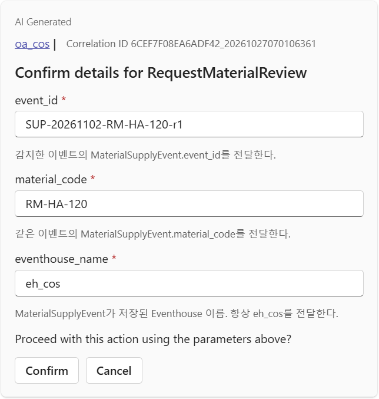
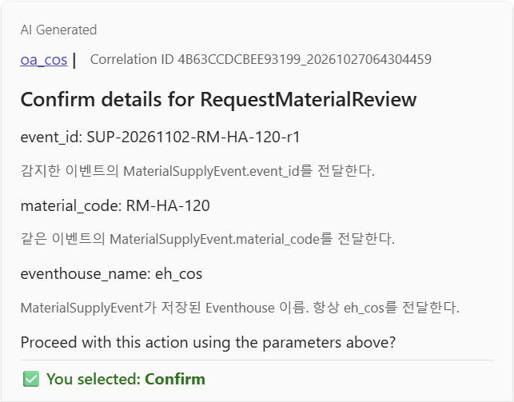
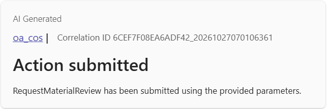
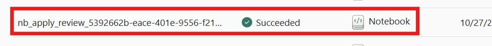
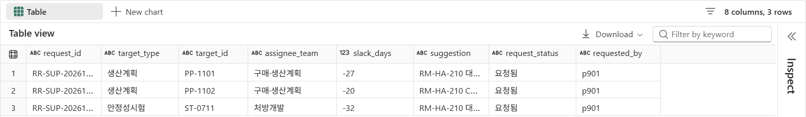
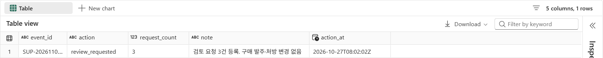
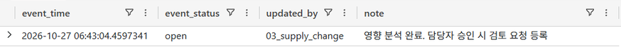

# 05. 승인 후 조치 — 검토 요청 기록

[목차](../README.md) \| 이전: [04. Operations Agent](04-operations-agent.md) \| 다음: [06. SQL Serving DB](06-serving-db.md)

알림을 승인된 기록으로 연결하는 장면입니다. 다음 장에서는 이 결과를 업무용 DB로 제공합니다.

> **공급 지연 반영 → 감시 조건 충족 → Teams 제안 → 담당자 승인 → 검토 요청 기록**

담당자가 Teams에서 승인하면 Operations agent가 `nb_apply_review`를 실행해 **영향 대상마다 원료 변경 검토 요청을 등록하고 조치 이력을 남깁니다.** 단순 알림을 넘어 업무로 이어지지만, AI가 구매 발주나 처방을 임의로 바꾸지는 않습니다.

## 시작 전 확인

- 4장에서 Teams 제안 메시지를 받았고 아직 승인하지 않았습니다.
- 4장에서 `nb_apply_review`의 기본 Lakehouse를 내 작업 영역의 `lh_cos`로 연결·저장했습니다.
- 내 작업 영역의 `oa_cos`에서 제안한 작업을 승인합니다. 승인된 작업은 **Operations agent를 만든 사람의 권한**으로 실행되며, 승인자 권한으로 바뀌는 것은 아닙니다.

## 1. Teams에서 승인

1. Teams의 **Fabric Operations Agent** 채팅에서 4장의 메시지를 엽니다.
2. **Proceed**를 누르면 "Confirm details for RequestMaterialReview" 창이 열립니다.
3. 매개 변수를 확인합니다. `event_id`는 **승인하려는 알림의 Id와 같은 값**이어야 합니다. `material_code = RM-HA-120`, `eventhouse_name = eh_cos`도 확인합니다.

   

4. **Confirm**을 누릅니다.

   

**확인할 결과:** **Action submitted** 메시지가 옵니다. 제출 완료이며, 실행 성공은 다음 단계에서 확인합니다.



## 2. 실행 확인

Fabric 왼쪽 메뉴의 **Monitor** → **Activities**에서 `nb_apply_review` 실행을 찾습니다.

**예상 코드 실행 시간:** 약 1–3분(세션 준비 제외). 승인 액션은 세션을 자동으로 준비하므로 제출 후 완료까지는 더 걸릴 수 있습니다. 직접 **Connect**나 **Run all**을 누르지 않고 Monitor에서 확인합니다.

**확인할 결과:** 상태가 **Succeeded**입니다.



Monitor의 **Jobs**는 Spark 작업 목록이고, **Item snapshots**는 실행 당시 코드·매개 변수 확인용입니다. 실제 기록은 아래 조회로 확인합니다.

## 3. 기록 확인

### 3-1. `02_answers` Notebook — 새 코드 셀 2개 추가

**실행 위치: `02_answers` Notebook**입니다. `lh_cos`가 기본 Lakehouse로 연결된 `02_answers`를 열고, 맨 아래에 **새 코드 셀 2개**를 추가합니다. 아래 두 조회를 **각 셀에 하나씩 붙여 넣고, 새로 만든 두 셀만 각각 실행**합니다. **Run all은 누르지 않습니다.** 세션 준비 시간이 추가될 수 있습니다. 기록 확인을 위해 `nb_apply_review`를 다시 실행하지 않습니다.

**첫 번째 새 코드 셀 — 검토 요청 조회**

```sql
%%sql
SELECT request_id, target_type, target_id, assignee_team, slack_days, suggestion, request_status, requested_by
FROM ops.review_request
WHERE event_id = 'SUP-20261102-RM-HA-120-r1'
ORDER BY target_id;
```

**조회 예상 출력:** 승인한 이벤트의 검토 요청 3행



| target_id | target_type | assignee_team | slack_days | suggestion |
|---|---|---|---|---|
| `PP-1101` | 생산계획 | 구매·생산계획 | -27 | RM-HA-210 대체 사용 검토 |
| `PP-1102` | 생산계획 | 구매·생산계획 | -20 | RM-HA-210 CN 등록 필요 — 등록 또는 일정 조정 검토 |
| `ST-0711` | 안정성시험 | 처방개발 | -32 | RM-HA-210 대체 사용 검토 |

`request_status`는 모두 `요청됨`입니다. `requested_by`는 Notebook 실행 컨텍스트의 사용자이며, Teams에서 승인한 사람을 증명하는 필드가 아닙니다. 실제 운영의 승인자 감사는 별도의 승인 기록과 연결해야 합니다.

**두 번째 새 코드 셀 — 조치 이력 조회**

```sql
%%sql
SELECT event_id, action, request_count, note, action_at
FROM ops.action_log
WHERE event_id = 'SUP-20261102-RM-HA-120-r1'
ORDER BY action_at;
```

**예상 결과:** `review_requested` 1행, `request_count = 3`, note `검토 요청 3건 등록. 구매 발주·처방 변경 없음`.



### 3-2. `eh_cos` Eventhouse — KQL로 상태 이력 확인

**여기부터는 Notebook이 아니라 `eh_cos`에서 실행합니다.** 작업 영역의 **Eventhouse `eh_cos`**를 열고, 왼쪽의 **KQL Database `eh_cos` → `eh_cos_queryset`**을 선택합니다. 아래 KQL을 붙여 넣고 **Run**을 누릅니다.

``` kql
MaterialSupplyEvent
| where event_id == 'SUP-20261102-RM-HA-120-r1'
| project event_time, event_status, updated_by, note
| order by event_time asc
```

**예상 결과:** `open` → `review_requested` 2행.

아래 화면은 `open` 1행만 조회된 예시입니다. 이 경우 승인한 알림의 `Id`와 조회의 `event_id`가 같은지 확인합니다.



## 4. 중복 승인 확인 (선택)

같은 메시지에서 다시 **Proceed** → **Confirm**하거나 `nb_apply_review`를 같은 `event_id`로 손으로 실행합니다.

**확인할 결과:** "최신 상태 review_requested"가 출력되고 `ops.review_request`의 해당 이벤트 기록은 여전히 3행입니다. 승인 작업은 **여러 번 실행돼도 결과가 같도록** 만들어야 합니다.

> **토론 포인트:** 이 Notebook이 한 일은 "검토 요청 등록"과 "이력 기록"뿐입니다. 실제 대체 원료 전환, 발주 변경, CN 등록 착수는 각 부서의 검토 절차를 따릅니다. 업무에 적용할 때 에이전트에게 맡길 범위와 사람의 승인이 필요한 범위를 구분합니다.

## 이 장의 완료 기준

- Teams 승인 후 `nb_apply_review`가 Succeeded입니다.
- 승인한 `event_id` 기준으로 `ops.review_request` 3행, `ops.action_log` 1행, Eventhouse 상태 이력 2행을 확인했습니다.

## Troubleshooting

- **Proceed** 후 실패하면 **Monitor**에서 오류를 봅니다. `event_id 파라미터가 비어 있습니다`이면 Action 매개 변수 연결을, Eventhouse 오류이면 `eventhouse_name`을 확인합니다.
- `ops.material_impact`에 영향 대상이 없다는 오류는 `03_supply_change`를 실행하지 않았거나 `run_tag`가 다른 경우입니다.
- 권한 오류는 승인 작업이 에이전트 작성자 권한으로 실행되기 때문입니다. 작성자가 `lh_cos`·`eh_cos`에 쓰기 권한이 있는지 확인합니다.
- Teams 승인이 어려운 환경이면 담당자 승인 후 `nb_apply_review`의 매개 변수 셀에 `event_id`를 넣고, **Connect**로 세션을 시작해 연결 완료 후 **Run all**합니다. 이 경로는 Teams 승인 액션 실행과 구분해 기록합니다.

## 공식 문서

- [Operations agent 작업(Actions)과 승인](https://learn.microsoft.com/en-us/fabric/real-time-intelligence/operations-agent-actions)
- [Monitor 허브](https://learn.microsoft.com/en-us/fabric/admin/monitoring-hub)
- [Spark 실행 상세 — Jobs와 Item snapshots](https://learn.microsoft.com/en-us/fabric/data-engineering/spark-detail-monitoring)

## 다음 단계

[06. SQL Serving DB](06-serving-db.md)에서 승인된 요청을 담당자용 조회·상태 관리로 연결합니다.
