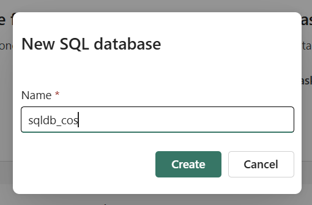
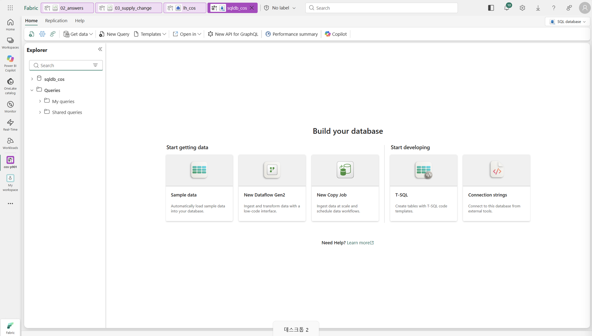
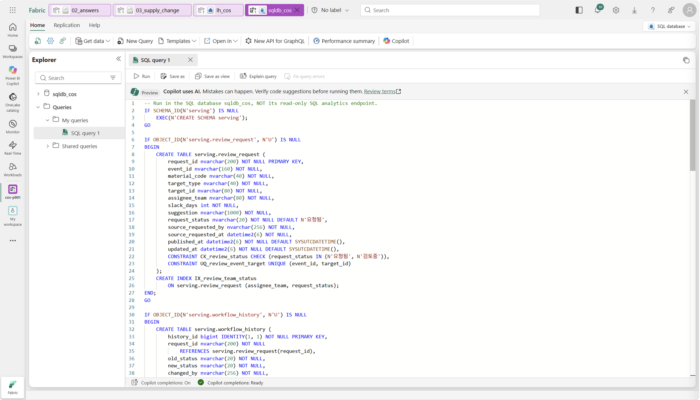
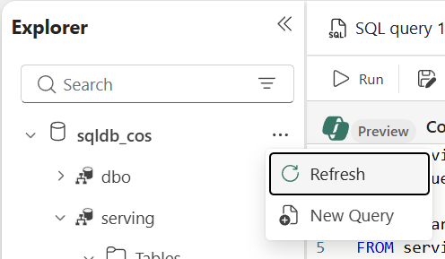
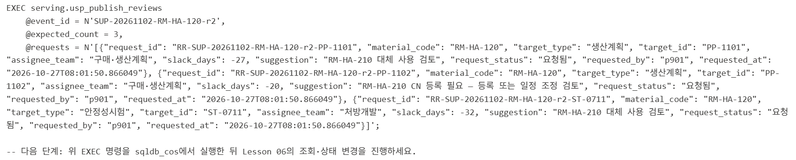
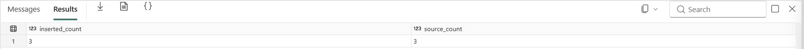
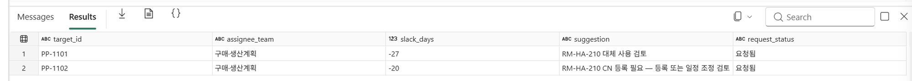
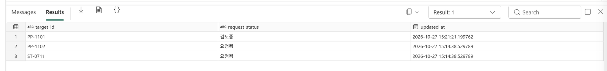
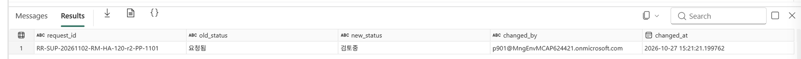

# 06. SQL Serving DB — 분석 결과를 업무로 제공

[목차](../README.md) \| 이전: [05. 승인과 조치 기록](05-approval.md) \| 다음: [07. Purview 거버넌스](07-purview.md)

이 장에서는 **SQL database in Fabric**에 승인된 검토 요청을 게시하고 **담당 팀별 조회 → 검토 착수 → 상태 이력**을 처리합니다.

| 계층 | 항목 | 담당하는 상태 |
|---|---|---|
| 분석·승인 사실 | `lh_cos`의 `ops` | 영향 계산, 승인 후 등록된 요청·조치의 스냅샷 |
| 이벤트 감시 | `eh_cos` | `open` → `review_requested` |
| 업무 Serving | `sqldb_cos`의 `serving` | 담당 팀별 요청 목록과 `요청됨` → `검토중` |

검토 요청·담당 팀·상태·이력을 키·제약 조건·트랜잭션으로 일관되게 관리할 수 있도록 SQL DB를 선정했습니다.

## 시작 전 확인

- 05장에서 `nb_apply_review`가 성공했고 현재 이벤트의 요청 3건이 있습니다.
- 내 실습 작업 영역의 기본 권한은 **Contributor**입니다. SQL DB 생성과 SQL 실행 가능 여부를 이 권한으로 사전 확인한 환경에서 진행합니다.
- **SQL database** 항목 `sqldb_cos`와 Serving 스키마는 이 장에서 직접 만듭니다. **Lakehouse의 SQL analytics endpoint와 다릅니다.**

## 1. SQL database 만들기

1. 내 작업 영역 `cos-pNNN`에서 **+ New item**을 누릅니다.
2. `SQL database`를 검색해 선택합니다.
3. 이름을 `sqldb_cos`로 입력하고 **Create**를 누릅니다.

   

4. 생성이 끝나고 DB의 **Home**과 **Explorer**가 열릴 때까지 기다립니다.
5. 화면 오른쪽 위 메뉴에 **SQL database**가 표시되는지 확인합니다. **SQL analytics endpoint**로 표시된다면 해당 메뉴를 눌러 **SQL database**로 전환합니다.

   

6. 화면 위쪽 도구 모음에서 **New Query**를 누릅니다. SQL을 입력할 수 있는 빈 쿼리 편집기가 열립니다.

**확인할 결과:** 본인 작업 영역에 `sqldb_cos`가 생기고 쿼리 편집기를 열 수 있습니다. 생성 직후에는 테이블과 프로시저 목록이 비어 있습니다.

이미 `sqldb_cos`가 있다면 중복 생성하거나 삭제하지 않고 기존 항목을 엽니다. 아래 예상 결과는 첫 실행 기준이며, 반복 실습은 기존 이력을 보존하고 05장에서 승인한 새 이벤트를 사용합니다.

## 2. Serving 스키마 만들기

1. [serving.sql](../fabric/sql/serving.sql)의 전체 내용을 복사해 쿼리 편집기에 붙여 넣고 **Run**을 누릅니다(`GO` 포함).

   

2. 실행이 끝나면 왼쪽 **Explorer**에서 `sqldb_cos` 옆 **… → Refresh**를 누릅니다.

   

3. `sqldb_cos` → `serving`을 펼친 뒤 **Tables**와 **Stored Procedures**에서 다음 객체를 확인합니다.

| 객체 | 용도 |
|---|---|
| `serving.review_request` | 요청 ID 기본 키, 이벤트·대상 유일 키, 담당 팀·상태 조회 인덱스 |
| `serving.workflow_history` | 상태 변경 전후, 실제 SQL 로그인, UTC 시간 |
| `serving.usp_publish_reviews` | 승인 결과를 신규 요청만 추가하는 방식으로 게시 |
| `serving.usp_start_review` | 요청 상태를 확인하고 상태 변경·이력을 한 트랜잭션으로 기록 |

**확인할 결과:** 테이블 2개·프로시저 2개가 있고 첫 실행에서는 테이블이 비어 있습니다. 스키마 스크립트 재실행은 기존 데이터를 지우지 않습니다.

## 3. 승인 결과 게시

**예상 코드 실행 시간:** 약 1–2분(세션 준비 제외). SQL DB에서 게시 명령을 실행하는 시간은 별도입니다.

1. `04_publish_serving`을 열고 내 작업 영역의 `lh_cos`를 기본 Lakehouse로 연결·저장합니다([연결 절차](00-scenario.md#4-notebook에-기본-lakehouse-연결)). `event_id`가 05장에서 승인한 이벤트인지 확인합니다. 세션이 연결되어 있지 않다면 **Connect**로 시작하고, 연결 완료 후 **Run all**을 누릅니다.

2. 출력의 `EXEC serving.usp_publish_reviews ...;` 명령 전체를 복사합니다. 승인 조치·요청 수가 다르거나 승인 전이면 Notebook이 오류로 멈춥니다.

3. 작업 영역에서 `sqldb_cos`를 열고 상단 **New Query**를 누릅니다. 복사한 게시 명령 전체를 쿼리 편집기에 붙여 넣고 **Run**을 누릅니다.

**Notebook 예상 출력:** 승인된 요청 표 3행(`PP-1101`·`PP-1102`·`ST-0711`, 상태 `요청됨`)과 `@expected_count = 3`을 포함한 `EXEC serving.usp_publish_reviews` 명령입니다. 마지막에는 `위 EXEC 명령을 sqldb_cos에서 실행`하라는 안내가 나옵니다.



**SQL 실행 후 예상 결과:** `inserted_count = 3`, `source_count = 3`. Notebook을 실행한 것만으로 DB에 게시되는 것은 아닙니다.



> 연결·드라이버·자격 증명 배포가 핵심 실습을 가리지 않도록 **명시적인 SQL 게시**를 사용합니다. 원본은 해당 이벤트의 승인된 요청이며 하드코딩한 샘플 3행이 아닙니다. 자동 게시·CDC·역방향 동기화는 구성하지 않습니다.

## 4. 담당 팀별 조회

**실행 위치:** 4–5단계는 모두 `sqldb_cos`의 **SQL database 쿼리 편집기**에서 진행합니다.

1. 작업 영역에서 `sqldb_cos`를 열고 상단 **New Query**를 누릅니다.
2. 아래 SQL을 붙여 넣고 **Run**을 누릅니다. 아래쪽 **Results** 탭에서 조회 결과를 확인합니다.

```sql
SELECT target_id, assignee_team, slack_days, suggestion, request_status
FROM serving.review_request
WHERE event_id = N'SUP-20261102-RM-HA-120-r1'
  AND assignee_team = N'구매·생산계획'
ORDER BY target_id;
```

**예상 결과:** `PP-1101`, `PP-1102` 2행.



## 5. 검토 착수와 이력 확인

같은 `sqldb_cos`에서 **New Query**를 누르고 아래 SQL 블록 전체(`EXEC` 1개와 `SELECT` 2개)를 붙여 넣은 뒤 **Run**을 누릅니다. **Results** 탭의 결과 선택 메뉴에서 첫 번째와 두 번째 결과를 전환해 요청 상태와 상태 변경 이력을 각각 확인합니다.

```sql
EXEC serving.usp_start_review
    @request_id = N'RR-SUP-20261102-RM-HA-120-r1-PP-1101';

SELECT target_id, request_status, updated_at
FROM serving.review_request
WHERE event_id = N'SUP-20261102-RM-HA-120-r1'
ORDER BY target_id;

SELECT request_id, old_status, new_status, changed_by, changed_at
FROM serving.workflow_history
ORDER BY history_id;
```

**예상 결과:** `PP-1101`만 `검토중`, 나머지는 `요청됨`. 이력은 `요청됨 → 검토중` 1행이고 `changed_by`는 SQL 실행 사용자입니다. 같은 착수 명령을 재실행하면 이미 상태가 바뀌었다는 오류가 발생하며 이력은 늘어나지 않습니다.





이 단계는 **검토를 시작했다는 상태 변경**일 뿐, 대체 원료 승인이나 처방·발주 변경이 아닙니다.

## 이 장의 완료 기준

- `sqldb_cos`와 Serving 스키마를 직접 만들고 SQL DB와 Lakehouse SQL 분석 엔드포인트의 역할 차이를 설명할 수 있습니다. 기존 항목을 재사용했다면 해당 범위를 구분합니다.
- 승인된 요청 3건을 게시하고 구매·생산계획 담당 요청 2건을 조회했습니다.
- 검토 착수 후 요청 상태와 변경 이력을 확인했습니다.

## Troubleshooting

- **읽기 전용/테이블 생성 불가:** SQL analytics endpoint가 아닌 SQL database를 열었는지 확인합니다.
- **SQL database가 없거나 생성이 거부됨:** 현재 작업 영역·용량·Contributor 역할과 SQL DB 생성 기능을 관리자와 확인합니다. 공식 문서의 권한 안내 차이는 [관리자 가이드](../admin/README.md#sql-serving-db-준비-06장)에 정리되어 있습니다. 오류를 확인하지 않은 채 Member나 테넌트·Purview 관리자 권한으로 임의 승격하지 않습니다.
- **DDL·프로시저 실행 권한 오류:** SQL database 편집기를 사용 중인지, 본인 실습 DB의 생성·실행 권한이 있는지 확인하고 관리자에게 오류와 실행 대상을 전달합니다.
- **프로시저가 없음:** `serving.sql` 전체를 `GO` 경계까지 실행했는지 확인합니다.
- **승인 조치가 없음/건수 불일치:** 같은 `event_id`로 05장을 완료했는지 확인합니다.
- **이전 실습 이력이 남음:** `01_prepare_data`는 SQL DB를 초기화하지 않습니다. 새 이벤트를 쓰거나 관리자에게 실습 DB 재생성을 요청합니다.

## 공식 문서

- [SQL database 만들기·권한](https://learn.microsoft.com/en-us/fabric/database/sql/create)
- [SQL database 연결·SQL analytics endpoint 구분](https://learn.microsoft.com/en-us/fabric/database/sql/connect)

## 다음 단계

[07. Purview 거버넌스](07-purview.md)에서 민감한 연구 데이터와 업무 제공 데이터의 관리 경계를 확인합니다.
